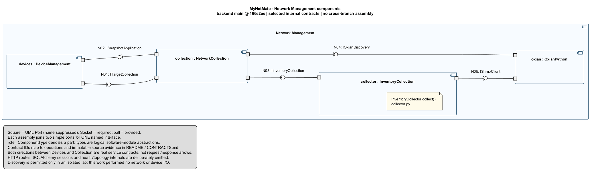

# MyNetMate — UML Component Diagrams จากโค้ดจริง (Revision 2)

ตรวจทาน: 22 ตุลาคม 2569 (2026-10-22)

ชุดนี้แทนภาพฉบับก่อนที่เปลี่ยน Dependency เป็น Ball-and-Socket กว้างเกินไป โดยกำหนดขอบเขต Component, สัญญาบริการ และผู้ให้–ผู้ใช้จาก source ก่อนวาด ทุก Assembly Connector มี Simple Port ฝั่ง Required และ Provided ที่จับคู่ Interface เดียวกัน ไม่มีหัวลูกศร

## 1. เปิดภาพฉบับแก้ไข

| ภาพ | มุมมองและ revision | เปิด / แก้ไข |
|---|---|---|
| 01 Network Management | backend main @ 166e2ee; Device Management, Collection, Collector และ Oxian Python | [SVG](01-components-across-branches.svg) · [PNG](01-components-across-branches.png) · [PlantUML](01-components-across-branches.puml) |
| 02 Authentication / Audit | backend feature/11-audit-writer @ b862c60; Auth, CLI, Adapter, Writer, Reader และ Session Factory | [SVG](02-auth-audit-binding.svg) · [PNG](02-auth-audit-binding.png) · [PlantUML](02-auth-audit-binding.puml) |
| 03 CIS Validation | backend feature/08-cis-security-validation @ 0f65dd8; branch-local contracts เท่านั้น | [SVG](03-cis-branch-boundaries.svg) · [PNG](03-cis-branch-boundaries.png) · [PlantUML](03-cis-branch-boundaries.puml) |
| 04 Configuration Management | backend main @ 166e2ee; Version, Drift, Planning, Render, Remediation และ SSH adapter | [SVG](04-configuration-main.svg) · [PNG](04-configuration-main.png) · [PlantUML](04-configuration-main.puml) |
| 05 Web Contract Pairs | แยกคู่ frontend/backend ของ Network, Configuration และ Identity/Audit เป็นสามกรอบอิสระ | [SVG](05-web-contract-pairs.svg) · [PNG](05-web-contract-pairs.png) · [PlantUML](05-web-contract-pairs.puml) |

ชื่อไฟล์ 01-components-across-branches คงไว้เพื่อไม่ให้ลิงก์เดิมเสีย แต่เนื้อหา Revision 2 เป็น Network backend main เท่านั้น ไม่ใช่ภาพประกอบรวมทุก branch

อ่านรายละเอียดทุกเส้นใน [CONTRACTS.md](CONTRACTS.md) และผลตรวจใน [REVIEW.md](REVIEW.md)

คำอธิบายภาษาไทยแบบกระชับก่อน–ละเอียดภายหลัง ครบ 5 ภาพหลักและ 10 ภาพย่อย A4 พร้อมระดับ Component ความหมายทุกเส้นในโค้ด เหตุผลแบ่งภาพ และผลตรวจความครบถ้วน: [EXPLANATION-TH.md](EXPLANATION-TH.md)

## 2. วิธีอ่านสัญลักษณ์

- กล่องที่มีสัญลักษณ์ Component คือหน่วยซอฟต์แวร์ตามขอบเขตในตาราง implementation
- ข้อความ `role : ComponentType` ระบุ Part/บทบาทและชนิด Component ที่ใช้ใน internal structure ไม่ได้หมายความว่าต้องมี Python Class ชื่อนั้น
- สี่เหลี่ยมเล็กที่ขอบคือ UML Port ไม่ใช่ TCP/UDP port; ซ่อนชื่อ Port บนภาพเพื่อลดการทับกัน
- ครึ่งวงกลม (Socket) คือ Interface ที่ผู้ใช้บริการต้องการ
- วงกลม (Ball/Lollipop) คือ Interface ที่ผู้ให้บริการเสนอ
- วงกลม–ครึ่งวงกลมประกบกันคือ Assembly Connector จับคู่สัญญาที่เข้ากัน ไม่ใช่ลูกศร ข้อมูลไหล ลำดับเวลา หรือ Request/Response
- แต่ละเส้นมี ID เช่น N01 หรือ A03 เพื่อย้อนกลับไปดู operations, caller, provider และ revision ของโค้ด
- กล่องคำอธิบาย/legend เป็นเพียงคำอธิบายประกอบ ไม่ใช่ Component เพิ่มเติมในระบบ

Ball-and-Socket ที่ใช้ในชุดนี้เชื่อม Simple Ports ซึ่งแต่ละ Port ให้หรือใช้เพียงหนึ่ง Interface ตาม [UML Component Diagrams Reference](https://www.uml-diagrams.org/component-diagrams-reference.html) และ [UML Port](https://www.uml-diagrams.org/port.html)

`portin` / `portout` เป็นคำสั่งจัดวางของ PlantUML ไม่ใช่คำจำกัดความ Required/Provided ของ UML เช่น N02 จัด Socket ไว้ซ้ายของ Collection และ Ball ไว้ขวาของ Devices เพื่อหลีกเลี่ยงเส้นย้อนทับกล่อง ความหมายผู้ให้–ผู้ใช้ยังเหมือนเดิม

## 3. ทำไมเลือก Component เหล่านี้

Component เป็น logical software module ที่ encapsulate หน้าที่และมี public operations ที่ระบุได้ สามารถแทน implementation ภายใต้สัญญาเดิมในแบบจำลองได้ ไม่จำเป็นต้องเป็น microservice หรือ process แยก และไม่ใช่การเรียกทุก Class/File ว่าเป็น Component โดยอัตโนมัติ

ตัวอย่าง:

- DeviceManagement แทนขอบเขต DeviceService ซึ่งรับ apply_snapshot และใช้ CollectionService ใน manual enrollment
- AuthAuditAdapterModule แทน module ที่มี AuthAuditAdapter เป็น implementing classifier และต้องใช้ AuditWriter Protocol
- TemplateRenderModule แทน render.py ซึ่งห่อ Jinja2 อยู่จริง ไม่ใช่กล่องรวมชื่อไลบรารีหลายชนิด
- NetmikoAdapter แทน netmiko_ops.py ไม่ใช่ interactive terminal ที่ใช้ Paramiko ซึ่งอยู่คนละขอบเขต

ตาราง Component-to-code และ public operations ครบทุกภาพอยู่ใน [CONTRACTS.md](CONTRACTS.md) ชื่อ Interface ที่ขึ้นต้น I เป็นชื่อในแบบจำลองที่สกัดจาก operations จริง ไม่ได้อ้างว่ามี Class/Protocol ชื่อตรงกัน ยกเว้น AuditWriter ซึ่งมี Python Protocol จริง

## 4. จุดที่แก้จากฉบับก่อน

### Session และ transaction

- Audit Writer รับ AsyncSession ในพารามิเตอร์ db จากผู้เรียก ไม่ได้เรียก Session Factory จึงเอาเส้น Writer–Session Provider เดิมออก
- AuthService, CLI Provisioning และ AuditReadService มีการรับ/เรียก factory จริง จึงแสดง IAsyncSessionFactory ให้สามผู้ใช้บริการนี้
- ฝั่ง CIS เป็น HTTP dependency boundary ที่ประกาศ Depends(get_db) แล้วส่ง db เข้า Service จึงไม่วาดว่า CIS Service เรียก get_db เอง
- Writer ตรวจ registry, ลดข้อมูล, add และ flush เท่านั้น เจ้าของ transaction เป็นผู้เรียก ไม่ได้ย้าย commit/rollback ไปให้ Writer

### ขอบเขตไลบรารี

เอากล่อง Configuration Tool Libraries ที่รวม Jinja2, hier_config, Netmiko และ Paramiko ออก เปลี่ยนเป็นโมดูล wrapper ที่มีโค้ดจริง ได้แก่ Render, Remediation และ Netmiko adapter ส่วน interactive SSH แสดงเป็น WebSocket contract แยกในภาพ 05 ไม่โยงเข้ากับ Netmiko adapter

### Branch และความครบถ้วน

ไม่มีกรอบ MyNetMate ใหญ่ที่ประกบ Auth/Audit, CIS และ main ราวกับ merge เรียบร้อยแล้ว ภาพ 01–04 ระบุ revision ของ backend แต่ละชุด ส่วนภาพ 05 เป็นสามคู่ client/server ที่แยกกันและไม่มีเส้นข้ามกรอบ

ตัวเลข branch inventory เดิมคงอยู่ใน [BRANCH-EVIDENCE.md](BRANCH-EVIDENCE.md) และ [branch-audit.json](branch-audit.json) ใช้เป็นประวัติการสำรวจทุก local/cached ref และ active remote branch ของรอบ audit เดิม ไม่ใช่คำยืนยันว่า remote HEAD ไม่เปลี่ยนหลังจากนั้น Revision 2 ตรวจโค้ดซ้ำที่ immutable SHA เดิม ไม่ได้ fetch หรือเปลี่ยน checkout

## 5. สิ่งที่ยังไม่อ้างว่าเชื่อมเสร็จแล้ว

- CIS branch ใช้ header identity แบบ development bridge ไม่ใช่ Session-backed Auth
- CIS audit bridge เขียน application log ไม่ใช่ shared AuditLog table และไม่ใช่สัญญาเดียวกับ AuditWriter Protocol ทุกประการ
- ยังไม่พบ main deployment เรียก CIS gate ใน revisions ที่ระบุ จึงไม่มี Assembly ระหว่างสองส่วนนี้
- ไม่พบ CIS UI หรือ Dashboard aggregation service ที่นำมาอ้างเป็น Component ทำงานแล้วได้
- ชุด Network, Auth/Audit และ Configuration frontend เป็นคนละ revision ไม่ได้อ้างว่ารวมกันแล้ว
- การตรงกันของ URL, generated-client call symbols และ operations เป็น static evidence ยังไม่ยืนยัน build artifact, E2E interoperability, database readiness หรือผลกับอุปกรณ์จริง
- ส่วน helper, HTTP, database และ third-party details ที่ละออกจากภาพเฉพาะเรื่อง เป็นการจำกัดระดับรายละเอียด ไม่ได้แปลว่าไม่มีในโปรแกรม

## 6. ผลตรวจและไฟล์ประกอบ

- 5 diagrams, 34 named interface bindings, 68 endpoint Ports
- ตรวจ source evidence 72 จุดจาก immutable Git objects ผ่านครบ
- ทุก connector มี Part อยู่ใน assembly เดียวกัน มี Required/Provided Simple Port และชื่อ Interface จับคู่ครบ
- PlantUML checkonly และ local SVG/PNG rendering ผ่านทั้ง 5 ภาพ; ตรวจภาพจริงเพื่อแก้เส้นทับชื่อและตรวจฝั่ง Socket/Ball
- [ผลตรวจทานและข้อจำกัด](REVIEW.md)
- [หลักฐานรายสัญญา](CONTRACTS.md)
- [แบบจำลองที่ตรวจซ้ำได้](component-model.json)
- [ผลตรวจอัตโนมัติ](verification-report.json)
- [สคริปต์ตรวจ source/ports/render](verify_component_model.ps1)

การตรวจนี้ไม่ใช่ UML metamodel validator หรือ test suite ของแอป แต่เป็นการตรวจความสอดคล้องของ source, notation และภาพประกอบกัน ไม่ได้เปิด server, scan เครือข่าย หรือส่งคำสั่งไปยังอุปกรณ์ ไม่ได้แก้ source code, เปลี่ยน branch, commit หรือ push

Render ด้วย PlantUML native 1.2026.9 แบบ local ทั้งหมด ไม่ส่งผังระบบไปยัง public renderer และไม่แก้ไฟล์ใน mynetmate/network-discovery/

## 7. แหล่งอ้างอิงสัญลักษณ์

1. [UML Component Diagrams Reference](https://www.uml-diagrams.org/component-diagrams-reference.html) — Component, provided/required interface, assembly และ delegation
2. [UML Port](https://www.uml-diagrams.org/port.html) — Port, Simple Port และการแสดง Interface
3. [OMG UML 2.5.1](https://www.omg.org/spec/UML/2.5.1) — มาตรฐาน UML
4. [PlantUML Component Diagram](https://plantuml.com/component-diagram) — ไวยากรณ์เครื่องมือ ไม่ใช้การ render ผ่านเป็นหลักฐานว่าแบบจำลองถูกความหมาย
