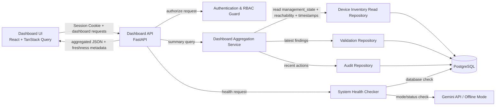

## 6. Component Architecture

> **Device Contract revision 2026-10-22:** อ่าน [API Contracts](04_API%20Contracts.md) ประกอบชื่อ Field และกฎนับ ภาพนี้เป็นสถาปัตยกรรม D&M ที่จะพัฒนา ไม่ใช่หลักฐานว่า Endpoint มีครบแล้ว

> **Auth Update (2026-08-27):** เปลี่ยนจาก Stateful JWT เป็น Opaque Server-side Session เพราะ Backend ต้องตรวจ Database ทุก Request อยู่แล้ว จึงลดความซับซ้อนโดยยัง Revoke ได้ทันที

### Component Responsibilities

| Component                         | หน้าที่                                                                             |
| --------------------------------- | ----------------------------------------------------------------------------------- |
| **Dashboard UI**                  | แสดง Widget, โหลด Summary ใหม่, Empty/Error/Stale state และ RBAC-aware actions; แยก Management State จาก Reachability และไม่สั่งตรวจอุปกรณ์ |
| **Dashboard API**                 | รับ Request และคืน Response ที่เหมาะกับหน้า Dashboard                               |
| **Dashboard Aggregation Service** | สรุปข้อมูลตาม API แต่ละชุด; Device Total ไม่รวม Retired, Reachability นับเฉพาะ Active, ข้อมูล Recent Activity แยก Endpoint และปฏิบัติตาม Audit Contract |
| **Authentication & RBAC Guard**   | ตรวจ Opaque Server-side Session จาก `auth_sessions`/`users` และสิทธิ์ของผู้ใช้      |
| **Repositories**                  | แยก Query ตาม Domain และป้องกัน Query logic กระจายใน Route                          |
| **System Health Checker**         | ตรวจ Dependency แบบ Asynchronous และจำกัด Timeout                                   |
| **PostgreSQL**                    | Source of Truth ของ Current state, Validation และ Audit                             |

Device Read Repository อ่าน `reachability_checked_at` เพื่ออายุผลตรวจ และ `last_seen_at` เพื่อเวลาติดต่อสำเร็จล่าสุด; `last_collected_at` ของ Inventory ไม่ใช่เวลาตรวจ Reachability และไม่ใช้แทนกัน D&M ไม่มีเส้นทางเรียก Health probe/Collector ของ Inventory เมื่ออ่าน Summary

สถาปัตยกรรม P1 ไม่ต้องมี Message Queue หรือ Streaming pipeline
