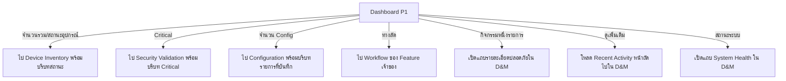

# UI Design — Dashboard & Monitoring P1

> **สถานะ:** แบบออกแบบหน้าจอและการโต้ตอบเพื่อคุยกับทีม; ไม่ใช่หน้าจอที่พัฒนาเสร็จแล้ว  
> **ขอบเขต:** ออกแบบเฉพาะหน้า Dashboard และแถบรายละเอียดที่ D&M เป็นเจ้าของ; หน้าของ Feature อื่นระบุเพียงปลายทางและข้อมูลที่ต้องการเห็น  
> **วันที่จัดทำ:** 2026-09-24

เอกสารนี้รวมโครงหน้า เนื้อหาที่แสดง Flow เมื่อกด สถานะข้อมูล และข้อที่รอทีมยืนยัน อ่านร่วมกับ [แหล่งอ้างอิงและเหตุผลการปรับ UI](06_แหล่งอ้างอิงและเหตุผลการปรับ%20Dashboard%20UI.md), [ขอบเขต Dashboard P1](MyNetMate%20Dashboard.md) และ [Glossary](../00_Glossary.md) หากคำหรือจำนวนในเอกสารเก่าขัดกับ Contract ที่ทีมยืนยันภายหลัง ให้ปรับเอกสารนี้พร้อม API Contract และ Acceptance Test

## 1. เป้าหมายและขอบเขตของหน้า

เมื่อเปิด Dashboard ผู้ใช้ควรตอบได้ภายในหน้าเดียวว่า:

1. มีอะไรที่ควรตรวจสอบก่อน: อุปกรณ์ที่ผลล่าสุดติดต่อไม่ได้ หรือผลตรวจ Security ระดับ Critical
2. ระบบมีอุปกรณ์และ Config กี่รายการตามนิยามที่เจ้าของข้อมูลยืนยัน
3. ข้อมูลแต่ละส่วนตรวจหรืออัปเดตเมื่อใด และยังเชื่อถือได้หรือไม่
4. กิจกรรมล่าสุดที่ตนมีสิทธิ์เห็นคืออะไร
5. Backend, Database และ Offline Mode อยู่ในสภาพใด
6. จะไปทำงานต่อที่หน้าใด

**Dashboard P1 เป็นหน้าสรุปหนึ่งหน้า** มีแถบรายละเอียดสั้น ๆ ของ Recent Activity และ System Health ภายในหน้าเดียว ส่วนรายการ Device, ผล Security, Config และ Full Audit เป็นหน้าของ Feature เจ้าของข้อมูล D&M ไม่ออกแบบตาราง ฟอร์ม หรือ Drawer ภายในหน้าเหล่านั้น

## 2. โครงหน้าและลำดับสายตา

```text
┌─────────────────────────────────────────────────────────────────────┐
│ เมนูหลัก │ Dashboard / ภาพรวม           ข้อมูลล่าสุด ณ [เวลา]       │
│          ├──────────────────────────────────────────────────────────┤
│          │ สิ่งที่ต้องตรวจสอบ                                     │
│          │ [อุปกรณ์ที่ผลล่าสุดติดต่อไม่ได้] [ผลตรวจ Critical]        │
│          ├──────────────────────────────┬───────────────────────────┤
│          │ ภาพรวมอุปกรณ์                │ จำนวน Config             │
│          │ รวม / ติดต่อได้ / ติดต่อไม่ได้ │ ที่บันทึกตามนิยามทีม      │
│          │ ยังไม่ทราบ / กำลังซ่อม        │                           │
│          ├──────────────────────────────┼───────────────────────────┤
│          │ กิจกรรมล่าสุด                │ สถานะระบบ                │
│          │ เหตุการณ์ที่อนุญาต            │ Backend / Database / Mode │
│          ├──────────────────────────────┴───────────────────────────┤
│          │ ทางลัดตามสิทธิ์: อุปกรณ์ / สร้าง Config / ตรวจ Security  │
└─────────────────────────────────────────────────────────────────────┘
```

- บนจอแคบให้เรียงเป็นแนวตั้งตามลำดับเดียวกัน: สิ่งที่ต้องตรวจ → อุปกรณ์ → Config → กิจกรรม → สถานะระบบ → ทางลัด
- สีช่วยแยกสถานะ แต่ต้องมีข้อความและจำนวนเสมอ ไม่ใช้สีเป็นหลักฐานเพียงอย่างเดียว
- ไม่ใช้แผนผังเครือข่าย กราฟย้อนหลัง หรือ Live Telemetry เป็นส่วนตกแต่งเพื่อเติมพื้นที่ใน P1

## 3. รายละเอียดสิ่งที่ D&M แสดง

| ID | ส่วน UI | ข้อมูลที่แสดง | จุดกด/ผลลัพธ์ | หมายเหตุ |
| --- | --- | --- | --- | --- |
| UI-01 | หัวหน้าและเวลา | ชื่อ “ภาพรวมระบบ”; เวลาอ่านหรือเก็บข้อมูลล่าสุดที่นิยามได้; ป้าย “ข้อมูลเก่า” เมื่อเกินเกณฑ์ | ไม่มีคำสั่งเก็บข้อมูลอุปกรณ์แฝงอยู่ในการเปิดหน้า | เวลาและเกณฑ์ Freshness ต้องมาจาก Contract ของข้อมูลแต่ละส่วน; ไม่อ้างว่า Real-time |
| UI-02 | สิ่งที่ต้องตรวจสอบ | จำนวนอุปกรณ์ที่ผลล่าสุดติดต่อไม่ได้ และจำนวนผลตรวจ Critical ที่เข้าเกณฑ์ | กดข้อความ/ปุ่ม “ดูอุปกรณ์” หรือ “ดูผลตรวจ” เพื่อไปยังเจ้าของข้อมูล | เป็นสรุปจากข้อมูล P1 ไม่ใช่ Alert Engine และไม่สร้าง Finding ใหม่ |
| UI-03 | ภาพรวมอุปกรณ์ | จำนวนอุปกรณ์ทั้งหมด; จำนวนตาม Reachability ที่ทีมยืนยัน; จำนวนที่อยู่ระหว่าง Maintenance แยกให้เห็น | กดจำนวนรวม/สถานะเพื่อขอเปิดรายการ Device Inventory ที่สัมพันธ์กับตัวเลขนั้น | Maintenance เป็นเงื่อนไขการดูแล ไม่ควรบังคับให้รวมอยู่ในแกน Reachability โดยยังไม่ตกลงกฎการนับ |
| UI-04 | จำนวน Config | จำนวน Config ที่นิยามว่า “บันทึกไว้” พร้อมคำกำกับที่ชัด | กด “ดูรายการ” ไปหน้า Configuration; ทางลัด “สร้าง Config” ไป Workflow สร้าง | นิยามว่ารายการใดถูกนับยังรอทีม Configuration; ห้ามนำจำนวน Version/Preview มานับเอง |
| UI-05 | กิจกรรมล่าสุด | เหตุการณ์ที่อนุญาตสูงสุด 10 รายการแรก: ผู้กระทำแบบปลอดภัย, คำอธิบายสั้น, เป้าหมายที่ปลอดภัย, เวลา | กดแถวเปิดแถบรายละเอียดสั้นใน D&M; “ดูเพิ่มเติม” โหลดรายการหน้าถัดไปด้วย Cursor | ทุก Role เห็นเฉพาะ Positive Allowlist ตาม Auth/Audit Contract |
| UI-06 | สถานะระบบ | Backend, Database, Offline Mode แยกบรรทัด; เวลาที่ตรวจ; สถานะอ่านไม่ได้หากตรวจล้มเหลว | กด “รายละเอียด” เปิดแถบ System Health ใน D&M; ปุ่ม “ลองใหม่” ตรวจ Health อีกครั้ง | Offline Mode ที่เปิดโดยตั้งใจเป็นข้อมูล ไม่ใช่ Critical Error; แหล่งค่าจริงรอยืนยัน |
| UI-07 | ทางลัด | ไป Device Inventory, Config Builder และ Security Validation | เปิดหน้าเจ้าของ Workflow ตามสิทธิ์ผู้ใช้ | ถ้าหน้าปลายทางยังไม่มี ให้ซ่อน/ปิดและระบุว่า “ยังไม่พร้อมใช้งาน” |

### 3.1 การนับสถานะอุปกรณ์บน UI

- จำนวนรวม = อุปกรณ์ที่อยู่ในขอบเขตการแสดงของ Device Inventory ตาม Contract ที่ยืนยัน; ไม่เดาว่าจะรวมอุปกรณ์ Retired หรือไม่
- Reachability เช่น ติดต่อได้/ติดต่อไม่ได้/ยังไม่ทราบ เป็นผลตรวจล่าสุดตามนิยามของ Device Inventory; D&M ไม่ Ping หรืออ่าน SNMP เอง
- Maintenance เป็นสถานะที่ผู้ดูแลกำหนดแยกต่างหาก จึงอาจซ้อนกับ Reachability ได้ ถ้าทีมยืนยันว่าเป็นคนละแกน **อย่าทำกราฟที่บังคับให้ผลรวมทุกป้ายเท่ากับจำนวนอุปกรณ์ทั้งหมด** จนกว่าจะตกลงกฎจัดกลุ่ม
- “ยังไม่ทราบ” ไม่เท่ากับ “ติดต่อไม่ได้” และการดึงข้อมูลสถานะไม่ได้ไม่ควรถูกแปลงเป็น `0`
- จำนวนบน UI-02 ต้องอ้างเกณฑ์เดียวกับ UI-03 เพื่อไม่ให้ Banner กับการ์ดแสดงเลขไม่ตรงกัน

### 3.2 Recent Activity ที่อนุญาต

Dashboard อ่านแบบ Read-only และแสดงเฉพาะ `user.login_success`, `user.logout`, `user.password_changed`, `user.created`, `user.updated` สำหรับทุก Role หากไม่พบผู้กระทำให้แสดง `Unknown` แถบรายละเอียดและการโหลดหน้าถัดไปยังคงกฎเดียวกัน: **ไม่ส่ง IP Address, User-Agent, Error Detail, Secret, Full Audit Description หรือเหตุการณ์ Security-sensitive** ไปยัง D&M UI

## 4. Flow เมื่อผู้ใช้กด



| Flow | ผู้ใช้กด | D&M ต้องทำ | สิ่งที่ขอจาก Feature ปลายทาง |
| --- | --- | --- | --- |
| F-01 | จำนวนอุปกรณ์ทั้งหมด | ไปหน้ารายการอุปกรณ์ | หน้าที่แสดงรายการทั้งหมดและกลับ Dashboard ได้ |
| F-02 | จำนวนตาม Reachability หรือ Maintenance | ส่งบริบทตัวกรองที่กดไปด้วย | วิธีรับตัวกรองจากลิงก์และแสดงรายการตรงกับจำนวนบน Dashboard; หากยังไม่มี ให้พาไปรายการทั่วไปพร้อมบอกว่าตัวกรองยังไม่พร้อม ไม่แอบอ้างว่า Filter สำเร็จ |
| F-03 | จำนวน Critical | ส่งบริบทระดับ Critical | หน้ารายการผลตรวจที่แสดงรายการตามนิยามจำนวนของ Security; Route/Filter รอยืนยัน |
| F-04 | จำนวน Config | ส่งบริบท “รายการที่ถูกนับ” | หน้ารายการ Config ตามนิยามของทีม Configuration; Route รอยืนยัน |
| F-05 | กิจกรรมหนึ่งรายการ | เปิดแถบรายละเอียดภายใน Dashboard พร้อมข้อมูลที่ผ่าน Redaction แล้ว | ไม่ต้องขอหน้าใหม่จาก Audit; ใช้ข้อมูลที่ Audit อนุญาตให้ D&M อ่าน |
| F-06 | “ดูเพิ่มเติม” ในกิจกรรม | โหลดหน้าถัดไปด้วย Cursor ในบริเวณ Recent Activity ของ D&M | ไม่ดึง Full Audit หรือเหตุการณ์ที่ไม่อยู่ใน Allowlist |
| F-07 | “รายละเอียด” สถานะระบบ | เปิดแถบด้านข้างสรุปสถานะแต่ละระบบ เวลาและข้อความอธิบาย | Health/Settings ต้องมีข้อมูลสถานะที่อ่านได้จริง; ไม่สร้างหน้าตั้งค่าใน D&M |
| F-08 | ทางลัด | ไปหน้าเจ้าของงานตามสิทธิ์ | Route และสิทธิ์ของ Action นั้น; D&M ไม่ออกแบบฟอร์มปลายทาง |

**พื้นที่ที่กด:** ให้ตัวเลขหรือปุ่มที่มีข้อความสื่อปลายทางกดได้ พร้อม Hover/Focus ชัดเจน ไม่จำเป็นต้องทำทั้งการ์ดเป็นปุ่ม เพราะบางการ์ดมีมากกว่าหนึ่ง Action การกดตัวเลขไม่สั่ง Collection หรือเปลี่ยนสถานะอุปกรณ์โดยอัตโนมัติ

### 4.1 แถบรายละเอียดที่ D&M ออกแบบเอง

**Recent Activity Detail:** หัวข้อเหตุการณ์, ผู้กระทำหรือ `Unknown`, เป้าหมายแบบ Safe Label และเวลา มีปุ่มปิด ไม่แสดงข้อมูลมากกว่าที่อยู่ใน Recent Activity Contract

**System Health Detail:** แสดง Backend, Database, Offline Mode แยกบรรทัด แต่ละบรรทัดมีสถานะและเวลาที่ตรวจ พร้อมคำอธิบายสั้น ๆ เมื่อผิดปกติและปุ่ม “ลองใหม่” เมื่ออ่านข้อมูลไม่สำเร็จ ไม่มีปุ่มเปลี่ยน Offline Mode ในแถบนี้

## 5. สถานะหน้าและข้อความที่ต้องออกแบบ

| ส่วน | กำลังโหลด | ยังไม่มีข้อมูล | มีข้อมูลและผลเป็นศูนย์ | ดึงข้อมูลไม่ได้ | ข้อมูลเก่า |
| --- | --- | --- | --- | --- | --- |
| อุปกรณ์ | โครงร่างการ์ด/ข้อความ “กำลังโหลด” | “ยังไม่มีอุปกรณ์” หรือ “ยังไม่เคยตรวจ” ตามกรณี | แสดง `0` เฉพาะจำนวนที่อ่านได้จริง | `--` + “อ่านสถานะอุปกรณ์ไม่ได้” + ลองใหม่ | แสดงป้าย “ข้อมูลเก่า” พร้อมเวลาตรวจ; ไม่เรียกว่าปัจจุบัน |
| Critical | กำลังโหลดผลตรวจ | “ยังไม่มีผลตรวจ Security” | “ไม่พบ Critical ในผลตรวจล่าสุด” | `--` + “อ่านผลตรวจไม่ได้” + ลองใหม่ | แสดงเวลา/คำเตือนว่าเป็นผลตรวจเก่า หาก Owner มีข้อมูลรองรับ |
| Config | กำลังโหลดจำนวน | “ยังไม่มี Config ที่บันทึก” เมื่อ Contract ยืนยันแล้ว | แสดง `0` เฉพาะการอ่านสำเร็จ | `--` + “อ่านจำนวน Config ไม่ได้” + ลองใหม่ | แสดงเวลาหรือคำเตือนตามข้อมูลที่ Owner มีจริง |
| Recent Activity | กำลังโหลดรายการ | “ยังไม่มีกิจกรรมที่แสดงได้” | ใช้ข้อความเดียวกับไม่มีรายการที่อนุญาต ไม่เติม Event ที่ถูกห้าม | “อ่านกิจกรรมไม่ได้” + ลองใหม่ | แสดงเวลาเหตุการณ์; ไม่อ้างว่า Live |
| System Health | กำลังตรวจสอบ | “ยังไม่มีข้อมูลสถานะ” | ไม่ใช้เลขศูนย์แทนสถานะ | “ตรวจสอบสถานะไม่ได้” + ลองใหม่ | แสดงเวลาตรวจล่าสุดและคำเตือน |

**กรณีบางส่วนล้มเหลว:** แสดงส่วนที่อ่านได้ตามปกติ และ Error เฉพาะส่วนที่ล้มเหลว ห้ามแทน Error ด้วยเลข `0` หรือสีเขียวทั้งหน้า

**กรณีปลายทางยังไม่พร้อม:** แสดงข้อมูลสรุปที่เชื่อถือได้ต่อไป แต่ปิดลิงก์ปลายทางและบอก “ยังไม่พร้อมใช้งาน” ไม่พาไปหน้า 404

## 6. สิทธิ์ การเข้าถึง และข้อความ

- Viewer อ่าน Dashboard ได้ แต่ทางลัดที่ทำให้เกิดการเปลี่ยนข้อมูลต้องเป็นไปตามสิทธิ์ของ Auth; Operator/Admin ก็ต้องยึดสิทธิ์ของ Action จริง ไม่อนุมานจากชื่อ Role อย่างเดียว
- คีย์บอร์ดต้องเข้าถึงทุกจุดกด มีชื่อปุ่มชัด และ Focus ที่มองเห็นได้ แถบด้านข้างมีปุ่มปิดและกลับไปยังจุดกดเดิมได้
- สีแดงใช้กับข้อมูลที่ตรวจพบปัญหาจริง สีเทา/กลางใช้กับ Unknown, No Data และ Offline Mode ที่ตั้งใจเปิด; ทุกสถานะมีข้อความกำกับ
- ข้อความเวลาควรระบุ “ตรวจล่าสุด” หรือ “ผลตรวจล่าสุด” ตามข้อมูลต้นทาง หลีกเลี่ยงคำว่า “Real-time” ใน P1
- ปุ่ม “ลองใหม่” ของ Dashboard หมายถึงโหลดข้อมูลสรุป/Health ใหม่เท่านั้น ไม่เท่ากับสั่งตรวจอุปกรณ์หรือสแกน Security ใหม่

## 7. ขอบเขตที่ต้องส่งต่อให้ทีมและจุดที่ยังรอ

| หัวข้อ | สิ่งที่ D&M ต้องรู้เพื่อแสดง/กดได้ | สิ่งที่ D&M ไม่ออกแบบแทน |
| --- | --- | --- |
| Device Inventory | นิยามตัวเลขและเวลา, วิธีเปิดรายการตามสถานะ, การนับ Maintenance | ตารางอุปกรณ์, Device Detail, วิธีตรวจอุปกรณ์ |
| Configuration | นิยาม “Config ที่บันทึก”, ทางเข้ารายการและ Builder | ฟอร์ม 6 แท็บ, Preview, Versioning |
| Security & Validation | นิยามจำนวน Critical, กรณีไม่เคยตรวจ, ทางเข้าผลตรวจที่เกี่ยวข้อง | กฎ CIS, หลักฐานและการ Override |
| Audit/Authentication | Positive Allowlist, Safe DTO, สิทธิ์, Cursor | Full Audit Trail และเหตุการณ์ Security-sensitive |
| Settings/System | แหล่งค่า Offline Mode, สถานะ Backend/Database, เวลาที่ตรวจ | หน้าตั้งค่าและการเปลี่ยน Offline Mode |

Route ที่ยืนยันใน Frontend ปัจจุบันมี `/` สำหรับ Dashboard placeholder และ `/devices` สำหรับ Device Inventory; Route และตัวกรองลิงก์ของ Feature อื่นเป็น **Pending** ห้ามเขียนเป็น URL จริงในเอกสาร/API โดยเดาเอง

## 8. สิ่งที่ถือว่าออกแบบครบและสิ่งที่ไม่อยู่ใน P1

เอกสาร UI ถือว่าพร้อมส่งต่อเมื่อทีมยืนยันนิยามตัวเลขและเวลา, ข้อความ Empty/Error/Stale, สิทธิ์และ Route ปลายทาง แล้วปรับ [API Contracts](04_API%20Contracts.md) และ [Acceptance Tests](05_Acceptance%20Tests%20และ%20Success%20Metrics.md) ให้ตรงกัน การออกแบบนี้ **ยังไม่ใช่ Implementation หรือผลทดสอบ**

P1 ไม่มีหน้า Monitoring เชิงลึกของ D&M เช่น Operational Snapshot, Interface/VLAN/WAN/Route Detail, Topology Preview, Historical Graph, Alert Center หรือการสั่ง Refresh อุปกรณ์จากการกดการ์ด Dashboard ความสามารถเหล่านั้นอยู่ใน [P2 Operational Monitoring](../P2_Operational_Monitoring/MVP%20D%26M.md) หรือเป็นหน้าของ Feature เจ้าของเองตาม Scope ที่ทีมยืนยัน
