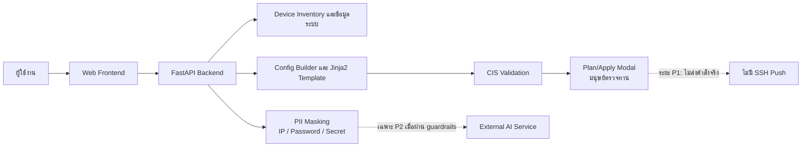

# ร่างโครงงาน 1

## ชื่อโครงงาน

**ชื่อภาษาไทย:** แอปพลิเคชันสำหรับการบริหารจัดการเครือข่ายและการทำให้การกำหนดค่าเครือข่ายเป็นอัตโนมัติ (MyNetMate)  
**ชื่อภาษาอังกฤษ:** Application for Network Management and Configuration Automation (MyNetMate)

**คำสำคัญ:** การจัดการเครือข่าย, การกำหนดค่าเครือข่าย, Network Automation, CIS Validation, Jinja2

## 1. ที่มาและความสำคัญ

การบริหารจัดการอุปกรณ์เครือข่ายและการปรับเปลี่ยนค่ากำหนดค่า (configuration) เป็นงานที่ต้องอาศัยความถูกต้อง ความสม่ำเสมอ และความรอบคอบสูง การดำเนินการด้วยมือทีละอุปกรณ์อาจใช้เวลาเป็นจำนวนมากและเพิ่มโอกาสเกิดความคลาดเคลื่อนจากมนุษย์ โดยเฉพาะเมื่อองค์กรต้องดูแลข้อมูลอุปกรณ์ ชุดคำสั่งกำหนดค่า และหลักฐานการเปลี่ยนแปลงหลายรายการพร้อมกัน

MyNetMate จึงมีเป้าหมายเพื่อพัฒนาเว็บแอปพลิเคชันที่ช่วยจัดระเบียบการจัดการอุปกรณ์เครือข่าย สร้างชุดคำสั่งกำหนดค่าจากแม่แบบที่ตรวจสอบได้ และเพิ่มจุดควบคุมด้านความปลอดภัยก่อนนำชุดคำสั่งเข้าสู่ขั้นตอนวางแผนการใช้งาน แนวคิดหลักของโครงการคือ **“ใช้ AI เมื่อต้องการความเข้าใจ ไม่ใช้ AI เมื่อต้องการความถูกต้อง”** กล่าวคือ งานที่มีผลลัพธ์ถูกต้องได้ชัดเจนจะใช้กฎและแม่แบบ Jinja2 แบบกำหนดผลลัพธ์ได้ (deterministic) เป็นหลัก ส่วน AI เป็นความสามารถเสริมสำหรับงานที่ต้องตีความหรืออธิบายเท่านั้น

แนวทางดังกล่าวช่วยลดการพึ่งพาบริการ AI ในกระบวนการสำคัญ ลดความเสี่ยงจากคำสั่งที่ไม่สอดคล้องกับอุปกรณ์ และกำหนดให้มนุษย์เป็นผู้ตรวจสอบและยืนยันก่อนเสมอ โดยชุดคำสั่งกำหนดค่าทุกชุดต้องผ่านการตรวจสอบ CIS Validation ก่อนเข้าสู่ขั้นตอน Deploy Plan

## 2. วัตถุประสงค์

1. เพื่อพัฒนาเว็บแอปพลิเคชันสำหรับจัดการข้อมูลอุปกรณ์เครือข่ายและสนับสนุนการสร้างชุดคำสั่งกำหนดค่าเครือข่าย
2. เพื่อสร้างชุดคำสั่งสำหรับ Cisco IOS จากข้อมูลแบบฟอร์มและแม่แบบ Jinja2 ที่ตรวจสอบย้อนกลับได้
3. เพื่อออกแบบกระบวนการตรวจสอบความมั่นคงปลอดภัยของชุดคำสั่งตามกฎ CIS แบบกำหนดผลลัพธ์ได้ ก่อนเข้าสู่ขั้นตอนวางแผนการใช้งาน
4. เพื่อออกแบบจุดควบคุมความปลอดภัย ได้แก่ การยืนยันตัวตน การกำหนดสิทธิ์ การบันทึกเหตุการณ์ และการปกปิด IP Address รหัสผ่าน และข้อมูลลับก่อนส่งให้บริการ AI ภายนอก
5. เพื่อประเมินการทำงานขององค์ประกอบที่พัฒนาแล้วด้วยการทดสอบซอฟต์แวร์ และทดสอบการค้นหาเครือข่ายหรืออุปกรณ์จริงเฉพาะใน Isolated Lab ตามขอบเขตที่อนุญาต

## 3. ขอบเขตของโครงงาน

### 3.1 ขอบเขตฟังก์ชันระยะ P1

ระบบระยะ P1 กำหนดกระบวนการสาธิตหลักดังนี้

```text
Login → Add Device → 6-Tab Config Builder → Jinja2 Preview → CIS Scan → Plan/Apply Modal
```

| รายการ                | ขอบเขตในระยะ P1                                                                                                |
| --------------------- | -------------------------------------------------------------------------------------------------------------- |
| การเข้าถึงระบบ        | ยืนยันตัวตนและกำหนดสิทธิ์ผู้ใช้ 3 บทบาท โดยออกแบบให้ใช้ opaque server-side session ผ่าน HttpOnly cookie        |
| ข้อมูลอุปกรณ์         | เพิ่มอุปกรณ์ด้วยตนเอง จัดกลุ่ม และแสดงสถานะการเข้าถึง/เก็บข้อมูลตามข้อมูลที่ระบบรองรับ                         |
| การสร้าง Config       | แบบฟอร์ม 6 แท็บ สร้างและแสดงตัวอย่างชุดคำสั่ง Cisco IOS ด้วย Jinja2 template                                   |
| การตรวจสอบความปลอดภัย | ตรวจ CIS จำนวน 8 กฎหลักแบบ deterministic rules/regular expression ก่อนเข้าสู่ขั้น Deploy Plan                  |
| การวางแผน Deploy      | แสดงผล Preview และ Plan/Apply Modal เพื่อให้มนุษย์ตรวจทานและยืนยันการดำเนินการ                                 |
| การคุ้มครองข้อมูล     | ปกปิด IP Address ด้วย yacryptopan และปกปิด Password/Secret ด้วยกฎแบบ regular expression ก่อนเรียกใช้ AI ภายนอก |
| การติดตามเหตุการณ์    | ออกแบบ Audit Trail เพื่อบันทึกผู้กระทำ รายการดำเนินการ และเวลา                                                 |

**ขอบเขต Vendor:** Cisco IOS เป็น Vendor baseline ของโครงงาน การพิจารณา Huawei Router และ MikroTik Switch เป็นเพียง Candidate Test Vendors ซึ่งต้องยืนยันรุ่น ระบบปฏิบัติการ ชุดคำสั่ง และผลการทดสอบใน Isolated Lab ก่อน จึงจะกล่าวถึงการรองรับได้

### 3.2 ขอบเขตด้านความปลอดภัยและสภาพแวดล้อมทดสอบ

1. ระยะ P1 **ไม่มีการส่งคำสั่งจริงผ่าน SSH ไปยังอุปกรณ์** ปุ่ม Apply เป็นส่วนของการแสดงแผนและการยืนยันโดยมนุษย์ ไม่ใช่การดำเนินการกับอุปกรณ์จริง
2. Network Discovery, Ping Sweep, Port Scan และการทดสอบกับอุปกรณ์จริงจะทำได้เฉพาะ Isolated Lab เท่านั้น ไม่ครอบคลุมการสแกนเครือข่ายมหาวิทยาลัยหรือเครือข่ายที่ไม่ได้รับอนุญาต
3. ต้องปกปิด IP Address, Password, Key และ Secret ก่อนส่งข้อมูลใด ๆ ไปยังบริการ AI ภายนอก
4. Config จากทุกแหล่งต้องผ่าน CIS Validation ก่อนเข้าสู่ขั้นตอน Deploy Plan และต้องมีมนุษย์ตรวจทานก่อนการตัดสินใจใด ๆ ที่มีผลต่ออุปกรณ์

### 3.3 สิ่งที่เลื่อนไปทำในระยะ P2

- Network Discovery และการแสดง Topology ที่มีหลักฐานรองรับจาก Isolated Lab
- AI Config Generation และ AI Review ภายใต้ guardrails และการปกปิดข้อมูล
- การส่งคำสั่งจริงผ่าน SSH พร้อมการเก็บ pre/post snapshot
- การควบคุมเวอร์ชันของ Config และขั้นตอน rollback แบบผู้ปฏิบัติงานดำเนินการ

### 3.4 สิ่งที่อยู่นอกขอบเขต (CUT)

- Complex Multi-vendor Policy
- Auto-rollback on error
- Full idempotency engine และ cross-device impact simulation
- RAG หรือ Vector Database
- spaCy NLP และ MOP generation
- Jinja2 Template Manager UI

## 4. กลุ่มผู้ใช้

| กลุ่มผู้ใช้ | บทบาทต่อระบบ | ความต้องการหลัก |
|---|---|---|
| ผู้ดูแลระบบเครือข่าย (Network Administrator) | เพิ่มและจัดการข้อมูลอุปกรณ์ ตรวจสอบแผนการกำหนดค่า | ลดงานซ้ำซ้อนและเห็นข้อมูลอุปกรณ์อย่างเป็นระเบียบ |
| วิศวกรเครือข่าย (Network Engineer) | กรอกแบบฟอร์ม สร้าง Preview และตรวจผล CIS | ได้ชุดคำสั่งมาตรฐานที่ตรวจสอบได้ก่อนนำไปใช้ |
| ผู้มีอำนาจอนุมัติ/ผู้ดูแลระบบ | ตรวจทานแผนและผลการตรวจสอบก่อนตัดสินใจ | ควบคุมความเสี่ยงและตรวจสอบย้อนกลับได้ |
| ผู้พัฒนาและผู้ทดสอบโครงการ | พัฒนา ทดสอบ และประเมินระบบใน Lab | แยกผลการทดสอบซอฟต์แวร์ การจำลอง และอุปกรณ์จริงอย่างชัดเจน |

## 5. สถาปัตยกรรมระดับสูง

ระบบออกแบบเป็นเว็บแอปพลิเคชัน แบ่งเป็นส่วนติดต่อผู้ใช้ ส่วนบริการ API และส่วนข้อมูล/บริการประกอบ โดยยึดหลักให้ Config Builder และ CIS Validation เป็นกระบวนการ deterministic ในเส้นทาง P1 ส่วนบริการ AI เป็นองค์ประกอบแยกที่เรียกใช้ได้ในระยะ P2 หลังผ่านการปกปิดข้อมูลและ guardrails



คำอธิบายการทำงานโดยสรุป: ผู้ใช้เข้าสู่ระบบและเพิ่มข้อมูลอุปกรณ์ จากนั้นกรอก Config Builder เพื่อสร้าง Preview ด้วย Jinja2 ชุดคำสั่งจะถูกส่งตรวจ CIS ก่อนแสดงผลใน Plan/Apply Modal การยืนยันใน P1 เป็นการยืนยันแผนโดยมนุษย์เท่านั้น ไม่มีโมดูล SSH Push ในเส้นทางนี้ หากในอนาคตมีการใช้ AI ข้อมูลที่ส่งออกต้องผ่าน PII Masking ก่อนเสมอ

## 6. สถานะการดำเนินงาน ณ วันที่ 17 กันยายน 2569

เพื่อไม่ให้สับสนระหว่างเป้าหมายกับผลที่เกิดขึ้นจริง เอกสารนี้ใช้ความหมายของสถานะดังต่อไปนี้: **สิ่งที่วางแผน** คือขอบเขตหรือการออกแบบที่ยังไม่ยืนยันด้วยผลการทำงานครบเส้นทาง, **Prototype/Implemented** คือส่วนที่พบหลักฐานในซอร์สโค้ดหรือส่วนติดต่อผู้ใช้ แต่ยังไม่เท่ากับผ่านการทดสอบครบระบบ, และ **Tested** คือส่วนที่มีผลทดสอบระบุได้

### 6.1 สิ่งที่วางแผน

| รายการ | สถานะและเงื่อนไขยืนยันผล |
|---|---|
| P1 critical flow แบบครบเส้นทาง | วางแผนตามขอบเขต MVP ต้องยืนยันการเชื่อมต่อ Login, Add Device, 6-Tab Builder, Jinja2 Preview, CIS Scan และ Plan/Apply Modal แบบ end-to-end ก่อนอ้างว่าเสร็จ |
| Jinja2 template สำหรับ Cisco IOS และ CIS 8 กฎหลัก | วางแผนเป็นแกนหลักของ P1 ต้องมีกรณีทดสอบและผลตรวจที่ทวนสอบได้ |
| Audit Trail แบบฐานข้อมูล | วางแผน ต้องยืนยันการบันทึก actor/action/time และการปกปิดข้อมูลสำคัญก่อนจัดเก็บ |
| PII masking ด้วย yacryptopan และ regex | วางแผนเป็นเงื่อนไขบังคับก่อนเรียก AI ภายนอก ต้องทดสอบกรณี IP, Password และ Secret ก่อนเปิดใช้จริง |
| Network Discovery/Topology จากอุปกรณ์จริง | วางแผนระยะ P2 เฉพาะ Isolated Lab ต้องยืนยันด้วยหลักฐานจากการเก็บข้อมูลจริง |
| AI Config Generation/Review และ SSH Push | วางแผนระยะ P2 ไม่อยู่ในเกณฑ์สำเร็จของ P1 |

### 6.2 Prototype/Implemented ที่พบหลักฐาน

| องค์ประกอบ | หลักฐานที่พบ | ข้อสรุปอย่างระมัดระวัง |
|---|---|---|
| Backend API | มี FastAPI application และมีการรวม router สำหรับ Config Generation, CIS Security Validation, AI-Assisted Config, Device Inventory, Device Groups และ Network Discovery | เป็นโครงสร้าง API ที่มีในซอร์ส ไม่ได้ยืนยันว่า P1 flow ทำงานครบทุกขั้นตอน |
| Authentication foundation | พบโมเดลผู้ใช้และ session, password hashing, session-token และ rate limiter ใน Backend | ยังไม่พบ Authentication Router ที่เชื่อมเข้ากับ router กลาง จึงยังไม่อ้างว่า Login/Logout/RBAC ผ่าน end-to-end |
| CIS validation | พบ endpoint และ service สำหรับ CIS Security Validation ใน Backend | ต้องตรวจรายละเอียดกฎและเพิ่มผลทดสอบของ CIS 8 กฎหลักก่อนนับว่าเป็น P1 ที่เสร็จสมบูรณ์ |
| Frontend Dashboard และ Topology | พบหน้า Dashboard ที่ระบุว่าเป็น placeholder และมีองค์ประกอบ Topology ในซอร์ส Frontend | Dashboard ยังไม่มีข้อมูลปฏิบัติการจริง และ Topology ไม่ใช่หลักฐานการค้นพบจากอุปกรณ์จริง |

### 6.3 Tested

| รายการทดสอบ | ผลที่ยืนยันได้ | ขอบเขตของผล |
|---|---|---|
| Backend automated tests | รัน `uv run pytest -q` เมื่อ 17 กันยายน 2569: **181 passed, 18 skipped** | ยืนยันผลรวมของชุดทดสอบ Backend ในสภาพแวดล้อมพัฒนาปัจจุบัน ไม่เท่ากับการทดสอบกับอุปกรณ์จริง |
| Authentication unit-level tests | รายงานความคืบหน้าครั้งที่ 3 ระบุผลเดิม 166 ผ่าน และ 15 ข้ามในรอบตรวจของรายงาน | เป็นหลักฐานของการทดสอบระดับโมดูลในรอบรายงานเดิม; ผลรวมปัจจุบันข้างต้นควรใช้เป็นผลล่าสุดของ Backend |
| Login/Logout/Cookie/RBAC แบบ end-to-end | **ยังไม่ยืนยัน** | Authentication Router ยังไม่ถูกรวมใน router กลางตามการตรวจซอร์ส จึงไม่ควรอ้างผลทดสอบครบเส้นทาง |
| Network Discovery/Topology กับ Lab หรืออุปกรณ์จริง | **ยังไม่ยืนยัน** | ไม่มีผลทดสอบอุปกรณ์จริงที่ใช้เป็นหลักฐานในเอกสารนี้ และไม่ทำการทดสอบบนเครือข่ายมหาวิทยาลัย |
| SSH Push | **ไม่ทดสอบใน P1** | อยู่นอกขอบเขต P1 และห้ามอ้างว่า P1 ส่งคำสั่งจริงไปยังอุปกรณ์ |

## 7. แผนดำเนินงาน

| ระยะดำเนินงาน | งานหลัก | ผลส่งมอบหรือเกณฑ์ตรวจรับ |
|---|---|---|
| 1. ยืนยันข้อกำหนดและสัญญา API | ทบทวน MVP, บทบาทผู้ใช้, ข้อมูลอุปกรณ์, รูปแบบ Config และกฎ CIS | เอกสารข้อกำหนดและ API contract ที่ตรวจสอบร่วมกันได้ |
| 2. พัฒนา P1 critical flow | เชื่อม Login, Device Inventory, 6-Tab Builder, Jinja2 Preview, CIS Scan และ Plan/Apply Modal | สาธิตเส้นทาง P1 ได้ครบโดยไม่มี SSH Push |
| 3. เสริมการคุ้มครองและการตรวจสอบย้อนกลับ | เชื่อม RBAC, Audit Trail, CIS gate และ PII masking | มีกรณีทดสอบสำหรับสิทธิ์ การปกปิดข้อมูล และผล CIS ก่อน Plan |
| 4. ทดสอบและประเมินผล P1 | Unit/Integration/E2E ตามส่วนที่พร้อม พร้อมบันทึกผลและข้อจำกัด | ตารางผลทดสอบที่แยกซอฟต์แวร์ การจำลอง และอุปกรณ์จริง |
| 5. พิจารณา P2 หลัง P1 มีเสถียรภาพ | ทดลอง Discovery ใน Isolated Lab, AI review และ SSH Push ตามการอนุมัติ | เริ่มได้เมื่อ P1 ผ่านเกณฑ์และมีมาตรการความปลอดภัยครบ |

## 8. ผลลัพธ์ที่คาดหวัง

1. ได้เว็บแอปพลิเคชันต้นแบบ MyNetMate ที่สนับสนุนกระบวนการจัดการอุปกรณ์และการสร้าง Config สำหรับ Cisco IOS ตามขอบเขต P1
2. ได้ชุดคำสั่งตัวอย่างจาก Jinja2 ที่มีรูปแบบสม่ำเสมอและตรวจสอบย้อนกลับได้
3. ได้กลไก CIS Validation แบบกำหนดผลลัพธ์ได้ ซึ่งเป็นด่านบังคับก่อนเข้าสู่ Deploy Plan
4. ได้กระบวนการที่ให้มนุษย์ตรวจทานแผนก่อนตัดสินใจ โดยไม่มีการส่งคำสั่งจริงไปยังอุปกรณ์ใน P1
5. ได้หลักฐานผลทดสอบที่แยกชัดเจนระหว่างผลทดสอบซอฟต์แวร์ การจำลองใน Lab และผลจากอุปกรณ์จริง (เมื่อมีการทดสอบในขอบเขตที่อนุญาต)
6. ได้แนวทางรองรับ AI ในอนาคตโดยคงเงื่อนไข PII masking, guardrails และ CIS validation

## 9. ข้อจำกัด

1. Vendor baseline ของโครงงานคือ Cisco IOS; ยังไม่สามารถอ้างการรองรับ Huawei หรือ MikroTik อย่างสมบูรณ์จนกว่าจะมีหลักฐานจาก Isolated Lab
2. P1 ไม่ครอบคลุม SSH Push, auto-rollback หรือการเปลี่ยนแปลงอุปกรณ์จริง จึงเป็นการสร้าง ตรวจสอบ และวางแผน Config ไม่ใช่ระบบ deployment อัตโนมัติเต็มรูปแบบ
3. การค้นหาเครือข่ายและทดสอบอุปกรณ์จริงจำกัดเฉพาะ Isolated Lab อันอาจทำให้ผลการทดสอบไม่ครอบคลุมสภาพแวดล้อมองค์กรจริงทุกกรณี
4. AI เป็นส่วนเสริมใน P2 และอาจมีข้อจำกัดด้าน quota ความพร้อมใช้งาน และความเสี่ยงของข้อมูล ดังนั้น P1 ต้องทำงานได้โดยไม่พึ่งพา AI ภายนอก
5. ความสมบูรณ์ของ CIS rules, PII masking, Audit Trail และการเชื่อมต่อฐานข้อมูลต้องยืนยันด้วยชุดทดสอบและหลักฐานการทำงานจริงเพิ่มเติม
6. ฟีเจอร์ Complex Multi-vendor Policy, Auto-rollback, Vector Database และรายการ CUT ไม่ใช่เกณฑ์ส่งมอบของโครงงานในขอบเขตปัจจุบัน

## 10. เอกสารอ้างอิง

1. คณะผู้จัดทำโครงการ MyNetMate. (2569). *MyNetMate Weight Feature List (AI คิด).* เอกสารภายในโครงการ. `02_feature/MyNetMate Weight Feature List (AI คิด).md`
2. คณะผู้จัดทำโครงการ CEPP68-33. (2568). *CEPP68-33 Proposal.* เอกสารข้อเสนอโครงงาน. `04_project_management/Document Project/CEPP68-33 Proposal.md`
3. รายวิชา Project 1. (2569). *ประกาศใน Classroom วันที่ 8 กันยายน 69.* เอกสารภายในรายวิชา. `04_project_management/วิชา CE Project 1 และ 2/รายงานความคืบหน้า/ประกาศใน Classroom วันที่ 8 กันยายน 69.md`
4. รายงานความคืบหน้า Project 1 ครั้งที่ 3: Network Management. (2569). เอกสารภายในโครงการ. `04_project_management/วิชา CE Project 1 และ 2/รายงานความคืบหน้า/Network Management(1)/เอกสารรายงานความคืบหน้า Project 1 ครั้งที่ 3 Network Management.md`
5. Center for Internet Security. (2024). *CIS Cisco IOS Benchmark.* `04_project_management/Document CIS Cisco Benchmark/`
6. The Pallets Projects. (2024). *Jinja2 Documentation (3.1.x).* https://jinja.palletsprojects.com/

---

## รายการที่ผู้จัดทำต้องตรวจสอบก่อนส่งอาจารย์

1. ตรวจชื่อภาษาไทยและอังกฤษของโครงงานให้ตรงกับชื่อที่อาจารย์อนุมัติ และเพิ่มรายชื่อผู้จัดทำ รหัสนักศึกษา อาจารย์ที่ปรึกษา และเลขกลุ่มหากต้องใช้หน้าปกตามแบบรายวิชา
2. ตรวจว่าต้องการระบุเปอร์เซ็นต์ความก้าวหน้ารวมของทั้งทีมเท่าใด เพราะเอกสารนี้ไม่สรุปเปอร์เซ็นต์แทนสมาชิกทุกคน
3. ยืนยันรายละเอียดของ 6 แท็บ Config Builder รายการ CIS 8 กฎหลัก และเกณฑ์ผลผ่าน/ไม่ผ่านก่อนเพิ่มเป็นรายละเอียดเชิงเทคนิคหรือภาพประกอบ
4. ตรวจผล Backend tests อีกครั้งก่อนวันส่ง หากมีการแก้ไขซอร์สหลังวันที่ 17 กันยายน 2569 และแนบผลทดสอบ Frontend หรือ end-to-end เฉพาะเมื่อมีหลักฐานผลรันจริง
5. ตรวจว่าอาจารย์ต้องการให้ร่างฉบับนี้ขยายเป็นบทที่ 1–3 พร้อมรูป UI/diagram หรือให้รวมเนื้อหา P2 จาก Proposal เดิมหรือไม่; เอกสารนี้ยึด MVP ปัจจุบันซึ่งตัด Vector DB และไม่รวม SSH Push ใน P1
