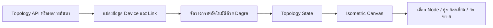
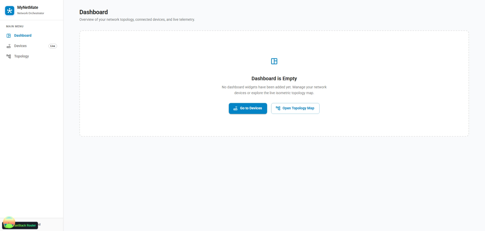
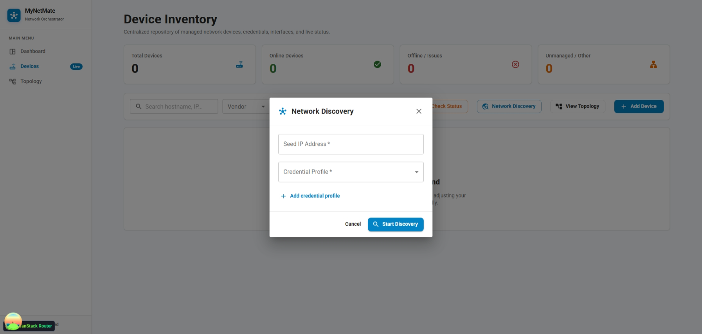
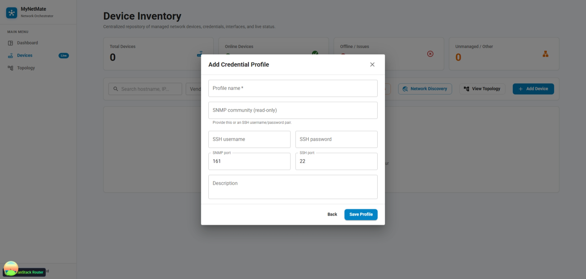
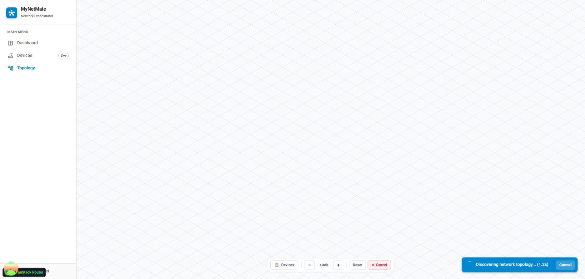
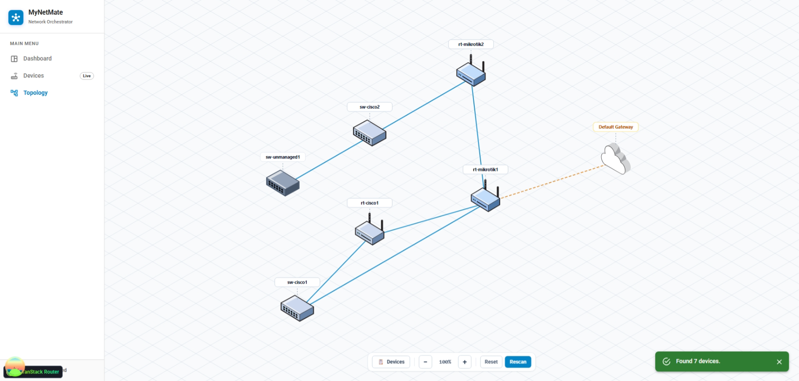

**รายงานความคืบหน้า รายวิชา Project 1 ครั้งที่ 3**  
**ภาควิชาวิศวกรรมคอมพิวเตอร์ คณะวิศวกรรมศาสตร์**  
**สถาบันเทคโนโลยีพระจอมเกล้าเจ้าคุณทหารลาดกระบัง**

1. หัวข้อโครงงาน (ภาษาอังกฤษ): Application for Network Management and Configuration Automation (1)  
2. การดำเนินการมีความคืบหน้า: **30%** (ประเมินเฉพาะขอบเขตงานที่นาย นภัทรรับผิดชอบ)  
3. รายงานความคืบหน้าระหว่าง: วันที่ **28 สิงหาคม 2569 ถึง 17 กันยายน 2569**  
4. สรุปความคืบหน้า (โครงงานประเภท Software Development)

| หัวข้อ | เปอร์เซ็นต์ความคืบหน้า (ครั้งที่) |  |  |  |  |
| ----- | :---: | :---: | ----- | ----- | ----- |
|  | **1** | **2** | **3** | **4** | **5** |
| 1. ศึกษาทบทวนข้อกำหนดที่ควรมี และจำเป็นต้องมี | 50% | 65% | **75%** |  |  |
| 2. การออกแบบ UX/UI | 0% | 0% | **40%** |  |  |
| 3. การออกแบบ Use Case Diagram / Class Diagram / Sequence Diagram หรือ Diagram แบบอื่น ๆ ที่อธิบายการทำงานของระบบ และโครงสร้างโปรแกรม | 30% | 40% | **45%** |  |  |
| 4. การออกแบบโครงสร้างของระบบ Software Architecture Diagram / System Architecture Diagram | 15% | 30% | **45%** |  |  |
| 5. ทำงานได้ตามข้อกำหนด และทดสอบการทำงาน Unit Testing / Integration Testing หรืออื่น ๆ ที่แสดงถึงการทำงานได้ตามข้อกำหนด | 15% | 20% | **40%** |  |  |
| 6. การ Deploy และ Integrate ให้เป็นระบบที่ทำงานได้ตามข้อกำหนด | 5% | 5% | **10%** |  |  |

## 5. รายละเอียดความคืบหน้าครั้งที่ 3

> รายงานฉบับนี้บันทึกงานของ **นาย นภัทร** ที่พัฒนาเพิ่มหลังรายงานความคืบหน้าครั้งที่ 2 ได้แก่ Authentication & RBAC, Dashboard UI และ Network Topology Visualization พร้อมเพิ่มเติมหัวข้อ UX/UI จากสมาชิกอีกคนในกลุ่ม Network Management ตามภาพที่ได้รับวันที่ 18 กันยายน 2569 โดยแยกเป็นหัวข้อเฉพาะ ไม่ระบุงานของเพื่อนเป็นผลงานของนาย นภัทร และไม่รวม Configuration Generation ของกลุ่ม (2)

> **หมายเหตุการส่งงาน:** ตามประกาศใน Classroom วันที่ 8 กันยายน 2569 การส่งรายงานความคืบหน้าครั้งที่ 3 กำหนดให้ส่ง “ร่างโครงงาน 1” ในขอบเขตประมาณ 30% เอกสารฉบับนี้จึงใช้เป็นข้อมูลความคืบหน้าและหลักฐานประกอบสำหรับนำไปเรียบเรียงในบทที่เกี่ยวข้องของร่างโครงงาน 1

### สรุปความก้าวหน้าจากครั้งที่ 2

รายงานครั้งที่ 2 กำหนดความต้องการและแบบจำลองข้อมูลของ Authentication & RBAC, Dashboard & Monitoring และ Network Topology Visualization ไว้ในระดับออกแบบ ได้แก่ บทบาทผู้ใช้ 3 ระดับ แนวคิด Opaque Server-side Session การแยกสถานะของอุปกรณ์ และการสร้างเส้นเชื่อมจากหลักฐาน LLDP/CDP

ในรอบนี้ได้เริ่มเปลี่ยนส่วนที่ออกแบบไว้เป็นโค้ดต้นแบบ โดยเน้น 2 ส่วนที่ตรวจสอบได้จาก Source Code คือโมดูลความปลอดภัยของ Authentication และหน้า Network Topology บน Frontend พร้อมทั้งวางหน้า Dashboard เป็นจุดเริ่มต้นของระบบ งานที่ยังต้องอาศัยฐานข้อมูลหรือ Isolated Lab จะถูกระบุเป็นงานระหว่างพัฒนา ไม่อ้างว่าใช้งานได้สมบูรณ์แล้ว

### 1. Authentication & RBAC

#### วัตถุประสงค์

Authentication & RBAC มีหน้าที่ตรวจสอบตัวตนของผู้ใช้งานและจำกัดสิทธิ์ในการเข้าถึงฟังก์ชันของระบบ โดยโครงงานกำหนดบทบาทผู้ใช้เป็น Admin, Operator และ Viewer เพื่อรองรับการใช้งานที่แตกต่างกัน เช่น การจัดการผู้ใช้ การจัดการข้อมูลอุปกรณ์ และการดูข้อมูลเครือข่าย

แนวทางที่ออกแบบไว้ตั้งแต่ครั้งที่ 2 คือ Opaque Server-side Session กล่าวคือ Browser จะเก็บเพียง Token แบบสุ่มผ่าน Cookie ส่วนข้อมูลผู้ใช้ สิทธิ์ และสถานะ Session จะอยู่ฝั่ง Server ซึ่งช่วยให้การ Logout, Deactivate ผู้ใช้ หรือเปลี่ยน Role สามารถมีผลกับคำขอถัดไปได้ทันทีเมื่อระบบเชื่อมกับฐานข้อมูลจริง

#### สิ่งที่พัฒนาเพิ่มในรอบนี้

ได้พัฒนา Security Foundation ของ Authentication บน Backend แยกเป็นโมดูล เพื่อให้สามารถนำไปเชื่อมกับ API และฐานข้อมูลในรอบถัดไปได้ โดยประกอบด้วย

- โมเดลข้อมูล `User` และ `AuthSession` สำหรับเก็บผู้ใช้ บทบาท และ Session ฝั่งเซิร์ฟเวอร์
- ฟังก์ชัน Hash และตรวจสอบรหัสผ่านด้วย Argon2 เพื่อไม่เก็บรหัสผ่านแบบ Plain Text
- การสร้าง Session Token แบบสุ่มด้วยแหล่งข้อมูลที่เหมาะกับงานด้านความปลอดภัย และการเก็บเฉพาะค่า Hash ของ Token แทน Token ต้นฉบับ
- กลไกจำกัดจำนวนครั้งในการเข้าสู่ระบบตาม IP เพื่อช่วยลดความเสี่ยงจากการเดารหัสผ่านต่อเนื่อง (Brute-force)
- Runtime configuration และการตรวจสอบค่า Configuration ที่เกี่ยวกับ Authentication

ส่วนประกอบเหล่านี้ทำให้ระบบมีแกนกลางด้านความปลอดภัยที่ตรวจสอบแยกส่วนได้ ก่อนนำไปประกอบเป็น Login Flow เต็มรูปแบบ โดยไม่ใช้ JWT แบบ Stateless ซึ่งไม่สอดคล้องกับความต้องการให้เพิกถอน Session และเปลี่ยนสิทธิ์ผู้ใช้ได้ทันที

#### การทดสอบที่ดำเนินการแล้ว

ได้รันชุดทดสอบเฉพาะ Authentication ใน Backend จำนวน 181 รายการ ผลคือผ่าน **166 รายการ** และข้าม **15 รายการ** ที่ต้องใช้ฐานข้อมูลจริง ตารางต่อไปนี้สรุปขอบเขตการตรวจสอบที่ทำแล้ว

| กลุ่มการทดสอบ | ผลที่ตรวจสอบ | สถานะ |
| ----- | ----- | ----- |
| Runtime configuration | ตรวจรูปแบบและค่าที่จำเป็นสำหรับระบบ Authentication | ผ่าน |
| User และ AuthSession model | ตรวจโครงสร้างข้อมูลและข้อกำหนดระดับโมเดล | ผ่าน |
| Password security | ตรวจการ Hash และการตรวจสอบรหัสผ่าน | ผ่าน |
| Session token | ตรวจการสร้าง Token และการ Hash ก่อนจัดเก็บ | ผ่าน |
| Login rate limiter | ตรวจการจัดการจำนวนครั้งของความพยายามเข้าสู่ระบบ | ผ่าน |
| Database schema integration | ต้องใช้สภาพแวดล้อมฐานข้อมูลจริง | ข้ามในรอบนี้ |

**ขอบเขตที่ยังไม่อ้างว่าเสร็จ:** ยังไม่มี Authentication Router ที่เชื่อมกับ API กลาง และยังไม่ได้เชื่อมฐานข้อมูลจริง จึงยังไม่สามารถสรุปว่า Login, Logout, HttpOnly Cookie, User Management และ RBAC ทำงานครบแบบ end-to-end ได้

### 2. Network Topology Visualization

#### วัตถุประสงค์

Network Topology Visualization มีเป้าหมายให้ผู้ใช้เห็นภาพความสัมพันธ์ของ Router, Switch และ Gateway บนแผนผังเดียวกัน โดยในขอบเขตที่ออกแบบไว้ เส้นเชื่อมต้องมาจากข้อมูลเพื่อนบ้าน LLDP/CDP ที่เก็บได้จริง และต้องสามารถระบุได้ว่าข้อมูลเก่าหรือมีหลักฐานไม่เพียงพอ ไม่สร้างเส้นเชื่อมจากการคาดเดา

#### สิ่งที่พัฒนาเพิ่มในรอบนี้

จากครั้งที่ 2 ที่มีเพียงข้อกำหนดระดับ Feature และ Data Ownership ในรอบนี้ได้พัฒนา Prototype ของหน้า Network Topology Visualization บน React แล้ว ความก้าวหน้าหลัก ได้แก่

- มีเส้นทางหน้า Topology พร้อมพารามิเตอร์สำหรับระบุอุปกรณ์ที่ต้องการโฟกัส หรือเริ่มการค้นหาจาก Seed IP
- มีขั้นตอนแปลงข้อมูลอุปกรณ์และความสัมพันธ์เป็นกราฟ แล้วจัดวางตำแหน่งอัตโนมัติด้วย Dagre เพื่อหลีกเลี่ยงการกำหนดตำแหน่งอุปกรณ์ด้วยมือทุกครั้ง
- สร้าง Component สำหรับแสดง Router, Switch และ Gateway แบบ Isometric รวมถึง Component สำหรับเส้นเชื่อมระหว่างอุปกรณ์
- สร้าง State สำหรับเก็บรายการ Node, Link, อุปกรณ์ที่ถูกเลือก สถานะการค้นหา ระยะเวลา และมุมมองของ Canvas
- ผู้ใช้สามารถเลือก Node เพื่อเน้นอุปกรณ์และเส้นเชื่อมที่เกี่ยวข้อง เปิดรายละเอียดอุปกรณ์ รวมถึงย่อ-ขยายและเลื่อนมุมมองแผนผัง
- มี UI สำหรับเริ่มหรือยกเลิกการค้นหา แสดงสถานะความคืบหน้า/ข้อผิดพลาด และเปิดหน้าต่างยืนยันการบันทึกอุปกรณ์ที่ค้นพบ

#### ลำดับการประมวลผลของหน้า Topology

เมื่อมีข้อมูล Topology จาก API หรือผลการค้นหา หน้าจอจะนำข้อมูล Device และ Link มาแปลงเป็นรูปแบบที่ใช้แสดงผล แล้วคำนวณตำแหน่งก่อนส่งให้ Canvas วาดแผนผัง กระบวนการนี้ช่วยแยกหน้าที่ของการรับข้อมูล การจัดวาง และการวาด UI ออกจากกัน เพื่อให้ทดสอบและปรับปรุงได้เป็นส่วน ๆ

การสร้าง Production Build ของ Frontend ผ่านสำเร็จ จึงยืนยันได้ว่าหน้าและ Component ที่พัฒนาสามารถ Compile ร่วมกับ React 19, TypeScript และ Vite ได้

**ขอบเขตที่ยังไม่อ้างว่าเสร็จ:** ความสัมพันธ์บนแผนผังต้องยืนยันด้วยหลักฐาน LLDP/CDP และเวลาที่เก็บข้อมูลจาก Isolated Lab ก่อน จึงจะถือว่าเป็นผลจากอุปกรณ์จริง ไม่ทำการ Scan บนเครือข่ายมหาวิทยาลัย

### 3. Dashboard & Monitoring

#### สิ่งที่พัฒนาเพิ่มในรอบนี้

ได้เพิ่มหน้า Dashboard และ App Layout ที่เชื่อมเส้นทางไปยังหน้า Device และ Topology ทำให้ผู้ใช้มีจุดเริ่มต้นสำหรับเข้าสู่ Workflow ของ Network Management และยืนยันเส้นทางหลักของ UI ได้แล้ว

หน้า Dashboard ปัจจุบันแสดงสถานะเริ่มต้นเมื่อยังไม่มี Widget พร้อมทางลัดให้ผู้ใช้ไปยัง Device Inventory หรือ Topology ได้ทันที การทำเช่นนี้ช่วยให้สามารถพัฒนา Navigation และ Layout ร่วมของระบบก่อน โดยไม่สร้างข้อมูล Monitoring จำลองที่อาจทำให้เข้าใจผิดว่าเป็นสถานะจริงของอุปกรณ์

ปัจจุบัน Dashboard ยังเป็นหน้าว่างแบบมีทางลัดไปยัง Device Inventory และ Topology จึงนับเป็นการวางโครงสร้าง UI เท่านั้น ยังไม่อ้างว่ามี Dashboard Widget, Operational Snapshot, Data Freshness หรือ Recent Activity ที่ดึงข้อมูลจริงจาก Backend

### 4. การออกแบบต้นแบบ UX/UI ของกลุ่ม Network Management

#### วัตถุประสงค์และขอบเขตความคืบหน้า

สมาชิกกลุ่ม Network Management ได้จัดทำต้นแบบส่วนติดต่อผู้ใช้สำหรับการนำทาง การดูรายการอุปกรณ์ และการเตรียมค้นหาอุปกรณ์ผ่าน Seed IP และ Credential Profile เพื่อให้ทีมเห็นลำดับการใช้งานก่อนรวมระบบ ภาพต้นแบบที่ได้รับแสดงหน้า Dashboard หน้าต่าง Network Discovery/เพิ่ม Credential Profile และหน้า Topology ทั้งระหว่างค้นหาและเมื่อแสดงแผนผัง ซึ่งใช้เป็นหลักฐานความคืบหน้าด้าน UX/UI ของกลุ่ม (1)

ในรอบนี้มีความก้าวหน้าด้านการกำหนดองค์ประกอบหน้าจอและขั้นตอนกรอกข้อมูล ภาพดังกล่าวยังไม่ใช่หลักฐานว่าการบันทึก Credential, การค้นหาอุปกรณ์ หรือการเชื่อมฐานข้อมูลทำงานครบวงจร และไม่มีผลประเมินความสะดวกในการใช้งานจากผู้ใช้แนบมา

#### 4.1 โครงสร้างหน้าจอและการนำทาง

ต้นแบบใช้แถบเมนูด้านซ้ายร่วมกัน โดยแสดงชื่อ MyNetMate และเมนู Dashboard, Devices และ Topology พร้อมเน้นเมนูที่กำลังเปิด หน้าจอแบ่งพื้นที่นำทางออกจากพื้นที่ทำงานหลัก และใช้สี รูปแบบปุ่ม และหัวข้อในแนวทางเดียวกัน เพื่อให้ผู้ใช้ติดตามตำแหน่งของตนระหว่างเปลี่ยนหน้าได้

หน้า Dashboard แสดง Empty State ว่ายังไม่มี Widget พร้อมปุ่ม `Go to Devices` และ `Open Topology Map` สำหรับเข้าสู่ขั้นตอนถัดไป ภาพนี้ยืนยันการวางโครงสร้างหน้าและทางลัดเท่านั้น ยังไม่มีผลสรุป Operational Monitoring แม้ข้อความบนต้นแบบจะกล่าวถึง Live Telemetry

*รูปที่ 1 ต้นแบบหน้า Dashboard ในสถานะยังไม่มี Widget และทางลัดไปยัง Devices/Topology*

#### 4.2 หน้า Device Inventory และจุดเริ่มต้นของ Workflow

พื้นที่ด้านหลังหน้าต่าง Network Discovery แสดงโครงหน้า Device Inventory ซึ่งประกอบด้วยการ์ดจำนวนอุปกรณ์ 4 กลุ่ม ได้แก่ Total Devices, Online Devices, Offline / Issues และ Unmanaged / Other พร้อมช่องค้นหา Hostname/IP ตัวเลือก Vendor และปุ่ม Check Status, Network Discovery, View Topology และ Add Device

การจัดกลุ่มองค์ประกอบดังกล่าวแสดงแนวทางให้ผู้ใช้เริ่มจากภาพรวมของอุปกรณ์ แล้วเลือกงานที่ต้องการทำต่อในหน้าเดียว ค่าจำนวนศูนย์และสถานะว่างในภาพเป็นหลักฐานของหน้าจอต้นแบบ ไม่สามารถใช้ยืนยันว่าระบบเก็บจำนวนหรือสถานะอุปกรณ์จริงได้แล้ว

#### 4.3 หน้าต่าง Network Discovery

หน้าต่าง Network Discovery กำหนดช่องหลัก 2 ช่อง ได้แก่ `Seed IP Address` และ `Credential Profile` โดยทำเครื่องหมายเป็นข้อมูลที่ต้องกรอก พร้อมทางเลือก `Add credential profile` ในกรณีที่ยังไม่มี Profile และปุ่ม `Cancel`/`Start Discovery` สำหรับยกเลิกหรือเริ่มขั้นตอนถัดไป

รูปแบบนี้แสดงแนวทางแยกการกำหนดอุปกรณ์เริ่มต้นออกจากข้อมูลที่ใช้เข้าถึงอุปกรณ์ และเปิดโอกาสให้เลือก Profile ที่เตรียมไว้แทนกรอกค่าซ้ำทุกครั้ง ทั้งนี้ ภาพยังไม่ยืนยันการตรวจรูปแบบ IP การตรวจสิทธิ์ Profile หรือการบังคับขอบเขต Isolated Lab ที่ Backend

*รูปที่ 2 ต้นแบบหน้าต่าง Network Discovery สำหรับระบุ Seed IP และเลือก Credential Profile*

#### 4.4 หน้าต่างเพิ่ม Credential Profile

ต้นแบบหน้าต่าง `Add Credential Profile` มีช่อง Profile Name, SNMP Community แบบ Read-only, SSH Username/Password, SNMP Port, SSH Port และ Description พร้อมปุ่ม `Back` และ `Save Profile` โดยมีข้อความแนะนำให้ระบุ SNMP Community หรือข้อมูล SSH ตามวิธีเข้าถึงอุปกรณ์

หน้าต่างนี้แสดงการจัดข้อมูลการเข้าถึงอุปกรณ์เป็น Profile ที่ตั้งชื่อได้ และกำหนดช่องค่าการเชื่อมต่อแยกกัน ข้อมูลนี้เป็น Credential ของอุปกรณ์เครือข่าย ไม่ใช่บัญชีผู้ใช้สำหรับ Login เข้า MyNetMate

ภาพเป็นหลักฐานของแบบฟอร์มเท่านั้น ยังไม่รับรองว่าระบบบันทึก Profile สำเร็จ เข้ารหัส Secret จำกัดสิทธิ์เข้าถึง หรือปกปิดค่าลับครบแล้ว ประเด็นเหล่านี้ต้องตรวจ implementation และทดสอบก่อนเปิดใช้กับข้อมูลจริง

*รูปที่ 3 ต้นแบบแบบฟอร์ม Credential Profile สำหรับข้อมูล SNMP/SSH และค่าพอร์ต*

#### 4.5 ลำดับการใช้งานที่ต้นแบบรองรับ

ลำดับที่เสนอเริ่มจากเปิด Device Inventory → เลือก Network Discovery → ระบุ Seed IP → เลือก Credential Profile หรือเปิดหน้าต่างเพิ่ม Profile → กลับมาที่หน้าต่าง Discovery → เลือก Start Discovery

รูปที่ 4 แสดงสถานะที่กรอก Seed IP และเลือก Profile แล้ว จึงใช้ประกอบการอธิบายจุดก่อนเริ่มค้นหาได้ ภาพ Topology ที่เพิ่มในหัวข้อ 4.6 แสดงหน้าจอระหว่างค้นหาและหน้าจอที่มีแผนผังแล้ว ทำให้เห็นลำดับการนำเสนอผลต่อจากแบบฟอร์ม แต่ยังไม่มีหลักฐานการบันทึกอุปกรณ์ลงฐานข้อมูลหรือผลทดสอบกรณีผิดพลาดแนบมา

*รูปที่ 4 ต้นแบบ Network Discovery หลังระบุ Seed IP และเลือก Profile ก่อนเริ่มค้นหา*

#### 4.6 หน้า Network Topology ระหว่างค้นหาและแสดงแผนผัง

**สถานะระหว่างค้นหา:** หน้าจอแสดงพื้นที่แผนผังแบบ Isometric Grid พร้อมข้อความ `Discovering network topology...` เวลาที่ผ่านไป และปุ่ม `Cancel` ทั้งในแถบควบคุมและข้อความสถานะ เพื่อให้ผู้ใช้ทราบว่างานกำลังดำเนินการและมีทางเลือกยกเลิก พื้นที่ว่างในสถานะนี้ไม่ใช่ผลสรุปว่าไม่พบอุปกรณ์ และเวลา 1.2 วินาทีที่ปรากฏในภาพเป็นเวลาขณะถ่ายภาพ ไม่ใช่ระยะเวลาค้นหาทั้งหมด

*รูปที่ 5 หน้า Topology ระหว่างค้นหา พร้อมข้อความสถานะ เวลาที่ผ่านไป และปุ่มยกเลิก*

**สถานะแสดงแผนผัง:** หน้าจอแสดงสัญลักษณ์ Router, Switch และ Default Gateway พร้อมชื่อกำกับ เช่น `rt-cisco1`, `sw-cisco1`, `rt-mikrotik1` และ `sw-unmanaged1` โดยมีเส้นเชื่อมสีน้ำเงินแบบทึบระหว่างโหนด และเส้นสีส้มแบบประไปยัง Default Gateway การใช้สัญลักษณ์และชื่อกำกับช่วยแยกองค์ประกอบของแผนผัง ส่วนความหมายของชนิดเส้นควรมี Legend อธิบายเพิ่มเติม เพื่อไม่ให้ผู้ใช้ตีความว่าเป็นสถานะการเชื่อมต่อที่ยืนยันแล้วโดยอัตโนมัติ

แถบควบคุมด้านล่างประกอบด้วยปุ่ม `Devices` ปุ่มลด/เพิ่มระดับการขยาย ค่าการขยาย `100%` ปุ่ม `Reset` และ `Rescan` ส่วนข้อความสีเขียวแสดง `Found 7 devices.` ซึ่งเป็นหลักฐานว่าหน้าจอมีรูปแบบแจ้งผลและเครื่องมือสำหรับดูแผนผัง ไม่ใช่ผลทดสอบความถูกต้องของจำนวนอุปกรณ์หรือการเชื่อมต่อจริง

*รูปที่ 6 หน้า Topology ที่แสดงโหนด เส้นเชื่อม Default Gateway และแถบควบคุม พร้อมข้อความแจ้งผลบนหน้าจอ*

ภาพทั้งสองเพิ่มเติมหลักฐานด้านการแสดงสถานะและการนำเสนอแผนผัง แต่ยังต้องตรวจสอบการเปลี่ยนสถานะกับเหตุการณ์จาก Backend การยกเลิกงาน และที่มาของแต่ละเส้นเชื่อมด้วยข้อมูลที่เก็บใน Isolated Lab ชื่อ Cisco/MikroTik ที่ปรากฏบนโหนดไม่ถือเป็นหลักฐานรับรองการรองรับอุปกรณ์แต่ละยี่ห้อครบถ้วน

#### งาน UX/UI ที่จะดำเนินการต่อไป

- เชื่อมแบบฟอร์ม Credential Profile และ Discovery กับ API ที่ตรงกับ Data Contract และตรวจค่าก่อนส่ง
- ตรวจการเปลี่ยนสถานะระหว่างค้นหาและแสดงผลกับเหตุการณ์จริงจาก Backend รวมถึงทดสอบการยกเลิก และเพิ่มกรณีไม่พบอุปกรณ์/Timeout
- เพิ่ม Legend อธิบายสัญลักษณ์และชนิดเส้นเชื่อม พร้อมแสดงที่มาและเวลาที่เก็บข้อมูลเมื่อ Data Contract รองรับ
- ตรวจการปกปิดช่อง Password/Community และการจำกัดสิทธิ์ก่อนใช้ Credential จริง
- ทดสอบลำดับการใช้งานตั้งแต่เลือก Profile จนถึงดูผลใน Isolated Lab และบันทึกผลแยกจากหลักฐานหน้าจอ
- พัฒนา Dashboard Widget ตามขอบเขต Network Management และปรับข้อความ Live Telemetry ให้ตรงกับกลไกเก็บข้อมูลจริง

### 5. ปัญหาที่เกิดขึ้นและแนวทางการแก้ไข

#### 1. การทดสอบ Authentication ที่พึ่งพาฐานข้อมูลยังไม่สามารถรันได้ครบ

การทดสอบ Database Schema Integration จำนวน 15 รายการถูกข้าม เนื่องจากยังไม่มีสภาพแวดล้อม PostgreSQL สำหรับการทดสอบในรอบนี้ หากอ้างผลว่า Authentication ทำงานครบทั้งหมดจะทำให้รายงานคลาดเคลื่อนจากความจริง

**แนวทางการแก้ไข:** จัดเตรียมฐานข้อมูลสำหรับ Development/Test, สร้าง Migration ที่เกี่ยวข้อง และเปิดใช้ชุดทดสอบที่ถูกข้าม ก่อนเชื่อม Login และ Protected API

#### 2. Topology ยังไม่มีหลักฐานจากอุปกรณ์จริง

แม้หน้า Topology และการจัดวางกราฟพัฒนาแล้ว แต่ข้อมูล Link จะถือว่าเชื่อถือได้ต่อเมื่อมีหลักฐาน LLDP/CDP พร้อมเวลาที่เก็บข้อมูล จึงยังไม่สามารถสรุปผลแผนผังจากอุปกรณ์จริงในรอบนี้

**แนวทางการแก้ไข:** ทดสอบการเก็บข้อมูลแบบอ่านอย่างเดียวใน Isolated Lab โดยใช้ข้อมูลจากอุปกรณ์ที่ลงทะเบียนเท่านั้น และบันทึกแหล่งหลักฐาน/เวลาที่เก็บข้อมูลร่วมกับเส้นเชื่อมทุกเส้น

#### 3. Dashboard ยังไม่มีข้อมูล Operational Snapshot ที่ยืนยันแล้ว

Dashboard ต้องอาศัยสัญญาข้อมูลจาก Device Inventory และผลการเก็บข้อมูล จึงไม่ควรแสดงตัวเลขหรือสถานะที่สร้างขึ้นเองก่อนการยืนยัน Data Contract

**แนวทางการแก้ไข:** รอ Schema ของ Operational Snapshot และ Data Freshness ที่ตกลงร่วมกัน แล้วจึงพัฒนา Widget สำหรับแสดง Reachability, Collection Status, Operational State และ Recent Activity

### 6. ผลการตรวจสอบในรอบนี้

| รายการตรวจสอบ | ผลลัพธ์ | ขอบเขตที่ยืนยันได้ |
| ----- | ----- | ----- |
| Authentication automated tests | ผ่าน **166** รายการ, ข้าม **15** รายการ | โมดูล Authentication และการป้องกันระดับหน่วยย่อยทำงานตามชุดทดสอบปัจจุบัน |
| Frontend lint | ผ่าน | ไม่มีข้อผิดพลาดจาก Oxlint ในรอบตรวจสอบ |
| Frontend production build | ผ่าน | หน้า Dashboard และ Topology รวมถึง Component ที่เกี่ยวข้อง Compile สำเร็จ |
| Database / end-to-end authentication | ยังไม่ครบ | รายการที่ใช้ฐานข้อมูลถูกข้าม และ Authentication Router ยังไม่เชื่อม API กลาง |
| Lab / real-device topology | ยังไม่ทดสอบ | ไม่อ้างผลการค้นหาหรือ Topology จากอุปกรณ์จริง |

### 7. สิ่งที่จะดำเนินการต่อไปในขอบเขตงานของนาย นภัทร

1. เชื่อม Authentication Router เข้ากับ API กลาง และทดสอบ Login, Logout, Session, Cookie และ RBAC กับฐานข้อมูลจริง
2. พัฒนา Audit Trail ส่วนกลาง เพื่อบันทึกเหตุการณ์สำคัญโดยปกปิดข้อมูลสำคัญก่อนจัดเก็บ
3. เปลี่ยน Dashboard จากหน้าว่างเป็นหน้าสรุป Operational Snapshot, Data Freshness และ Recent Activity เมื่อ Data Contract พร้อมใช้งาน
4. ทดสอบ Topology ใน Isolated Lab และเพิ่มการแสดงแหล่งหลักฐาน ระยะเวลาที่เก็บข้อมูล และสถานะความน่าเชื่อถือของเส้นเชื่อม

### 8. เอกสารและหลักฐานอ้างอิงจากโฟลเดอร์โครงการ

ข้อมูลความคืบหน้าในรายงานนี้อ้างอิงจาก Source Code และชุดทดสอบที่อยู่ในโฟลเดอร์โครงการจริง ณ วันที่ตรวจสอบ ไม่ใช่เพียงเอกสารออกแบบ โดยมีหลักฐานสำคัญดังนี้

| งานที่รายงาน | ไฟล์หรือโฟลเดอร์อ้างอิง | สิ่งที่ใช้ยืนยัน |
| ----- | ----- | ----- |
| User และ AuthSession model | `mynetmate/backend/app/features/authentication/models.py` | โครงสร้างข้อมูลผู้ใช้ บทบาท และ Session ฝั่ง Server |
| Password Hashing | `mynetmate/backend/app/features/authentication/passwords.py` | ฟังก์ชัน Hash และตรวจสอบรหัสผ่านด้วย Argon2 |
| Session Token | `mynetmate/backend/app/features/authentication/session_tokens.py` | การสร้าง Token และการ Hash Token ก่อนจัดเก็บ |
| Login Rate Limiter | `mynetmate/backend/app/features/authentication/rate_limiter.py` | กลไกจำกัดการพยายามเข้าสู่ระบบตาม IP |
| Authentication Configuration | `mynetmate/backend/app/features/authentication/config.py` | Runtime settings และการตรวจสอบค่าการตั้งค่าที่จำเป็น |
| Authentication Tests | `mynetmate/backend/tests/test_authentication_*.py` | ชุดทดสอบ Configuration, Model, Security, Rate Limiter และ Startup |
| หน้า Topology | `mynetmate/website/src/features/topology/TopologyPage.tsx` | การรับข้อมูล Topology, การจัดการ UI และการเปิดรายละเอียดอุปกรณ์ |
| Automatic Layout | `mynetmate/website/src/features/topology/utils/layout.ts` | การแปลงข้อมูลอุปกรณ์/เส้นเชื่อมและจัดวางกราฟด้วย Dagre |
| Topology State และการค้นหา | `mynetmate/website/src/features/topology/state.ts`, `mynetmate/website/src/features/topology/hooks/useNetworkScan.ts` | State ของ Node, Link, Scan และการรับสถานะการค้นหา |
| Topology Canvas | `mynetmate/website/src/features/topology/components/TopologyCanvas.tsx` | การวาด Node/Link และการเลือกอุปกรณ์บนแผนผัง |
| Dashboard และ Layout | `mynetmate/website/src/features/home/HomePage.tsx`, `mynetmate/website/src/shared/components/AppLayout.tsx` | หน้า Dashboard เริ่มต้นและการนำทางร่วมของระบบ |
| ขอบเขต MVP | `02_feature/MyNetMate Weight Feature List (AI คิด).md` | หลักการ P1/P2, การใช้ Isolated Lab และข้อจำกัดด้านความปลอดภัย |
| ข้อกำหนดการส่งครั้งที่ 3 | `04_project_management/วิชา CE Project 1 และ 2/รายงานความคืบหน้า/ประกาศใน Classroom วันที่ 8 กันยายน 69.md` | กำหนดให้ส่งร่างโครงงาน 1 ในขอบเขตประมาณ 30% |
| ต้นแบบ UX/UI ของสมาชิกกลุ่ม (1) | `../Img/network-management-progress-3-ui-dashboard.png`, `../Img/network-management-progress-3-ui-discovery-empty.png`, `../Img/network-management-progress-3-ui-credential-profile.png`, `../Img/network-management-progress-3-ui-discovery-ready.png` | ภาพที่ผู้จัดทำส่งมาเพิ่มเติมวันที่ 18 กันยายน 2569; ยืนยันเฉพาะองค์ประกอบหน้าจอและลำดับที่เสนอ ไม่ใช่ผลการทดสอบ Backend |
| ภาพ UX/UI หน้า Topology ที่เพิ่มภายหลัง | `../Img/network-management-progress-3-ui-topology-scanning.png`, `../Img/network-management-progress-3-ui-topology-result.png` | ภาพที่ผู้จัดทำส่งมาเพิ่มเติมวันที่ 18 กันยายน 2569; แสดงหน้าจอระหว่างค้นหาและแผนผังพร้อมข้อความแจ้งผล ไม่ใช่ผลทดสอบความถูกต้องของ Topology จากอุปกรณ์จริง |

**คำสั่งตรวจสอบที่ใช้ในรอบรายงาน:** รัน `uv run pytest` เฉพาะไฟล์ `test_authentication_*.py` จากโฟลเดอร์ `mynetmate/backend` ได้ผลผ่าน 166 รายการ และข้าม 15 รายการ; รัน `npm run lint` และ `npm run build` จากโฟลเดอร์ `mynetmate/website` ผ่านทั้งสองรายการ

---

*รายงานนี้บันทึกความคืบหน้างานของนาย นภัทร พร้อมหัวข้อ UX/UI ของสมาชิกกลุ่ม Network Management ที่เพิ่มภายหลัง โดยแยกแหล่งหลักฐานและขอบเขตความรับผิดชอบ*
