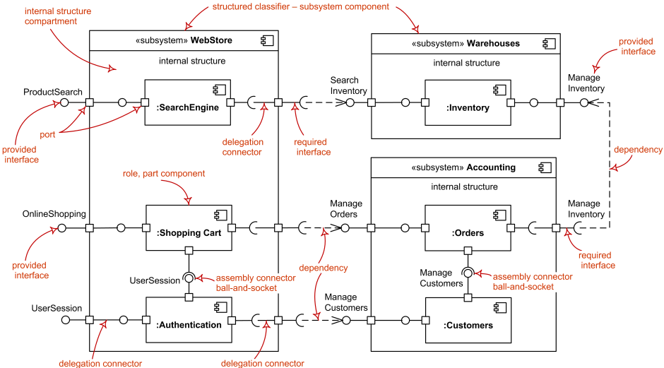
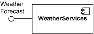
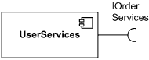
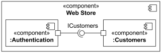
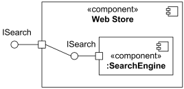
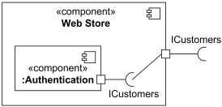
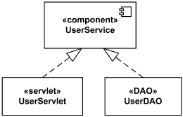
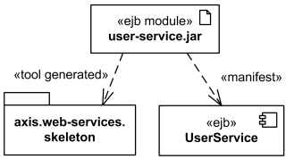
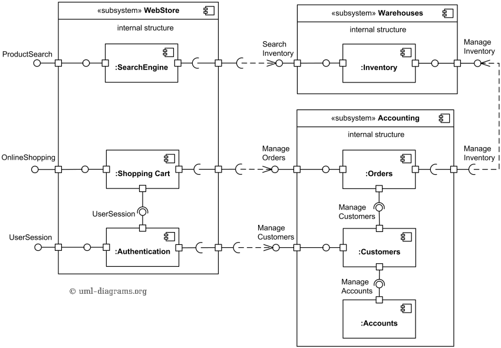

# UML Component Diagram

> แหล่งอ้างอิงหลัก: [UML Component Diagrams — UML-Diagrams.org](https://www.uml-diagrams.org/component-diagrams.html) และหน้ารายละเอียดที่เชื่อมโยงจากบทความ
> ผู้เขียนแหล่งอ้างอิงและภาพ: Kirill Fakhroutdinov, UML-Diagrams.org
> วันที่ตรวจสอบและปรับโน้ต: 22 ตุลาคม 2569 (2026-10-22)

Component Diagram ใช้อธิบายโครงสร้างของระบบผ่าน Component, Interface, Port และความสัมพันธ์ระหว่างส่วนต่าง ๆ 
เพื่อ ช่วยให้เห็น
- ขอบเขตความรับผิดชอบ 
- บริการที่แต่ละส่วนให้
- ความต้องการ 
- วิธีประกอบส่วนเหล่านั้นเข้าด้วยกัน

โน้ตนี้เรียบเรียงคำอธิบายภาษาไทยและแนวทางอ่านภาพขึ้นใหม่ ภาพประกอบเป็นภาพต้นฉบับจาก UML-Diagrams.org เก็บสำเนาไว้ใน `Img/UML-Component-Diagram/` พร้อมลิงก์ที่มาใต้ภาพ
## 1. ภาพรวมของ Component Diagram



*รูปที่ 1 ภาพรวม Component, Part, Provided/Required Interface, Port, Assembly Connector, Delegation Connector และ Dependency — ที่มา: [UML Component Diagrams](https://www.uml-diagrams.org/component-diagrams.html), ภาพโดย Kirill Fakhroutdinov / UML-Diagrams.org*

ให้อ่านภาพโดยเริ่มจากกรอบ `WebStore`, `Warehouses` และ `Accounting` แล้วพิจารณาว่าแต่ละกรอบมีส่วนใดอยู่ภายใน ให้บริการอะไรออกมา และต้องใช้บริการใดจากกรอบอื่น คำกำกับสีแดงช่วยระบุว่าสัญลักษณ์แต่ละตำแหน่งหมายถึงอะไร

Component Diagram **เป็นมุมมองเชิงโครงสร้าง เส้น Dependency บอกการพึ่งพา ส่วน Connector บอกการเชื่อมส่วนต่าง ๆ ในบริบทของโครงสร้างนั้น** หากต้องการอธิบายว่าข้อความใดเกิดก่อนหรือหลัง ควรใช้ Sequence Diagram ประกอบ

## 2. Component คืออะไร

Component คือส่วนที่เป็น**โมดูลของระบบ** มีขอบเขตห่อหุ้มรายละเอียดภายใน และมีสัญญาการให้หรือใช้บริการที่ระบุผ่าน Interface การแทนที่ Component ต้องพิจารณาความสอดคล้องกับสัญญาทั้งด้านโครงสร้างและพฤติกรรม

ตัวอย่างชื่อที่สื่อความรับผิดชอบ ได้แก่ `Authentication`, `Shopping Cart` และ `Inventory` ส่วนหนึ่งอาจประกอบด้วยหลาย Class หรือหลายส่วนย่อย การเป็น Component จึงไม่ได้กำหนดว่าต้องเป็น Microservice หรือต้องแยก Process เสมอไป
### สัญลักษณ์และขอบเขต

- ใช้กรอบสี่เหลี่ยมพร้อมคำว่า `«component»` หรือไอคอน Component ที่มุมขวาบน เมื่อมีไอคอนแล้วสามารถละคำว่า `«component»` ได้
- Component ขนาดใหญ่สามารถมี Parts และ Connectors ภายในเพื่อแสดงการประกอบระบบ
- `«subsystem»` ใช้กับ Component ที่แทนส่วนย่อยขนาดใหญ่ของระบบ เช่น WebStore ในภาพ
- Package ใช้จัดกลุ่มองค์ประกอบของแบบจำลอง การวาดกรอบ Package ครอบส่วนย่อยจึงไม่ได้แสดงความหมายเท่ากับ Component ที่มี Port และโครงสร้างภายใน

คำว่า `Service` ในชื่อ เช่น `Authentication Service` เป็นการตั้งชื่อ ส่วนการใส่ `«Service»` เป็น Stereotype มีความหมายเฉพาะในแบบจำลอง จึงควรเลือกใช้โดยตั้งใจ

อ่านเพิ่มเติม: [Component](https://www.uml-diagrams.org/component.html)
### Part กับ Component Type

ในภาพพบชื่ออย่าง `:SearchEngine` และ `:Authentication` ซึ่งแสดงบทบาทของส่วนภายในที่มีชนิดเป็น Component นั้น รูปแบบทั่วไปคือ `partName : ComponentType` และสามารถละชื่อ Part ได้

จุดนี้ช่วยแยก “ชนิดของส่วนประกอบ” ออกจาก “ส่วนที่นำมาประกอบอยู่ใน Component ใหญ่” ตัวอย่างเช่นชนิดเดียวกันอาจถูกใช้เป็นหลาย Parts ได้

อ่านเพิ่มเติม: [Part](https://www.uml-diagrams.org/composite-structure-diagrams/part.html?context=components)

## 3. Interface: บริการที่ให้และบริการที่ต้องการ

Interface คือสัญญาของบริการ เช่น การดำเนินการที่เรียกได้ ข้อมูลที่เกี่ยวข้อง และข้อกำหนดพฤติกรรมที่ผู้ให้และผู้ใช้บริการต้องสอดคล้องกัน

| ประเภท             | ความหมาย                                       | สัญลักษณ์แบบย่อ       |
| ------------------ | ---------------------------------------------- | --------------------- |
| Provided Interface | บริการที่ Component มีให้ผู้อื่นใช้            | วงกลมหรือ Lollipop    |
| Required Interface | บริการที่ Component ต้องใช้เพื่อทำหน้าที่ของตน | ครึ่งวงกลมหรือ Socket |

### Provided Interface



*รูปที่ 2 Weather Services ให้บริการ Weather Forecast — ที่มา: [Component — Provided Interface](https://www.uml-diagrams.org/component.html#provided-interface), ภาพโดย Kirill Fakhroutdinov / UML-Diagrams.org*

วงกลมที่เชื่อมกับ Component ระบุบริการที่ Component นั้นให้แก่ภายนอก การเขียนชื่อ Interface กำกับทำให้ผู้อ่านทราบว่าบริการคืออะไร

### Required Interface



*รูปที่ 3 User Services ต้องการ IOrderServices — ที่มา: [Component — Required Interface](https://www.uml-diagrams.org/component.html#required-interface), ภาพโดย Kirill Fakhroutdinov / UML-Diagrams.org*

Socket ระบุความต้องการบริการ การมี Required Interface ยังไม่ได้ระบุเองว่า Component ใดเป็นผู้ให้บริการ ต้องดูความสัมพันธ์ที่เชื่อมอยู่ด้วย

### การตั้งชื่อ Interface

ควรใช้ชื่อที่บอกสัญญาบริการ เช่น `IOrderServices`, `Product Search` หรือ `Search Inventory` แล้วจึงกำกับเทคโนโลยีที่ใช้ติดต่อเมื่อจำเป็น ตัวอย่างเช่น `Device Inventory API — HTTPS/JSON`

REST หรือ gRPC อธิบายแนวทางหรือเทคโนโลยีการติดต่อ แต่เพียงชื่อเทคโนโลยียังไม่บอกว่าระบบให้บริการอะไร ทั้งนี้ UML ไม่ได้บังคับให้ชื่อ Interface ขึ้นต้นด้วยตัวอักษร I

ถ้าต้องแสดงรายละเอียดของ Interface สามารถใช้กรอบ `«interface»` พร้อมรายการ Operations แทนสัญลักษณ์แบบย่อได้ โดยผู้ให้บริการสัมพันธ์กับ Interface ผ่าน Interface Realization และผู้ใช้บริการสัมพันธ์ผ่าน Usage

อ่านเพิ่มเติม: [Component](https://www.uml-diagrams.org/component.html) และ [Interface](https://www.uml-diagrams.org/interface.html)

## 4. Port: จุดติดต่อบนขอบ Component

Port เป็นจุดติดต่อที่มีชื่อและชนิดได้ แสดงด้วยสี่เหลี่ยมเล็กบนขอบ Component หรือส่วนย่อย ใช้กำหนดว่าการติดต่อระหว่างภายนอกกับภายในเกิดผ่านจุดใด

Port หนึ่งอาจมีทั้ง Provided และ Required Interfaces ได้ จึงไม่ควรถือว่าทุก Port ให้บริการได้อย่างเดียวหรือร้องขอบริการได้อย่างเดียว

**UML Port ไม่ใช่หมายเลข TCP/UDP Port** เช่น 22, 161 หรือ 443 และไม่ได้เท่ากับ REST Endpoint หนึ่งรายการโดยอัตโนมัติ การจับคู่กับรายละเอียดเครือข่ายขึ้นอยู่กับระดับแบบจำลองที่เลือก

ไม่จำเป็นต้องใส่ Port ทุกครั้งที่กล่าวถึง Interface แต่เมื่ออธิบาย Delegation หรือการประกอบ Parts ภายใน การแสดง Port ช่วยทำให้จุดเชื่อมชัดเจนขึ้น

อ่านเพิ่มเติม: [Port](https://www.uml-diagrams.org/port.html?context=components)

## 5. Relationship และ Connector: เลือกเส้นให้ตรงความหมาย

### 5.1 Dependency และ Usage

Dependency แสดงว่าองค์ประกอบหนึ่งต้องพึ่งพาอีกองค์ประกอบในการระบุความหมายหรือการนำไปสร้างระบบ ใช้เส้นประพร้อมหัวลูกศรเปิด ชี้จาก Client ซึ่งเป็นผู้พึ่งพาไปยัง Supplier ซึ่งเป็นสิ่งที่ถูกพึ่งพา

Usage เป็น Dependency ที่เจาะจงว่าผู้พึ่งพาต้องใช้ Supplier เพื่อให้การทำงานหรือการนำไปสร้างระบบสมบูรณ์ แสดงด้วยคำว่า `«use»` กำกับเส้น

ตัวอย่างต่อไปนี้เป็นข้อความช่วยอ่านทิศทาง:

```text
Order Service - - - > Payment Service
       Client              Supplier

Order Service - - - > IPayment : «use»
```

ลูกศร Dependency ไม่ได้กำหนดลำดับเวลา และไม่ใช่ลูกศรแสดงเส้นทาง Request/Response ทั้งหมด การส่งผลลัพธ์กลับจึงไม่ใช่เหตุให้เพิ่ม Dependency ย้อนกลับโดยอัตโนมัติ

อ่านเพิ่มเติม: [Dependency และ Usage](https://www.uml-diagrams.org/dependency.html)

### 5.2 Assembly Connector

Assembly Connector เชื่อม Parts หรือ Ports ของ Parts ภายในบริบทของโครงสร้างเดียวกัน เพื่อประกอบส่วนที่ให้บริการเข้ากับส่วนที่ใช้บริการนั้น



*รูปที่ 4 การประกอบ Authentication และ Customers ผ่าน ICustomers ภายใน Web Store — ที่มา: [Connector — Assembly Connector](https://www.uml-diagrams.org/composite-structure-diagrams/connector.html), ภาพโดย Kirill Fakhroutdinov / UML-Diagrams.org*

ในภาพ `Authentication` ต้องการ `ICustomers` และ `Customers` เป็นผู้ให้บริการ จึงเชื่อม Required/Provided Interface ที่เข้ากันได้ด้วย Ball-and-socket

การแสดงแบบ Ball-and-socket ใช้กับ Simple Ports ที่ให้หรือต้องการ Interface เดียว เมื่อ Port มีหลาย Interfaces ควรเลือกสัญลักษณ์ที่แสดงจุดเชื่อมโดยตรงและรายละเอียดให้ชัด แทนการใช้ Ball-and-socket โดยไม่อธิบาย

Assembly Connector ไม่ใช่ลูกศร Dependency และไม่จำเป็นต้องมีหัวลูกศรบอกลำดับเรียกใช้งาน

### 5.3 Delegation Connector

Delegation Connector เชื่อม Port บนขอบของ Component ใหญ่กับ Part หรือ Port ของ Part ภายใน เพื่อส่งต่อการติดต่อให้ส่วนที่รับผิดชอบทำงานจริง ใช้อธิบายการแบ่งโครงสร้างเป็นชั้น ๆ

**กรณีส่งต่อบริการที่ Component ใหญ่ให้แก่ภายนอก**



*รูปที่ 5 Web Store เปิดให้ใช้ ISearch และส่งต่อไปยัง SearchEngine ภายใน — ที่มา: [Connector — Delegation Connector](https://www.uml-diagrams.org/composite-structure-diagrams/connector.html), ภาพโดย Kirill Fakhroutdinov / UML-Diagrams.org*

**กรณีส่วนภายในต้องใช้บริการจากภายนอก**



*รูปที่ 6 Authentication ต้องการ ICustomers และเชื่อมความต้องการนั้นออกผ่าน Port ของ Web Store — ที่มา: [Connector — Delegation Connector](https://www.uml-diagrams.org/composite-structure-diagrams/connector.html), ภาพโดย Kirill Fakhroutdinov / UML-Diagrams.org*

ให้ตรวจปลายเส้นทั้งสองด้านว่าเชื่อมขอบเขตภายนอกกับส่วนภายในของ Component เดียวกันหรือไม่ การเรียกบริการของอีกระบบหนึ่งเฉย ๆ ยังไม่ทำให้เส้นนั้นเป็น Delegation และการเขียนคำว่า `delegate` บนลูกศรทั่วไปก็ไม่เปลี่ยนชนิดความสัมพันธ์

### 5.4 Association ต่างจาก Connector อย่างไร

Association อธิบายความสัมพันธ์ระหว่าง Instances ของ Classifiers ส่วน Connector ระบุการเชื่อม Instances ที่ทำหน้าที่เป็น Parts ในโครงสร้างที่กำลังแสดง

ทั้งสองอาจใช้เส้นทึบที่ดูคล้ายกัน จึงต้องอ่านชนิดองค์ประกอบและบริบทประกอบ ไม่ควรใช้เส้นทึบทุกเส้นแทนข้อความกว้าง ๆ ว่า “สอง Component ติดต่อกัน” แล้วสรุปว่าเป็น Association เสมอไป

| สิ่งที่ต้องการสื่อ | ความสัมพันธ์ที่ควรพิจารณา |
|---|---|
| A พึ่งพา B ในแบบจำลอง | Dependency |
| A ต้องใช้ B เพื่อทำงานหรือสร้างระบบ | Usage `«use»` |
| ประกอบ Parts ที่ให้และใช้บริการร่วมกัน | Assembly Connector |
| เชื่อม Port ของ Component ใหญ่กับส่วนภายใน | Delegation Connector |
| ความสัมพันธ์ระหว่าง Instances ของ Classifiers | Association |

อ่านเพิ่มเติม: [Connector](https://www.uml-diagrams.org/composite-structure-diagrams/connector.html)

## 6. Black-box และ White-box View

| มุมมอง | สิ่งที่แสดง | คำถามที่ช่วยตอบ |
|---|---|---|
| Black-box / External View | Component และสัญญาที่มองเห็นจากภายนอก เช่น Provided/Required Interfaces และ Ports | ส่วนนี้ให้บริการอะไร และต้องใช้บริการอะไร |
| White-box / Internal View | Parts, Connectors หรือ Classifiers ที่ทำให้พฤติกรรมภายนอกเกิดขึ้นจริง | ภายในแบ่งงานและเชื่อมต่อกันอย่างไร |

ทั้งสองมุมมองใช้อธิบาย Component เดียวกันในระดับรายละเอียดต่างกัน ตัวอย่างเช่น Black-box ของ `WebStore` แสดงบริการ `Product Search` ส่วน White-box เปิดให้เห็น `SearchEngine` และเส้น Delegation ที่รับผิดชอบบริการนั้น

เมื่อต้องวาดภาพรวมของระบบใหญ่ ควรกำหนดระดับรายละเอียดให้สม่ำเสมอ แล้วเปิดรายละเอียดภายในเฉพาะส่วนที่ต้องอธิบาย แทนการนำทุก Class ทุกไฟล์ และทุก Server มาไว้ในภาพเดียวกัน

อ่านเพิ่มเติม: [Component — External View](https://www.uml-diagrams.org/component.html) และ [Component Realization — Internal View](https://www.uml-diagrams.org/component-realization.html)

## 7. Component Realization, Artifact และ Manifestation

### 7.1 Component Realization

Component Realization แสดง Classifiers ที่ทำให้สัญญาของ Component เกิดขึ้นจริง ใช้เส้นประพร้อมหัวสามเหลี่ยมโปร่ง ชี้จาก Classifiers ที่ทำงานจริงไปยัง Component ที่ถูกรองรับ



*รูปที่ 7 UserServlet และ UserDAO ทำให้พฤติกรรมของ UserService เกิดขึ้นจริง — ที่มา: [Component Realization](https://www.uml-diagrams.org/component-realization.html), ภาพโดย Kirill Fakhroutdinov / UML-Diagrams.org*

ตัวอย่างนี้ช่วยเชื่อมระดับ Component เข้ากับ Class Design โดยยังคงแยกสัญญาของ Component ออกจากรายละเอียดของแต่ละ Class

### 7.2 Artifact และ Manifestation

Artifact คือสิ่งที่ใช้หรือผลิตขึ้นในกระบวนการพัฒนา ติดตั้ง หรือใช้งานระบบ เช่น Source File, Script, Library และไฟล์ Archive ไม่ได้จำกัดเฉพาะไฟล์ที่ Execute ได้

Manifestation แสดงการทำให้องค์ประกอบในแบบจำลองปรากฏเป็นสิ่งที่เป็นรูปธรรมผ่าน Artifact ใช้เส้นประพร้อมหัวลูกศรเปิดและคำว่า `«manifest»` ชี้ **จาก Artifact ไปยังองค์ประกอบที่ Artifact นั้นทำให้เกิดขึ้น** เช่น Component



*รูปที่ 8 user-service.jar มีความสัมพันธ์ Manifestation ไปยัง UserService และมีความสัมพันธ์อีกแบบไปยัง Skeleton ที่สร้างด้วยเครื่องมือ — ที่มา: [Deployment Diagrams — Manifestation](https://www.uml-diagrams.org/deployment-diagrams.html#manifestation), ภาพโดย Kirill Fakhroutdinov / UML-Diagrams.org*

| ประเด็น | ความสัมพันธ์ | ทิศทางในตัวอย่าง |
|---|---|---|
| Classifiers ใดทำให้สัญญาของ Component เกิดขึ้นจริง | Component Realization | UserServlet/UserDAO → UserService |
| Artifact ใดทำให้ Component ปรากฏเป็นสิ่งที่เป็นรูปธรรม | Manifestation `«manifest»` | user-service.jar → UserService |
| Artifact ถูกติดตั้งที่ใด | Deployment | อธิบายใน Deployment Diagram ร่วมกับ Deployment Target |

ใน UML 2.x ให้แสดงการ Deploy ผ่าน Artifact ไปยัง Node หรือ Deployment Target ส่วน Component เชื่อมกับ Artifact ผ่าน Manifestation หากเน้นคำถามว่า Software ทำงานอยู่บน Server หรือ Environment ใด ควรใช้ Deployment Diagram ประกอบ

อ่านเพิ่มเติม: [Artifact](https://www.uml-diagrams.org/artifact.html) และ [Manifestation / Deployment](https://www.uml-diagrams.org/deployment-diagrams.html#manifestation)

## 8. อ่านตัวอย่าง Online Shopping จาก UML-Diagrams.org



*รูปที่ 9 White-box View ของ WebStore, Warehouses และ Accounting — ที่มา: [Online Shopping UML Component Diagram Example](https://www.uml-diagrams.org/examples/online-shopping-uml-component-diagram-example.html), ภาพโดย Kirill Fakhroutdinov / UML-Diagrams.org*

ภาพนี้ใช้ตัวอย่างจากแหล่งอ้างอิงโดยตรง สามารถอ่านตามลำดับต่อไปนี้:

1. **ดูขอบเขต:** มีสาม Subsystems ได้แก่ WebStore, Warehouses และ Accounting แต่ละกรอบมี Parts ภายใน
2. **ดูบริการด้านนอก:** WebStore เปิดบริการ Product Search, Online Shopping และ UserSession
3. **ตาม Delegation เข้าไป:** Product Search เชื่อมผ่าน Port ของ WebStore ไปยัง SearchEngine ส่วนบริการ Manage Orders ของ Accounting เชื่อมเข้าหา Orders ภายใน
4. **ดูความต้องการข้าม Subsystem:** SearchEngine ต้องการ Search Inventory จาก Warehouses และ Shopping Cart ต้องการ Manage Orders จาก Accounting
5. **ดู Assembly ภายใน:** Shopping Cart ใช้ UserSession จาก Authentication และ Orders ใช้ Manage Customers จาก Customers
6. **แยกเส้นข้ามกรอบกับเส้นภายใน:** เส้นประระหว่าง Interfaces ของ Subsystems แสดงการพึ่งพา ส่วนเส้นระหว่าง Port ที่ขอบกับ Part ภายในแสดง Delegation

การอ่านภาพนี้เป็นการอธิบายโครงสร้างและสัญญาที่แสดงอยู่ รายละเอียดอย่างชื่อ Endpoint, HTTP Method, Database Schema และลำดับ Login/Checkout ต้องมีแบบจำลองหรือคำอธิบายเพิ่มเติม

## 9. วิธีนำไปใช้วาดระบบของตนเอง

เริ่มจากกำหนดวัตถุประสงค์ของภาพและขอบเขตระบบ จากนั้นระบุ Component แต่ละตัวพร้อมหน้าที่ บริการที่ให้ และบริการที่ต้องใช้ ก่อนเลือกชนิดเส้นเชื่อม

1. เลือกว่าภาพจะเน้น Black-box, White-box หรือการเชื่อมหลาย Subsystems
2. ตั้งชื่อ Component ตามหน้าที่ และกำหนดระดับรายละเอียดให้สอดคล้องกัน
3. ระบุ Provided/Required Interfaces โดยตั้งชื่อบริการให้ชัด
4. เพิ่ม Ports และ Parts เมื่อจำเป็นต้องอธิบายการประกอบหรือ Delegation
5. เลือก Dependency, Usage, Assembly หรือ Delegation ตามความสัมพันธ์จริง
6. ถ้าต้องเชื่อมกับ Class หรือไฟล์ที่นำไปใช้งาน ให้เพิ่ม Realization หรือ Manifestation ตามความหมาย
7. ระบุว่าภาพเป็นแบบออกแบบหรือภาพจากระบบที่พัฒนาแล้ว พร้อมวันที่และหลักฐานที่เกี่ยวข้อง

### จุดที่ควรตรวจทาน

- Interface ที่เชื่อมกันมีสัญญาที่เข้ากันได้ ไม่ใช่เพียงชื่อคล้ายกัน
- Dependency ชี้จากผู้พึ่งพาไปยังสิ่งที่ถูกพึ่งพา
- Delegation เชื่อมขอบเขตกับส่วนภายใน โดยแยกจากการเรียกบริการภายนอก
- แยก Component, Package, Part, Classifier, Artifact และ Node ตามระดับที่ต้องการสื่อ
- ภาพไม่ได้ทำให้เข้าใจว่า Component ทุกตัวคือ Microservice หรือ Server คนละเครื่อง
- ภาพมีชื่อ คำอธิบายสัญลักษณ์ และแหล่งอ้างอิงที่ตามกลับได้

สำหรับการใช้ PlantUML ใน Vault ให้ใช้ Code Block ชนิด `plantuml` และเลือกสัญลักษณ์ให้สอดคล้องกับความสัมพันธ์ที่ต้องการแสดง การติดป้ายข้อความบนเส้นเพียงอย่างเดียวไม่ได้ทำให้เส้นนั้นมีความหมายเป็น Connector ชนิดที่ระบุ ดูวิธีตั้งค่าที่ [Obsidian Extensions Guide](../../OBSIDIAN_EXTENSIONS.md#37-plantuml)

## 10. เอกสารอ้างอิงและเครดิตภาพ

แหล่งหลักของโน้ตคือหน้า Component Diagrams และหน้ารายละเอียดในชุดเดียวกันของ UML-Diagrams.org ซึ่งระบุว่าครอบคลุม UML ถึงรุ่น 2.5 ส่วนมาตรฐาน OMG UML 2.5.1 ใช้ตรวจความหมายเพิ่มเติม

1. Kirill Fakhroutdinov. [UML Component Diagrams](https://www.uml-diagrams.org/component-diagrams.html).
2. Kirill Fakhroutdinov. [Component](https://www.uml-diagrams.org/component.html).
3. Kirill Fakhroutdinov. [Part](https://www.uml-diagrams.org/composite-structure-diagrams/part.html?context=components).
4. Kirill Fakhroutdinov. [Port](https://www.uml-diagrams.org/port.html?context=components).
5. Kirill Fakhroutdinov. [Connector: Assembly and Delegation](https://www.uml-diagrams.org/composite-structure-diagrams/connector.html).
6. Kirill Fakhroutdinov. [Dependency and Usage](https://www.uml-diagrams.org/dependency.html).
7. Kirill Fakhroutdinov. [Component Realization](https://www.uml-diagrams.org/component-realization.html).
8. Kirill Fakhroutdinov. [Artifact](https://www.uml-diagrams.org/artifact.html).
9. Kirill Fakhroutdinov. [Deployment Diagrams: Manifestation](https://www.uml-diagrams.org/deployment-diagrams.html#manifestation).
10. Kirill Fakhroutdinov. [Online Shopping UML Component Diagram Example](https://www.uml-diagrams.org/examples/online-shopping-uml-component-diagram-example.html).
11. Object Management Group. [Unified Modeling Language, Version 2.5.1](https://www.omg.org/spec/UML/2.5.1) และ [Normative UML Metamodel](https://www.omg.org/spec/UML/20161101/UML.xmi).

ตรวจสอบแหล่งอ้างอิงและดาวน์โหลดภาพเมื่อ 22 ตุลาคม 2569 ภาพทั้ง 9 ภาพเป็นของ UML-Diagrams.org / Kirill Fakhroutdinov และเก็บโดยไม่ดัดแปลง รายการไฟล์และ URL ต้นฉบับอยู่ใน [เครดิตภาพประกอบ](../../Img/UML-Component-Diagram/README.md)


--
**Component คือหน่วยซอฟต์แวร์ที่แบ่งความรับผิดชอบชัดเจน มีรายละเอียดภายใน และเปิดบริการบางอย่างให้ส่วนอื่นใช้ผ่าน Interface** 
ในโค้ดอาจประกอบด้วยหลาย Class และหลายไฟล์ เช่น โมดูล Device Inventory ไม่จำเป็นต้องแยกเป็น Server หรือ Microservice แนวคิดนี้ตรงกับ [ข้อกำหนด Component ของ OMG](https://www.omg.org/spec/UML/2.2/Superstructure/PDF/)

ตัวอย่างสมมติใน MyNetMate: Dashboard ต้องขอรายการอุปกรณ์จาก Device Inventory

| สิ่งที่วาด                                    | ในงานเขียนโปรแกรมหมายถึงอะไร                                              |
| --------------------------------------------- | ------------------------------------------------------------------------- |
| Component `Device Inventory`                  | ชุดโค้ดที่รับผิดชอบจัดการและให้ข้อมูลอุปกรณ์                              |
| Provided Interface — วงกลม                    | สัญญาบริการที่ Inventory มีให้ เช่น `list_devices()` ซึ่งคืนรายการอุปกรณ์ |
| Required Interface — ครึ่งวงกลม               | Dashboard ต้องการบริการอ่านรายการอุปกรณ์จากส่วนอื่น                       |
| Assembly Connector — การต่อวงกลมกับครึ่งวงกลม | เชื่อมผู้ใช้บริการเข้ากับผู้ให้บริการที่มีสัญญาตรงกัน                     |

ตัวอย่างโค้ดแบบย่อ เพื่อให้เห็นการเชื่อมจริง:

```
class DeviceInventory:
    def list_devices(self):
        return ["Router-1", "Switch-1"]


class Dashboard:
    def __init__(self, inventory):
        self.inventory = inventory

    def device_count(self):
        return len(self.inventory.list_devices())


dashboard = Dashboard(DeviceInventory())
```

ในตัวอย่างนี้:

- `DeviceInventory.list_devices()` คือ Operation ของบริการที่ Inventory **ให้**
- `Dashboard` เรียก `self.inventory.list_devices()` แสดงว่ามัน **ต้องการใช้** บริการนั้น
- `Dashboard(DeviceInventory())` คือจุดที่นำผู้ให้บริการจริงมาเชื่อมกับผู้ใช้บริการ

Class สองตัวนี้เป็นตัวแทนอย่างย่อของ Component ในระบบใหญ่แต่ละ Component อาจมีหลาย Class ร่วมกันทำงาน และ Interface ก็อาจมีหลาย Operations ไม่ได้จำกัดว่าหนึ่งวงกลมต้องเท่ากับหนึ่ง Function

ถ้าอยู่คนละระบบ การเชื่อมอาจเกิดผ่าน API แทน เช่น Dashboard ส่ง `GET /devices` และ Backend คืนรายการอุปกรณ์ ดังนั้น Interface ใน UML ไม่จำเป็นต้องเป็นคำสั่ง `interface` ของภาษา Java หรือ TypeScript เสมอไป

ส่วนคำว่า **“เส้นเรียก” ต้องดูว่าอาจารย์หมายถึงเส้นชนิดไหน**:

- เส้นประ Dependency ชี้จาก Dashboard ไป Inventory บอกว่า Dashboard **พึ่งพา** Inventory เช่น มีการอ้างอิงหรือเรียกใช้โค้ดของมัน
- เส้น Assembly บอกว่า **ประกอบผู้ต้องการบริการกับผู้ให้บริการเข้าด้วยกัน**
- ถ้าจะอธิบายว่าเรียกเมื่อไร ส่งข้อมูลอะไร และตอบกลับอย่างไร ให้แสดงใน Sequence Diagram

ประโยคที่ใช้ตอบปากเปล่าได้คือ:

> “Component เป็นขอบเขตของชุดโค้ดที่รับผิดชอบงานหนึ่งครับ ส่วนวงกลมคือบริการที่ชุดโค้ดนั้นเปิดให้ใช้ ครึ่งวงกลมคือบริการที่มันต้องเรียกจากส่วนอื่น และเส้นเชื่อมแสดงว่าเราเชื่อมผู้เรียกกับผู้ให้บริการอย่างไร เช่น Dashboard ใช้บริการอ่านรายการอุปกรณ์จาก Device Inventory ครับ”