# UML Sequence Diagram — คู่มืออ่านและเขียนอย่างละเอียด

> แหล่งอ้างอิงหลัก: [UML-Diagrams.org — UML Sequence Diagrams](https://www.uml-diagrams.org/sequence-diagrams.html) และหน้ารายละเอียดในเว็บไซต์เดียวกัน
>
> ผู้เขียนแหล่งอ้างอิงและภาพ: Kirill Fakhroutdinov / UML-Diagrams.org
>
> วันที่เรียบเรียงและตรวจทาน: 22 ตุลาคม 2569 (2026-10-22)

โน้ตนี้อธิบายวิธีอ่านและเขียน Sequence Diagram ตั้งแต่ผู้เข้าร่วมกับข้อความ ไปจนถึงเงื่อนไข การวนซ้ำ การทำงานที่อาจสลับกัน และการแยกภาพให้ใช้อ้างอิงซ้ำได้ ภาพประกอบเป็นภาพต้นฉบับจาก UML-Diagrams.org ส่วนตัวอย่างการจองหนังสือช่วงท้ายเรียบเรียงขึ้นใหม่เพื่อเชื่อมกับโน้ต Use Case

ภาพทั้ง 12 ภาพเก็บไว้ใน `Img/UML-Sequence-Diagram/` โดยไม่ดัดแปลง พร้อม [เครดิตและ URL ต้นฉบับ](../../Img/UML-Sequence-Diagram/README.md) เนื้อหาที่เป็นข้อสังเกตของผู้เขียนเว็บจะแยกจากความหมายที่ตรวจสอบกับ OMG UML 2.5.1

## 1. Sequence Diagram ใช้ตอบคำถามอะไร

Sequence Diagram เป็นแผนภาพปฏิสัมพันธ์ที่เน้นว่า **ผู้เข้าร่วมใดส่งข้อความอะไรถึงใคร และเหตุการณ์เหล่านั้นมีข้อกำหนดด้านลำดับอย่างไร**

ถ้า Use Case ระบุว่า “สมาชิกจองหนังสือได้” Sequence Diagram จะเปิดรายละเอียดว่าใครรับคำขอ ส่วนใดตรวจสิทธิ์ ส่วนใดยืนยันการจอง และผลถูกส่งกลับอย่างไร โดยเลือกแสดงระดับที่เหมาะกับวัตถุประสงค์ของภาพ

| ระดับของภาพ | ตัวอย่างผู้เข้าร่วม | เหมาะกับคำถาม |
|---|---|---|
| System / Black-box Sequence | ผู้ใช้ กับระบบที่มองเป็นกล่องเดียว | ผู้ใช้ส่งอะไร และระบบตอบอะไรในสถานการณ์หนึ่ง |
| Design / White-box Sequence | UI, Service, Repository หรือ Object ภายใน | ส่วนใดรับผิดชอบแต่ละขั้นและสื่อสารกันอย่างไร |

คำแบ่งสองระดับนี้เป็นแนวทางออกแบบเอกสาร ไม่ใช่ข้อบังคับว่าต้องสร้าง Diagram สองชุดทุกครั้ง ภาพหนึ่งควรรักษาระดับรายละเอียดให้สอดคล้องกัน

### Interaction และ Trace

Interaction คือหน่วยพฤติกรรมที่เน้นการแลกเปลี่ยนข้อมูล ส่วน Trace คือลำดับการเกิดเหตุการณ์หนึ่งที่แบบจำลองอธิบายได้ Sequence Diagram ที่มีเงื่อนไขหรือการทำงานแบบขนานอาจแทนได้หลาย Traces ไม่ได้จำกัดว่าทั้งภาพต้องมีลำดับการทำงานแบบเดียว

กรอบภายนอกมักมีหัว `sd` ตามด้วยชื่อ Interaction เช่น `sd ReserveBook` หัวกรอบนี้ไม่ใช่ชื่อ Class และไม่ใช่ Combined Fragment อย่าง `alt` หรือ `loop`

อ่านเพิ่มเติม: [Sequence Diagrams](https://www.uml-diagrams.org/sequence-diagrams.html) และ [Interaction](https://www.uml-diagrams.org/interaction.html)

## 2. ภาพรวมสัญลักษณ์และวิธีเริ่มอ่าน

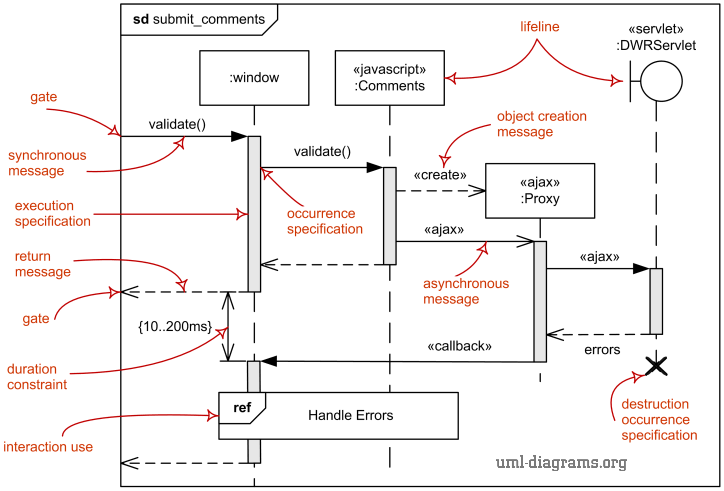

*รูปที่ 1 Lifeline, Message, Execution, Gate, Creation, Destruction, Duration Constraint และ Interaction Use — ที่มา: [UML Sequence Diagrams](https://www.uml-diagrams.org/sequence-diagrams.html), ภาพโดย Kirill Fakhroutdinov / UML-Diagrams.org*

เริ่มจากชื่อ Interaction `submit_comments` แล้วดูหัว Lifelines ได้แก่ `:window`, `:Comments`, `:Proxy` และ `:DWRServlet` จากนั้นตามข้อความจากผู้ส่งไปผู้รับ โดยอ่านเหตุการณ์บน Lifeline เดียวกันจากบนลงล่าง

ในภาพ Proxy ถูกสร้างระหว่างการทำงาน จึงเริ่ม Lifeline ต่ำกว่าตัวอื่น มีข้อความหลายชนิดและการเรียกกลับ รวมถึงกรอบ `ref Handle Errors` ที่อ้างอิง Interaction อีกชุด

ภาพใช้คำอย่าง `«ajax»`, `«callback»` และ `«servlet»` ประกอบตัวอย่างเทคโนโลยี คำเหล่านี้ไม่ใช่ Message Sort มาตรฐานที่ใช้แทน Synchronous/Asynchronous ได้โดยอัตโนมัติ ต้องอ่านชนิดลูกศรและคำอธิบายพฤติกรรมด้วย

## 3. Lifeline: ผู้เข้าร่วมหนึ่งรายในปฏิสัมพันธ์

Lifeline แทนผู้เข้าร่วมหนึ่งราย มีส่วนหัวและเส้นแนวตั้งที่แสดงการมีอยู่ของผู้เข้าร่วมใน Interaction ผู้เข้าร่วมอาจเป็น Actor, Object, ส่วนที่มีบทบาทเป็น Service หรือระบบที่กำลังมองเป็นกล่องเดียว

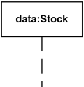

*รูปที่ 2 `data:Stock` ระบุชื่อผู้เข้าร่วมและชนิด — ที่มา: [Sequence Diagrams — Lifeline](https://www.uml-diagrams.org/sequence-diagrams.html#lifeline), ภาพโดย Kirill Fakhroutdinov / UML-Diagrams.org*

### การตั้งชื่อ

| รูปแบบ | ความหมาย |
|---|---|
| `data:Stock` | ผู้เข้าร่วมชื่อ data มีชนิด Stock |
| `:User` | ไม่ระบุชื่อเฉพาะของผู้เข้าร่วม แต่ระบุชนิด User |
| `item[k]:Item` | เลือกผู้เข้าร่วมรายหนึ่งจากส่วนที่มีหลายค่าโดย Selector |
| `self` | Object ของ Classifier ที่เป็นบริบทของ Interaction นั้น |

Lifeline ไม่ได้แปลว่า Class ทั้งชนิดกำลังส่งข้อความร่วมกันหนึ่งก้อน และเส้นหนึ่งไม่ได้แทนผู้ใช้ทุกคนพร้อมกัน หากต้องการแสดงหลายผู้เข้าร่วมให้ระบุบทบาทหรือเงื่อนไขการเลือกให้ชัด

### Actor ของ Use Case กับ Lifeline ต่างกันอย่างไร

Actor ของ Use Case ต้องอยู่นอก Subject ที่เลือก ส่วน Lifelines ใน White-box Sequence สามารถแทนส่วนภายในได้ด้วย เช่น Repository เป็น Lifeline ในภาพออกแบบได้ โดยไม่ต้องเปลี่ยนให้เป็น Actor ของระบบ

ผู้เข้าร่วมที่มีอยู่ก่อนเริ่มสถานการณ์มักวางหัวไว้ด้านบน ส่วนที่ถูกสร้างระหว่างสถานการณ์ควรเริ่มที่จุดสร้าง การสิ้นสุดหน้ากระดาษไม่ใช่การยืนยันว่า Object ถูกทำลาย

อ่านเพิ่มเติม: [Lifeline](https://www.uml-diagrams.org/sequence-diagrams.html#lifeline)

## 4. ลำดับเวลา: อ่านจากบนลงล่างอย่างมีขอบเขต

เหตุการณ์บน Lifeline เดียวกันมีลำดับตามที่แสดง และเหตุการณ์ส่งของ Message ต้องเกิดก่อนเหตุการณ์รับของ Message นั้น เมื่อรวมข้อกำหนดของการเรียก การตอบ และ Combined Fragments จึงได้ลำดับที่แบบจำลองอนุญาต

**ตำแหน่งสูง–ต่ำบนคนละ Lifeline ไม่ได้กำหนดลำดับรวมของทุกเหตุการณ์เสมอไป** โดยเฉพาะส่วนที่อิสระกันหรืออยู่ใน `par`/Weak Sequencing ต้องอ่านข้อกำหนดเฉพาะร่วมด้วย

ตัวอย่างเช่น A ส่งงานไป B และ C แบบ Asynchronous ภาพอาจแสดงการส่งไป B ก่อน C แต่ไม่ได้ทำให้สรุปว่า B ต้องทำงานเสร็จก่อน C หากไม่มีข้อความหรือข้อกำหนดเพิ่มเติม

ระยะห่างแนวตั้งไม่ได้เป็นมาตราวินาทีโดยอัตโนมัติ และการวางลูกศรระดับเดียวกันบนคนละคู่ผู้เข้าร่วมไม่ได้พิสูจน์ว่าเกิดพร้อมกันจริง หากต้องการเงื่อนไขด้านเวลา ให้ระบุ Time/Duration Constraint

Occurrence Specification คือจุดเหตุการณ์ เช่น ส่งข้อความ รับข้อความ เริ่ม Execution หรือจบ Execution ช่วยแยก “จุดที่เกิดเหตุการณ์” ออกจาก “ช่วงการดำเนินพฤติกรรม”

อ่านเพิ่มเติม: [Occurrence](https://www.uml-diagrams.org/sequence-diagrams.html#occurrence), [Interaction](https://www.uml-diagrams.org/interaction.html) และ [Combined Fragments](https://www.uml-diagrams.org/sequence-diagrams-combined-fragment.html)

## 5. Message: เลือกชนิดข้อความให้ตรงพฤติกรรม

Message แทนการสื่อสารหนึ่งรายการระหว่าง Message Ends โดยทั่วไปคือเหตุการณ์ส่งกับเหตุการณ์รับ ชื่อข้อความควรสื่อสิ่งที่ร้องขอหรือผลลัพธ์ เช่น `search(criteria)`, `reserve(copyId)` และ `reservationConfirmed(reference)`

ชื่อ Operation และ Parameters เป็นรายละเอียดที่เลือกแสดงได้ตามระดับภาพ การมีชื่อข้อความใน Diagram ยังไม่ใช่หลักฐานว่ามี Method หรือ Endpoint นั้นใน Source Code แล้ว

### 5.1 Synchronous Call และ Reply

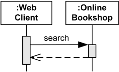

*รูปที่ 3 Web Client เรียก search และรอผลตอบกลับจาก Online Bookshop — ที่มา: [Message — Synchronous Call / Reply](https://www.uml-diagrams.org/interaction-message.html), ภาพโดย Kirill Fakhroutdinov / UML-Diagrams.org*

Synchronous Call ใช้เส้นทึบพร้อมหัวลูกศรทึบ ผู้เรียกรอให้การเรียกนั้นเสร็จก่อนดำเนินต่อในเส้นทางการเรียกนั้น ไม่ได้หมายความว่าทุก Thread หรือทุกส่วนของระบบหยุดทำงานทั้งหมด

Reply มักแสดงด้วยเส้นประและหัวลูกศรเปิด กลับจากผู้รับคำเรียกไปยังผู้เรียก อาจกำกับผลลัพธ์ เช่น `results` หรือ `reservationId` ไม่จำเป็นต้องวาด Reply ทุกอันหากเป็นผลตอบกลับที่เข้าใจได้อยู่แล้ว แต่ผลที่มีผลต่อเงื่อนไขและความถูกต้องของสถานการณ์ควรระบุ

### 5.2 Asynchronous Call และ Signal

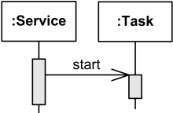

*รูปที่ 4 Service ส่ง start ไป Task โดยไม่ต้องรอให้ Task เสร็จก่อนดำเนินต่อ — ที่มา: [Message — Asynchronous Call](https://www.uml-diagrams.org/interaction-message.html), ภาพโดย Kirill Fakhroutdinov / UML-Diagrams.org*

Asynchronous Message ใช้เส้นทึบพร้อมหัวลูกศรเปิด ผู้ส่งไม่ต้องรอการสิ้นสุดของงานเพื่อดำเนินต่อ การยืนยันว่ารับคำขอแล้วกับการยืนยันว่าทำงานสำเร็จเป็นคนละผลลัพธ์กัน

- **Asynchronous Call:** การเรียก Operation แบบไม่รอการจบของการเรียก
- **Asynchronous Signal:** การส่ง Signal; ข้อมูลในข้อความสัมพันธ์กับ Attributes ของ Signal

ทั้งสองมีสัญลักษณ์คล้ายกัน ต้องอ่านสัญญาการสื่อสารประกอบ ถ้ามีผลภายหลัง ให้แสดงข้อความแจ้งผลหรือ Callback แยกตามการออกแบบ ไม่ถือว่าทุกข้อความตอบกลับภายหลังเป็น Reply ของ Synchronous Call

คำว่า HTTP, REST, AJAX, `async` ในภาษาโปรแกรม หรือ Queue เพียงอย่างเดียวไม่เพียงพอที่จะตัดสินชนิด Message ต้องอธิบายว่าผู้เข้าร่วมใดรอผลใดอยู่ในแบบจำลอง

### 5.3 สรุปชนิด Message

| ประเภท | สัญลักษณ์หรือจุดสังเกต | ความหมายหลัก |
|---|---|---|
| Synchronous Call | เส้นทึบ หัวลูกศรทึบ | เรียก Operation และรอการสิ้นสุดของการเรียก |
| Asynchronous Call / Signal | เส้นทึบ หัวลูกศรเปิด | ส่งการเรียกหรือ Signal โดยไม่ต้องรอให้งานเสร็จ |
| Reply | เส้นประ หัวลูกศรเปิด | ผลตอบกลับของ Operation Call |
| Create | เส้นประ หัวลูกศรเปิด ชี้หัว Lifeline ที่เริ่มตรงนั้น | สร้างผู้เข้าร่วมใหม่ |
| Delete | ข้อความไปยังเหตุการณ์ทำลายที่ปลาย Lifeline | ยุติ Instance ที่ Lifeline แทน |

Create กับ Reply อาจมีรูปเส้นคล้ายกัน ให้ดูจุดปลายและบริบท ส่วน Delete ไม่มีรูปหัวลูกศรเฉพาะที่เว็บไซต์รับรองเป็นมาตรฐาน จึงควรอาศัย Destruction Occurrence และคำอธิบายประกอบ

อ่านเพิ่มเติม: [Interaction Message](https://www.uml-diagrams.org/interaction-message.html)

### 5.4 Lost และ Found ไม่ใช่ชนิดเดียวกับ Sync/Async

UML แยก Message Sort เช่น Synchronous Call ออกจาก Message Kind ซึ่งพิจารณาว่ามี Send/Receive Events ในแบบจำลองหรือไม่

| Message Kind | เหตุการณ์ในแบบจำลอง | สัญลักษณ์ที่พบ |
|---|---|---|
| Complete | มีทั้งเหตุการณ์ส่งและรับ | มี Message Ends ทั้งสองด้าน |
| Lost | มีเหตุการณ์ส่ง แต่ไม่มีเหตุการณ์รับ | วงกลมทึบที่ปลายรับ |
| Found | มีเหตุการณ์รับ แต่ไม่มีเหตุการณ์ส่ง | วงกลมทึบที่ต้นทาง |

Found ใช้เมื่อแหล่งส่งอยู่นอกขอบเขตที่อธิบาย ส่วน Lost แสดงการส่งที่ไม่มีการรับใน Interaction นี้ จึงต้องมีบริบทเพิ่มก่อนสรุปว่าเป็น Packet Loss ของเครือข่ายจริง และวงกลมทึบนี้ก็ไม่ใช่ Actor คนใหม่

## 6. Execution Specification หรือ Activation

Execution Specification แสดงช่วงที่ผู้เข้าร่วมดำเนิน Behavior/Action มักวาดเป็นสี่เหลี่ยมแคบบน Lifeline มีจุดเริ่มและจุดจบ ช่วงนี้รวมการรอ Reply ได้ จึงไม่ควรอ่านว่า CPU กำลังประมวลผลตลอดทั้งแท่ง

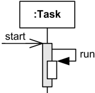

*รูปที่ 5 Task รับ start แล้วเรียก run บน Lifeline ของตนเอง — ที่มา: [Sequence Diagrams — Execution](https://www.uml-diagrams.org/sequence-diagrams.html#execution), ภาพโดย Kirill Fakhroutdinov / UML-Diagrams.org*

Self Message เป็นข้อความที่มีผู้ส่งและผู้รับบน Lifeline เดียวกัน หากเป็นการเรียกซ้อน มักแสดง Execution ซ้อนหรือเยื้องออกด้านข้าง การซ้อนแท่งไม่ได้ยืนยันว่าเป็น Thread ใหม่ และ Self Call เพียงครั้งเดียวก็ไม่ได้แปลว่าเป็น Recursion เสมอไป

สำหรับ Callback ระหว่างหลายผู้เข้าร่วม อาจมี Execution ซ้อนบน Lifeline เดิมเช่นกัน ต้องอ่านการส่งและรับจริงแทนการตัดสินจากจำนวนแท่ง Activation

อ่านเพิ่มเติม: [Execution Specification](https://www.uml-diagrams.org/sequence-diagrams.html#execution)

## 7. การสร้างและทำลายผู้เข้าร่วม

### Create Message

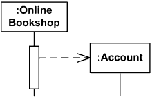

*รูปที่ 6 Account เริ่มมีอยู่เมื่อได้รับ Create Message ที่ส่วนหัว — ที่มา: [Message — Create](https://www.uml-diagrams.org/interaction-message.html), ภาพโดย Kirill Fakhroutdinov / UML-Diagrams.org*

หัว Lifeline ของผู้ถูกสร้างเริ่มที่ระดับรับ Create Message ไม่ควรวาดให้ Instance เดียวกันรับข้อความก่อนจุดสร้าง ส่วนชื่อ `create` หรือ `new` เป็นรายละเอียดที่ต้องทำให้สอดคล้องกับระดับภาพ ไม่จำเป็นต้องเท่ากับ Constructor ในภาษาใดโดยตรง

### Delete และ Destruction Occurrence

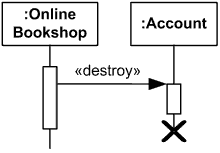

*รูปที่ 7 Online Bookshop ยุติ Account และแสดง Destruction Occurrence เป็น X — ที่มา: [Message — Delete](https://www.uml-diagrams.org/interaction-message.html), ภาพโดย Kirill Fakhroutdinov / UML-Diagrams.org*

เครื่องหมาย X ระบุการทำลาย Instance ที่ Lifeline นั้นแทน จึงไม่มีเหตุการณ์ถัดไปบน Lifeline เดียวกันหลังจุดนี้ การจบ Activation เพียงอย่างเดียวไม่ใช่การทำลาย Object

รูปใช้คำว่า `«destroy»` ซึ่งเว็บไซต์เสนอเป็นป้ายประกอบ ไม่ควรบอกว่าเป็น Stereotype มาตรฐานที่จำเป็นต้องใช้กับทุก Delete Message

การ Logout, ปิดหน้าเว็บ หรือ Delete แถวข้อมูล ไม่ได้เท่ากับทำลาย Instance ทุกชนิดเสมอไป ต้องกำหนดก่อนว่า Lifeline แทนสิ่งใดและเหตุการณ์ใดสิ้นสุดการมีอยู่ของสิ่งนั้น

## 8. Combined Fragment: กรอบที่กำหนดรูปแบบการทำงาน

Combined Fragment ใช้กรอบพร้อม Operator เช่น `alt`, `opt`, `loop` และ `par` เพื่อกำหนดวิธีรวมพฤติกรรม ภายในแบ่งเป็น Operands ด้วยเส้นประแนวนอนเมื่อมีหลายส่วน

Guard หรือ Interaction Constraint เป็นนิพจน์ Boolean ในวงเล็บเหลี่ยม เช่น `[available]` ไม่ใช่ชื่อ Message หากชื่อย่อยังคลุมเครือ ให้เขียนความหมายและช่วงที่ตรวจเงื่อนไขไว้ในคำบรรยาย

### 8.1 alt — เลือกทางเลือก

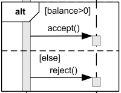

*รูปที่ 8 เลือก accept เมื่อ balance มากกว่าศูนย์ และ reject ในกรณี else — ที่มา: [Combined Fragment — Alternatives](https://www.uml-diagrams.org/sequence-diagrams-combined-fragment.html), ภาพโดย Kirill Fakhroutdinov / UML-Diagrams.org*

เลือกได้มากที่สุดหนึ่ง Operand ที่ Guard เป็นจริง `[else]` หมายถึงไม่มี Guard อื่นเป็นจริง ไม่ใช่เงื่อนไขที่ตรวจเป็นอย่างแรก

ถ้ามีหลาย Guards เป็นจริง UML ไม่ได้กำหนดให้เลือกตามลำดับบน–ล่างแบบ `if/else if` โดยอัตโนมัติ ควรเขียนเงื่อนไขให้แยกจากกันเมื่อการออกแบบต้องการทางเลือกแน่นอน

ถ้าไม่มี Guard ใดเป็นจริงและไม่มี else จะข้ามพฤติกรรมของกรอบแล้วทำส่วนถัดไป ส่วน Operand ที่ไม่เขียน Guard มี Guard จริงโดยปริยาย จึงควรตรวจว่าตรงเจตนาหรือไม่

### 8.2 opt — มีส่วนทำงานหรือไม่ทำ

`opt` มีหนึ่ง Operand ใช้อธิบายพฤติกรรมที่เลือกให้เกิดหรือไม่เกิด เช่น `[requestReceipt]` แล้วส่งใบเสร็จ หากเงื่อนไขไม่เป็นจริงจะข้ามส่วนในกรอบและทำต่อ

ในทางความหมายใกล้เคียง `alt` ที่มีทางหนึ่งทำงานและอีกทางว่าง ไม่ได้หมายความว่ามีสองเส้นทางให้เลือกหลายแบบภายใน opt เดียว

อ่านเพิ่มเติม: [Combined Fragments](https://www.uml-diagrams.org/sequence-diagrams-combined-fragment.html)

## 9. loop และ break

### 9.1 loop — การทำซ้ำ

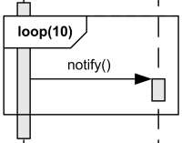

*รูปที่ 9 `loop(10)` ทำพฤติกรรม notify ซ้ำสิบครั้ง — ที่มา: [Combined Fragment — Loop](https://www.uml-diagrams.org/sequence-diagrams-combined-fragment.html), ภาพโดย Kirill Fakhroutdinov / UML-Diagrams.org*

Loop มีหนึ่ง Operand ที่ทำซ้ำได้ ระบุขอบเขตจำนวนรอบและ Guard ประกอบได้ เช่น `loop(10)` ในภาพกำหนดจำนวนรอบแน่นอน ส่วน `loop [hasNextItem]` สื่อการทำซ้ำตามเงื่อนไขที่ต้องอธิบายการเปลี่ยนค่าให้เข้าใจ

Guard ควรเป็นสิ่งที่ตรวจได้ เช่น ยังมีรายการถัดไปหรือยังไม่เกินจำนวนครั้งที่กำหนด หากเป็นการลองใหม่ ให้ระบุด้วยว่าความพยายามครั้งแรกนับรวมในจำนวนครั้งทั้งหมดหรือไม่ และจะหยุดเมื่อใด

เว็บไซต์อภิปรายความกำกวมของการใช้ Lower/Upper Bounds ร่วมกับ Guard ในข้อกำหนด UML รุ่นเก่า โน้ตนี้จึงใช้ภาพจำนวนรอบคงที่เป็นตัวอย่างพื้นฐาน ถ้าภาพจริงใช้ทั้งจำนวนรอบขั้นต่ำและเงื่อนไขหยุด ต้องเขียนนโยบายการทำซ้ำให้ชัดและตรวจตามรุ่นมาตรฐาน/เครื่องมือที่เลือก

### 9.2 break — ใช้สถานการณ์นี้แทนส่วนที่เหลือ

เมื่อ Guard ของ `break` เป็นจริง ให้ทำ Operand ของ break แทนส่วนที่เหลือของ Interaction Fragment ที่ครอบอยู่โดยตรง หาก Guard เป็นเท็จให้ข้าม Operand ของ break และทำส่วนถัดไปตามปกติ

`break` จึงไม่ได้เท่ากับคำสั่งออกจาก Loop ที่ใกล้ที่สุดในทุกกรณี และไม่ได้ยุติทุก Interaction ที่ซ้อนอยู่ทั้งหมดโดยอัตโนมัติ ต้องตรวจว่ากรอบใดครอบมันโดยตรง

ควรให้ break ครอบคลุม Lifelines ของบริบทที่ต้องยุติและระบุ Guard ชัดเจน หากไม่ใส่ Guard มาตรฐานให้ทางเลือกแบบไม่กำหนดแน่นอนระหว่าง break กับส่วนที่เหลือ ซึ่งมักไม่เหมาะกับเอกสารที่ต้องการอธิบายเหตุผลการหยุดงาน

อ่านเพิ่มเติม: [Loop and Break](https://www.uml-diagrams.org/sequence-diagrams-combined-fragment.html) และ [OMG UML Metamodel — InteractionOperatorKind](https://www.omg.org/spec/UML/20161101/UML.xmi)

## 10. par, seq, strict และ critical

### 10.1 par — งานที่สลับเหตุการณ์กันได้

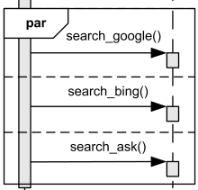

*รูปที่ 10 Operands ของการค้นหา Google, Bing และ Ask อาจสลับเหตุการณ์กันหรือเกิดขนานกัน — ที่มา: [Combined Fragment — Parallel](https://www.uml-diagrams.org/sequence-diagrams-combined-fragment.html), ภาพโดย Kirill Fakhroutdinov / UML-Diagrams.org*

`par` อนุญาตให้เหตุการณ์จากต่าง Operands สลับกันได้ โดยยังคงรักษาลำดับที่แต่ละ Operand กำหนดไว้ ขอบเขตนี้ไม่ได้รับรองว่าเริ่มพร้อมกัน เสร็จพร้อมกัน หรือมีหลาย CPU/Threads

ถ้างานถัดไปต้องใช้ผลจากทุก Operand ให้วาดส่วนที่ต้องใช้ผลไว้หลังกรอบพร้อมทำให้เห็นการสิ้นสุดงานที่เกี่ยวข้อง ไม่ควรใช้เพียงชื่อ par เพื่อสมมติว่าระบบมีการรอผลครบหรือมีการจัดการ Timeout แล้ว

**Coregion** เป็นรูปย่อสำหรับกรณีที่ลำดับของเหตุการณ์บน Lifeline หนึ่งไม่สำคัญ ใช้วงเล็บแนวตั้ง/เส้นขอบกำกับบริเวณนั้น และพิจารณาส่วนที่บรรจุเป็น Operands ที่อาจสลับกันได้ ดูตัวอย่างจริงในหัวข้อร้านหนังสือ

### 10.2 seq กับ strict

| Operator | ข้อกำหนดด้านลำดับ |
|---|---|
| `seq` — Weak Sequencing | รักษาลำดับภายในแต่ละ Operand; บน Lifeline เดียวกัน เหตุการณ์ของ Operand ก่อนอยู่ก่อน Operand ถัดไป; เหตุการณ์ของคนละ Lifeline จากต่าง Operands อาจสลับกันได้ |
| `strict` — Strict Sequencing | กำหนดลำดับระหว่าง Operands ระดับแรกของกรอบอย่างเคร่งครัด ก่อนดำเนิน Operand ถัดไป |

ดังนั้น seq ไม่ใช่ข้อกำหนดว่าทุกเหตุการณ์ใน Operand แรกต้องจบก่อนเหตุการณ์ใด ๆ ของ Operand ถัดไปบนทุก Lifeline และ strict ก็ไม่ได้ลบกฎภายใน Combined Fragments ที่ซ้อนอยู่

### 10.3 critical — ไม่ให้เหตุการณ์อื่นแทรกในขอบเขตนั้น

`critical` กำหนดว่าช่วงพฤติกรรมนี้ไม่ถูกสลับแทรกด้วยเหตุการณ์อื่นบน Lifelines ที่กรอบครอบคลุม เป็นข้อกำหนดด้าน Traces ของแบบจำลอง

กรอบนี้ไม่ได้สร้าง Lock, Transaction หรือ Isolation Level ให้ระบบจริง การออกแบบและทดสอบกลไกที่ทำให้ข้อกำหนดนั้นเป็นจริงต้องมีหลักฐานเพิ่มเติม และไม่ได้รับรองคุณสมบัติ ACID ทุกข้อโดยอัตโนมัติ

อ่านเพิ่มเติม: [Parallel, Sequencing and Critical Region](https://www.uml-diagrams.org/sequence-diagrams-combined-fragment.html)

## 11. ref และ Gate: แยกปฏิสัมพันธ์ที่ใช้ซ้ำ

Interaction Use เป็นการอ้างอิง Interaction อีกชุด แสดงด้วยกรอบ `ref` เพื่อย่อรายละเอียดหรือใช้พฤติกรรมเดียวกันในหลายสถานการณ์ แม้รูปกรอบคล้าย Combined Fragment แต่ `ref` ไม่ใช่ค่าใน InteractionOperatorKind เช่น alt หรือ loop

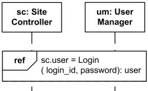

*รูปที่ 11 Site Controller และ User Manager ใช้ Interaction Login พร้อมข้อมูลเข้าและผลที่นำไปเก็บใน sc.user — ที่มา: [Sequence Diagrams — Interaction Use](https://www.uml-diagrams.org/sequence-diagrams.html#interaction-use), ภาพโดย Kirill Fakhroutdinov / UML-Diagrams.org*

ในภาพ `Login(login_id, password): user` ระบุ Interaction ที่อ้างอิง Arguments และผลลัพธ์ ส่วน `sc.user =` แสดงตำแหน่งที่รับผลลัพธ์ในตัวอย่าง ชื่อและค่าเหล่านี้เป็นสัญลักษณ์ของแบบจำลอง ไม่ใช่ข้อมูลรับรองจริง

### Gate คืออะไร

Gate เป็น Message End บนขอบกรอบ ใช้เชื่อมข้อความนอกกรอบกับข้อความภายใน เช่น `validate()` ที่เข้ากรอบในรูปที่ 1

- Interaction ที่ถูกอ้างอิงมี Formal Gates
- Interaction Use มี Actual Gates ที่ต้องจับคู่ให้สอดคล้องกัน
- การผูก Parameters และการจับคู่ผู้เข้าร่วมต้องตรงกับ Interaction ที่ถูกอ้างอิง

Gate ไม่ใช่ UML Port ของ Component Diagram และไม่ใช่ API Gateway เสมอไป การอ้างอิง ref ควรมีภาพหรือคำอธิบายปลายทางที่ผู้อ่านตามต่อได้ ส่วน ref ไม่ได้มีความหมายเท่ากับ Use Case `«include»` โดยตรง

อ่านเพิ่มเติม: [Interaction Use](https://www.uml-diagrams.org/sequence-diagrams.html#interaction-use) และ [Gate](https://www.uml-diagrams.org/sequence-diagrams.html)

## 12. State Invariant, เวลา และ Operators สำหรับตรวจพฤติกรรม

### State Invariant ต่างจาก Guard อย่างไร

State Invariant เป็นข้อกำหนดสถานะ ณ ตำแหน่งบน Lifeline เช่น `{status = confirmed}` หรือสัญลักษณ์สถานะ มักประเมินก่อนเหตุการณ์ถัดไปที่เกี่ยวข้อง หากข้อกำหนดเป็นเท็จ Trace นั้นไม่ถูกต้องตามที่ระบุ

Guard ของ alt/opt ใช้เลือกพฤติกรรม ส่วน State Invariant ใช้กำหนดว่าพฤติกรรมที่ตำแหน่งนั้นต้องสอดคล้องกับสถานะใด จึงไม่ควรใช้แทนกันโดยไม่อธิบาย

### Time และ Duration Constraints

เงื่อนไขเวลาควรระบุหน่วยและเหตุการณ์ต้น–ปลายที่ใช้วัด รูปที่ 1 มี `{10..200ms}` ผูกกับช่วงระหว่างเหตุการณ์ที่แสดง เป็นข้อกำหนดระยะเวลาในตัวอย่าง ไม่ใช่ค่าที่อนุมานจากความสูงของรูป

หากกำหนดว่า “แสดงผลภายใน 2 วินาที” ต้องระบุว่าเริ่มนับจากผู้ใช้ยืนยันคำขอ จาก Server รับคำขอ หรือจากจุดอื่น และจบเมื่อใด โดยเฉพาะระบบที่ส่งเพียง Acknowledgment ก่อนผลจริง

### neg, assert, ignore และ consider

| Operator | ความหมายที่ใช้ตรวจพฤติกรรม |
|---|---|
| `neg` | ระบุ Traces ที่ไม่ถูกต้องตามแบบจำลอง |
| `assert` | กำหนดว่าลำดับใน Operand เป็น Continuations ที่ถูกต้อง ส่วน Continuations อื่นไม่ถูกต้องในขอบเขตนั้น |
| `ignore` | ระบุชนิดข้อความที่ไม่นำมาพิจารณาในขอบเขตนี้ |
| `consider` | ระบุข้อความที่นำมาพิจารณา โดยละข้อความอื่น |

การ ignore ไม่ได้แปลว่าระบบจริงไม่ต้องจัดการข้อความนั้น และการ neg พฤติกรรมหนึ่งไม่ได้พิสูจน์ว่าทุกพฤติกรรมอื่นถูกต้อง Interaction อาจมีทั้ง Traces ที่ถูกต้อง ไม่ถูกต้อง และ Traces ที่ไม่ได้ระบุไว้

อ่านเพิ่มเติม: [State Invariant](https://www.uml-diagrams.org/sequence-diagrams.html#state-invariant), [Combined Fragments](https://www.uml-diagrams.org/sequence-diagrams-combined-fragment.html) และ [Interaction / Traces](https://www.uml-diagrams.org/interaction.html)

## 13. อ่านตัวอย่างร้านหนังสือจากเว็บไซต์อย่างละเอียด

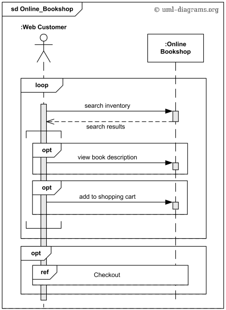

*รูปที่ 12 Online Bookshop ใช้ loop, opt, Coregion และ ref — ที่มา: [Online Shopping UML Sequence Diagram Example](https://www.uml-diagrams.org/online-shopping-uml-sequence-diagram-example.html), ภาพโดย Kirill Fakhroutdinov / UML-Diagrams.org*

### สิ่งที่อ่านได้จากรูป

1. **ขอบเขต:** `sd Online_Bookshop` อธิบาย Interaction ระดับสูงระหว่าง Web Customer กับ Online Bookshop โดยยังไม่เปิด Services ภายใน
2. **การค้นหา:** ลูกค้าส่ง `search inventory` และได้รับ `search results` กลับมา
3. **การทำซ้ำ:** กรอบ loop ครอบการค้นหาและพฤติกรรมที่เกี่ยวข้อง แสดงว่าบริเวณนี้ทำซ้ำได้ แต่ภาพไม่ได้ระบุจำนวนรอบหรือ Guard อย่างละเอียด
4. **ทางเลือก:** มี opt สำหรับดูรายละเอียดหนังสือและเพิ่มเข้าตะกร้า ภาพไม่ระบุเงื่อนไขทางธุรกิจครบ ต้องเขียนคำบรรยายเพิ่มหากจะใช้เป็นข้อกำหนด
5. **Coregion:** สัญลักษณ์วงเล็บยาวบน Lifeline ฝั่งลูกค้าครอบสอง opt แสดงการไม่บังคับลำดับระหว่างส่วนเหล่านี้ จึงไม่ควรสรุปว่าต้องดูรายละเอียดก่อนเพิ่มเข้าตะกร้าเสมอ
6. **Checkout:** หลังส่วน loop มี opt ที่อ้างอิง `ref Checkout` รายละเอียดขั้นตอนชำระเงินถูกแยกไปยัง Interaction อื่น

### สิ่งที่รูปยังไม่ได้กำหนด

ภาพนี้ไม่ได้ระบุ HTTP Endpoints, Class ของตะกร้า, การเก็บข้อมูล หรือเงื่อนไข Checkout ว่าต้องมีสินค้าเท่าใด รวมถึงไม่ได้แสดงการชำระเงินไม่สำเร็จ จึงควรใช้เป็นตัวอย่างการอ่านสัญลักษณ์และระดับรายละเอียด มากกว่าคัดลอกเป็นแบบออกแบบระบบจริงโดยไม่เพิ่มเติม

## 14. จาก Use Case ไปเป็น Sequence: ตัวอย่างจองหนังสือ

ตัวอย่างนี้ **เรียบเรียงขึ้นใหม่สำหรับระบบห้องสมุดสมมติ** โดยอ้างต่อจาก UC-LIB-01 ใน [โน้ต Use Case Diagram](Use%20Case%20Diagram%20-%20UML.md) ไม่ใช่ภาพหรือข้อกำหนดจาก UML-Diagrams.org และไม่ได้ยืนยันว่ามีระบบนี้ Implement แล้ว

### กำหนดสถานการณ์ก่อน

- Use Case: จองหนังสือ
- Scenario: สมาชิกยืนยันการจองสำเนาที่ยังพร้อมให้จอง
- Preconditions: เข้าสู่ระบบแล้ว บัญชีใช้ได้ และเลือกหนังสือที่อ้างอิงได้
- Success Postcondition: มีรายการจองที่ยืนยันแล้ว พร้อมหมายเลขอ้างอิงและกำหนดเวลารับ

ภาพนี้เลือกเริ่มที่ **การยืนยันคำขอ** จึงไม่แสดงการค้นหาและแสดงรายละเอียดก่อนหน้า เป้าหมายนี้เป็นหนึ่ง Scenario ภายใน Use Case เดียว ไม่จำเป็นต้องยัดทุก Scenario ลงภาพเดียว

### ผู้เข้าร่วมที่เลือกสำหรับภาพออกแบบ

| Lifeline สมมติ | หน้าที่ใน Scenario |
|---|---|
| สมาชิก | ผู้ยืนยันคำขอและรับผล |
| `ui:ReservationPage` | รับการยืนยันและแสดงผลลัพธ์ |
| `service:ReservationService` | ประสานกฎการจองและจัดการผล |
| `policy:MemberPolicy` | ตรวจสิทธิ์และโควตาของสมาชิก |
| `repository:ReservationRepository` | ยืนยันการจองตามกฎความพร้อมของสำเนาและโควตา ณ จุดยืนยัน |

Service, Policy และ Repository เป็นข้อเสนอการแบ่งหน้าที่ในตัวอย่างนี้ ไม่ใช่กฎว่า Sequence Diagram ทุกภาพต้องมีสามชั้นนี้ และไม่ทำให้ส่วนภายในเหล่านี้กลายเป็น Actors ของ Use Case

### ลำดับข้อความกรณีสำเร็จ

| ขั้น | ผู้ส่ง → ผู้รับ | ข้อความ / ผลลัพธ์ | ความหมาย |
|---|---|---|---|
| 1 | สมาชิก → UI | ยืนยันการจอง | เริ่ม Scenario นี้ |
| 2 | UI → Service | `reserve(memberId, copyId)` | ส่งคำขอในบริบทของสมาชิกที่ยืนยันตัวตนแล้ว |
| 3 | Service → Policy | `checkEligibility(memberId)` | ตรวจสิทธิ์และจำนวนรายการจอง |
| 4 | Policy → Service | `eligible` | คืนผลตรวจสิทธิ์ |
| 5 | Service → Repository | `tryConfirmReservation(memberId, copyId)` | ขอให้ยืนยันการจองโดยคงกฎไม่จองสำเนาซ้ำและไม่เกินโควตา |
| 6 | Repository → Service | `confirmed(reference, pickupDeadline)` | ยืนยันผลการสร้างรายการจอง |
| 7 | Service → UI | `reservationConfirmed(reference, pickupDeadline)` | คืนผลสำเร็จหลังการยืนยันแล้ว |
| 8 | UI → สมาชิก | แสดงหมายเลขอ้างอิงและกำหนดเวลารับ | ผู้ใช้ได้รับผลตามเป้าหมาย |

ในตัวอย่างนี้การเรียก Policy และ Repository เป็น Synchronous Calls และผลตอบกลับเป็น Replies การแสดงผลสำเร็จเกิดหลังได้รับการยืนยันจาก Repository การตรวจ Policy ก่อนหน้าไม่แทนการคงกฎ ณ จุดยืนยันเมื่อมีคำขออื่นเปลี่ยนข้อมูลระหว่างทาง ส่วนวิธีบังคับกฎเหล่านี้ต้องอธิบายและทดสอบในเอกสารออกแบบเพิ่มเติม

### เพิ่ม Alternative และ Exception Scenarios

| สถานการณ์ | การแสดงใน Sequence ที่เหมาะสม | ผลที่ต้องรักษา |
|---|---|---|
| Policy คืนค่าไม่ผ่าน | alt `[eligible]` / `[else]` หรือภาพแยก | ไม่เรียกยืนยันการจอง และแจ้งเหตุผล |
| สำเนาไม่พร้อมเมื่อยืนยัน | alt ตามผลของ Repository | ไม่ส่งผลสำเร็จและไม่มีรายการจองที่ขัดกฎ |
| ยังไม่ทราบผลการยืนยัน | แสดงผลไม่แน่นอน/สถานะรอตรวจสอบตามข้อกำหนด | ไม่กล่าวอ้างว่าไม่มีรายการเกิดขึ้นหรือว่าสำเร็จโดยไม่มีหลักฐาน |
| สมาชิกยกเลิกก่อนส่งคำขอ | แสดงทางเลือกก่อน Message ไป Service | ไม่เกิดคำขอจอง |

หากคำขอถูกส่งไปแล้ว การกด Cancel ที่ UI ไม่ได้ยืนยันว่า Service ยกเลิกสำเร็จ ต้องมีข้อความและผลลัพธ์รองรับการยกเลิกตามการออกแบบจริง

## 15. ข้อผิดพลาด, Timeout และการตอบรับงาน

Sequence Diagram แสดงความผิดพลาดผ่าน Messages, Guards, alt, break และ State Invariants ได้ แต่ UML ไม่มีกรอบ `try/catch` มาตรฐานที่แมปตรงกับภาษาโปรแกรมทุกภาษา หากใช้ป้ายอย่าง `«exception»` ต้องอธิบายว่าเป็น Convention หรือ Profile ที่เลือก

**Timeout ของผู้เรียกไม่ได้พิสูจน์ว่าผู้รับไม่ทำงานสำเร็จ** ผู้รับอาจทำรายการเสร็จแล้วแต่ผู้เรียกยังไม่ได้รับผล การออกแบบจึงควรแยก “ทราบว่าปฏิเสธ/ล้มเหลว” ออกจาก “ยังไม่ทราบผล” ตามชนิดงาน

เช่นเดียวกัน Acknowledgment ว่ารับงานเข้าคิวแล้วไม่ใช่ Final Result หากออกแบบงาน Asynchronous ควรแสดงว่าจะติดตามผลผ่าน Event, Callback, Polling หรือวิธีใด พร้อมกรณีที่ไม่ได้รับผล

การระบุ Error Message ในภาพไม่ได้รับรองว่ามีการจัดการข้อผิดพลาดนั้นใน Source Code ต้องเชื่อมกับข้อกำหนดและผลทดสอบเมื่อนำไปใช้เป็นหลักฐานโครงการ

อ่านเพิ่มเติม: [Sequence Diagrams — Questions & Answers](https://www.uml-diagrams.org/sequence-diagrams-questions-answers.html)

## 16. วิธีเริ่มเขียน Sequence Diagram ของตนเอง

1. **เลือก Use Case และ Scenario:** ระบุเป้าหมาย Trigger จุดเริ่ม จุดจบ และเงื่อนไขก่อนเริ่ม
2. **เลือกระดับภาพ:** จะมองระบบเป็นกล่องเดียวหรือเปิดส่วนภายใน ไม่จำเป็นต้องใช้ทุก Class
3. **หา Lifelines:** ใครส่งข้อมูล ใครรับผิดชอบตัดสินใจ ใครเก็บหรือยืนยันผล
4. **เขียน Messages กรณีสำเร็จ:** ระบุข้อมูลที่จำเป็นและผลลัพธ์สำคัญให้สอดคล้องกับหน้าที่
5. **เลือกชนิดข้อความ:** ผู้ส่งต้องรอการจบของงานหรือไม่ ผลที่กลับมาเป็น Reply, Acknowledgment หรือผลภายหลัง
6. **เพิ่ม Lifecycle และ Execution:** ระบุ Create/Delete เฉพาะเมื่อเกี่ยวข้อง และอย่าอ่าน Activation เป็น CPU Time
7. **เพิ่มเงื่อนไขและการทำซ้ำ:** ใช้ alt/opt/loop หรือแยกภาพเมื่อข้อมูลเริ่มแน่น
8. **ตรวจข้อกำหนดลำดับ:** มีเหตุการณ์ที่สลับกันได้หรือสิ่งที่ต้องรอจริงหรือไม่ เลือก par/strict/critical เฉพาะที่มีเหตุผล
9. **แยกรายละเอียดที่ใช้ซ้ำ:** ใช้ ref พร้อมชื่อ Parameters และจุดเชื่อมที่ตามกลับได้
10. **ตรวจกรณีไม่สำเร็จ:** ข้อมูลไม่ผ่าน ผลไม่แน่นอน Timeout และการยกเลิกมีผลอย่างไร
11. **เทียบกับ Use Case และแบบออกแบบ:** ข้อความและหน้าที่ตรงกับเป้าหมาย Interface และความรับผิดชอบที่กำหนดหรือไม่

ไม่จำเป็นต้องใส่เลขลำดับ Message ทุกเส้น เพราะภาพมีลำดับบน Lifelines อยู่แล้ว ถ้าต้องอ้างอิงในคำบรรยาย สามารถกำหนดเลขหรือรหัส Message อย่างสม่ำเสมอได้

## 17. ข้อผิดพลาดที่พบบ่อยและวิธีปรับ

| ข้อผิดพลาด | ทำให้เข้าใจคลาดเคลื่อนอย่างไร | วิธีปรับ |
|---|---|---|
| สรุปทุกเหตุการณ์จากความสูงของรูป | คิดว่ามีลำดับรวมเดียวบนทุก Lifeline | อ่านลำดับต่อ Lifeline, Send/Receive และ Operators ร่วมกัน |
| ใช้ความสูงของ Activation เป็นเวลา | เข้าใจว่าเป็นผลวัด Performance | ระบุ Constraint และจุดเริ่ม–จบที่ใช้วัด |
| ใช้หัวลูกศรเหมือนกันทุก Message | ไม่ทราบว่าผู้ส่งต้องรอหรือไม่ | แยก Sync, Async และ Reply ตามพฤติกรรม |
| วาด Reply เป็นคำเรียกใหม่โดยไม่มีเหตุผล | เข้าใจผลตอบกลับเป็นงานอีกคำขอ | ใช้เส้น Reply หรืออธิบาย Event/Callback ให้ตรงสัญญา |
| วาด Object รับข้อความก่อน Create | Lifecycle ไม่สอดคล้องกัน | เริ่มหัว Lifeline ที่จุดสร้าง |
| มีเหตุการณ์หลัง X บน Lifeline เดิม | Object ทำงานหลังถูกทำลาย | ทบทวนจุดทำลายหรือใช้ Instance ใหม่ |
| ใช้ alt เหมือน if/else if โดย Guard ซ้อนกัน | สมมติลำดับความสำคัญที่ UML ไม่ได้กำหนด | ทำ Guards ให้แยกกันหรือระบุข้อกำหนดเพิ่ม |
| อ่าน par ว่าเริ่มและจบพร้อมกัน | อ้างการ Synchronize หรือหลาย Threads เกินภาพ | ระบุ Message และจุดรอผลตามการออกแบบ |
| อ่าน break ว่าออกจากทุกกรอบ | ทิ้งขอบเขตพฤติกรรมผิดระดับ | ตรวจ Fragment ที่ครอบโดยตรงและ Guard |
| ใช้ critical แล้วถือว่ามี Transaction แล้ว | สับสนข้อกำหนดกับหลักฐานการ Implement | ระบุกลไกและการทดสอบแยก |
| วาดทุกสถานการณ์ในภาพเดียว | ไม่เห็นเป้าหมายและเหตุผลของทางเลือก | แยกตาม Scenario และใช้ ref ตามจำเป็น |
| Timeout แล้วแสดงว่าล้มเหลวแน่นอน | อาจขัดกับผลจริงที่ผู้รับทำเสร็จแล้ว | แยกผลไม่แน่นอนและวิธีตรวจผล |

## 18. แยกจาก Diagram อื่นและข้อสังเกตจากแหล่งอ้างอิง

| Diagram | คำถามหลัก |
|---|---|
| Use Case | ระบบให้บริการอะไรแก่บทบาทภายนอก |
| Sequence | ผู้เข้าร่วมแลกเปลี่ยนข้อความและมีข้อกำหนดลำดับอย่างไรใน Scenario |
| Activity | กระบวนงาน ทางเลือก และการไหลของงานเป็นอย่างไร |
| State Machine | สิ่งหนึ่งเปลี่ยนสถานะจากเหตุการณ์อย่างไร |
| Component | ส่วนซอฟต์แวร์มีหน้าที่และสัญญาการเชื่อมต่ออะไร |
| Communication | ผู้เข้าร่วมเชื่อมกันและแลกเปลี่ยนข้อความอะไร โดยเน้นโครงสร้างการติดต่อ |

Communication Diagram ใช้อธิบาย Interaction เช่นกัน แต่ภาพ Sequence ที่มี Combined Fragments, Interaction Uses หรือข้อกำหนดลำดับซับซ้อนอาจแปลงเป็น Communication Diagram โดยรักษาความหมายทั้งหมดไม่ได้ตรง ๆ

### ประเด็นที่ต้องอ่านเว็บไซต์อย่างระมัดระวัง

- หน้าเว็บมีทั้งคำอธิบายมาตรฐาน ตัวอย่าง และข้อวิจารณ์ของผู้เขียน โดยกล่าวถึง UML หลายรุ่น จึงไม่ควรถือทุกประโยคเป็นข้อกำหนดของรุ่นเดียวกัน
- คำว่า `ref` ใช้สัญลักษณ์กรอบแบบอ้างอิง Interaction; ชนิดแบบจำลองคือ InteractionUse ไม่ใช่ CombinedFragment ที่มี Operator ชื่อ ref
- หน้า Combined Fragments มีคำอธิบายประกอบภาพ seq ที่อาจทำให้สับสนกับ strict ให้ยึดนิยาม Weak Sequencing และอ่านข้อความในหัวข้อนั้นประกอบ
- เรื่อง Loop Bounds กับ Guard มีข้ออภิปรายของ UML รุ่นเก่า จึงควรเขียนเงื่อนไขหยุดให้ชัดเจนแทนการใช้ภาพย่อแล้วคาดว่าผู้อ่านจะตีความตรงกัน
- หน้า neg มีข้อความสรุปกว้างกว่าหน้า Interaction; โน้ตนี้ยึดการแยก Valid, Invalid และ Traces ที่ยังไม่ได้ระบุ ตามคำอธิบาย Interaction
- คำอย่าง `«destroy»`, `«ajax»` และ `«callback»` ในตัวอย่างต้องอ่านเป็นป้ายประกอบตามบริบท ไม่เพิ่มให้เป็น Message Sort มาตรฐานเอง

อ่านต่อใน Vault: [Use Case Diagram](Use%20Case%20Diagram%20-%20UML.md), [Component Diagram](Component%20based%20Diagram%20-%20UML.md) และ [Activity Diagram](Activity%20Diagram.md)

## 19. รายการตรวจทานก่อนนำไปใช้

- [ ] ชื่อ Interaction, Scenario, Preconditions และผลลัพธ์ที่ต้องการชัดเจน
- [ ] Lifelines แทนผู้เข้าร่วมตามระดับของภาพ และมีหน้าที่สอดคล้องกัน
- [ ] ไม่สรุปลำดับรวมจากแนวตั้งหรือระยะเวลาจากระยะห่างโดยไม่มีข้อกำหนด
- [ ] ชนิดและทิศทาง Message ตรงกับการรอผลจริงในแบบจำลอง
- [ ] แยก Reply, Acknowledgment และ Final Result ได้
- [ ] Execution, Create และ Destruction สอดคล้องกับ Lifecycle
- [ ] Guards ของ alt/opt และนโยบายการวนซ้ำไม่กำกวม
- [ ] break อ้างขอบเขตที่ครอบโดยตรง และ par ไม่ถูกใช้แทนข้อรับรองเรื่อง Thread
- [ ] ขอบเขต critical, State Invariants และ Constraints มีความหมายที่ตรวจสอบได้
- [ ] ref มี Interaction ปลายทางและการผูก Parameters/ผู้เข้าร่วมที่สอดคล้องกัน
- [ ] มีทางเลือก ความผิดพลาด หรือผลไม่แน่นอนที่สำคัญตาม Use Case
- [ ] แยกภาพออกแบบ ตัวอย่างสมมติ และสิ่งที่ Implement/Tested แล้ว
- [ ] ภาพและคำอธิบายมีเครดิตและแหล่งอ้างอิงที่ตามกลับได้

การตรวจทานโน้ตนี้ครอบคลุมการอ่านภาพต้นฉบับทุกภาพ เทียบทิศทางและหัวลูกศรกับคำอธิบาย และตรวจชนิด Message, Lifeline, ExecutionSpecification, InteractionUse, CombinedFragment, InteractionOperatorKind และ StateInvariant กับ Normative Metamodel ของ OMG UML 2.5.1 อีกครั้ง

## 20. เอกสารอ้างอิง

ตรวจสอบแหล่งอ้างอิงและดาวน์โหลดภาพเมื่อ 22 ตุลาคม 2569 ยึด UML-Diagrams.org เป็นแหล่งอธิบายและภาพหลัก และใช้ OMG ตรวจความหมายเพิ่มเติม

1. Kirill Fakhroutdinov. [UML Sequence Diagrams](https://www.uml-diagrams.org/sequence-diagrams.html).
2. Kirill Fakhroutdinov. [Interaction](https://www.uml-diagrams.org/interaction.html).
3. Kirill Fakhroutdinov. [Interaction Message](https://www.uml-diagrams.org/interaction-message.html).
4. Kirill Fakhroutdinov. [Sequence Diagrams — Combined Fragment](https://www.uml-diagrams.org/sequence-diagrams-combined-fragment.html).
5. Kirill Fakhroutdinov. [Online Shopping UML Sequence Diagram Example](https://www.uml-diagrams.org/online-shopping-uml-sequence-diagram-example.html).
6. Kirill Fakhroutdinov. [Sequence Diagrams — Questions & Answers](https://www.uml-diagrams.org/sequence-diagrams-questions-answers.html).
7. Object Management Group. [Unified Modeling Language, Version 2.5.1](https://www.omg.org/spec/UML/2.5.1) และ [Normative UML Metamodel](https://www.omg.org/spec/UML/20161101/UML.xmi).
