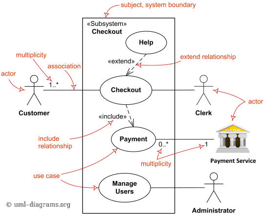
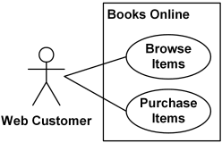
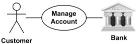
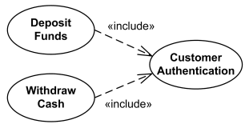
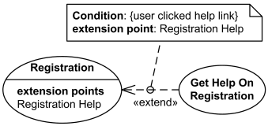
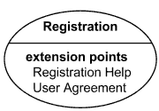
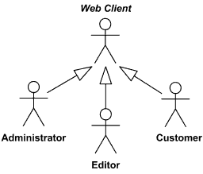
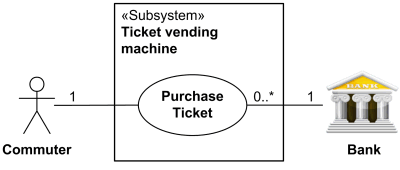

# UML Use Case Diagram — คู่มืออ่านและเขียนอย่างละเอียด

> แหล่งอ้างอิงหลัก: [UML-Diagrams.org — UML Use Case Diagrams](https://www.uml-diagrams.org/use-case-diagrams.html) และหน้ารายละเอียดในเว็บไซต์เดียวกัน
>
> ผู้เขียนแหล่งอ้างอิงและภาพ: Kirill Fakhroutdinov / UML-Diagrams.org
>
> วันที่เรียบเรียงและตรวจทาน: 22 ตุลาคม 2569 (2026-10-22)

โน้ตนี้เรียบเรียงคำอธิบายภาษาไทยเพื่อให้เริ่มอ่าน Use Case Diagram และนำไปเขียนเอกสารความต้องการของระบบได้ มีภาพต้นฉบับจากเว็บไซต์พร้อมคำอธิบาย และตัวอย่างคำบรรยาย Use Case ที่สร้างขึ้นสำหรับการเรียนรู้โดยเฉพาะ

ภาพทั้ง 8 ภาพเก็บไว้ใน `Img/UML-Use-Case-Diagram/` พร้อม [รายการเครดิตและ URL ต้นฉบับ](../../Img/UML-Use-Case-Diagram/README.md) ส่วนประเด็นที่เว็บไซต์มีคำอธิบายต่างกันตามรุ่นหรือมีข้อเสนอของผู้เขียน จะระบุแยกจากความหมายที่ตรวจสอบกับ OMG UML 2.5.1

## 1. Use Case Diagram ใช้ตอบคำถามอะไร

Use Case Diagram ช่วยตอบว่า **ระบบที่กำลังศึกษาให้บริการอะไรแก่ผู้ที่ติดต่อกับระบบ และผู้ติดต่อเหล่านั้นมีบทบาทอะไร** โดยมองจากผลที่สังเกตได้ภายนอก

ตัวอย่างเช่น ระบบจำหน่ายตั๋วให้ผู้โดยสารซื้อตั๋วได้ การซื้อสำเร็จทำให้ผู้โดยสารได้รับตั๋วตามเงื่อนไขที่กำหนด การระบุเป้าหมายนี้ยังไม่จำเป็นต้องตัดสินว่าระบบใช้ภาษาใด มีกี่ Service หรือเก็บข้อมูลในฐานข้อมูลแบบใด

Use Case ที่เป็นเป้าหมายหลักควรให้ผลที่มีคุณค่าแก่ Actor หรือ Stakeholder ส่วนพฤติกรรมที่แยกมาเพื่อ Include หรือ Extend อาจเป็นเพียงส่วนประกอบของเป้าหมายหลัก จึงไม่ควรบังคับให้ทุกวงรีเป็นเป้าหมายที่ผู้ใช้เริ่มทำโดยลำพังได้

### Diagram กับ Use Case Description ต่างกันอย่างไร

| สิ่งที่จัดทำ | หน้าที่ |
|---|---|
| Use Case Diagram | แสดง Subject, Actors, Use Cases และความสัมพันธ์ เพื่อให้เห็นขอบเขตและภาพรวม |
| Use Case Description / Specification | บรรยายเป้าหมาย เงื่อนไข ลำดับปฏิสัมพันธ์ ทางเลือก ข้อผิดพลาด และผลลัพธ์ของ Use Case หนึ่งเรื่อง |

วงรีชื่อ `ซื้อตั๋ว` ทำให้รู้ว่ามีบริการนี้ แต่ยังไม่บอกว่าจ่ายเงินไม่สำเร็จแล้วเกิดอะไรขึ้น จึงควรมีคำบรรยายประกอบ Use Case สำคัญ

อ่านเพิ่มเติม: [Use Case Diagrams](https://www.uml-diagrams.org/use-case-diagrams.html), [Use Case](https://www.uml-diagrams.org/use-case.html) และ [FAQ](https://www.uml-diagrams.org/use-case-diagrams-questions-answers.html)

## 2. องค์ประกอบหลักและวิธีอ่านภาพรวม

*รูปที่ 1 Subject, Actors, Use Cases, Association, Include, Extend และ Multiplicity — ที่มา: [UML Use Case Diagrams](https://www.uml-diagrams.org/use-case-diagrams.html), ภาพโดย Kirill Fakhroutdinov / UML-Diagrams.org*

เริ่มอ่านภาพจากกรอบ `Checkout` ซึ่งเป็น Subject ภายในมี Use Cases เช่น `Checkout`, `Payment` และ `Manage Users` ส่วน Customer, Clerk, Payment Service และ Administrator อยู่ภายนอกกรอบ

เส้นทึบเชื่อม Actor กับ Use Case แสดงการมีปฏิสัมพันธ์ ลูกศร `«include»` จาก Checkout ไป Payment แสดงการนำพฤติกรรม Payment มาใช้ ส่วน `«extend»` จาก Help ไป Checkout แสดงการเพิ่มพฤติกรรม Help เข้าใน Checkout

แม้ Subject กับ Use Case หนึ่งจะมีชื่อ Checkout เหมือนกัน ทั้งสองมีหน้าที่ต่างกัน: กรอบกำหนดขอบเขตที่ศึกษา ส่วนวงรีระบุพฤติกรรมหนึ่งของ Subject นั้น

| องค์ประกอบ | สัญลักษณ์ที่พบทั่วไป | คำถามที่ใช้ตรวจความเข้าใจ |
|---|---|---|
| Subject / System Boundary | กรอบสี่เหลี่ยมพร้อมชื่อ | กำลังศึกษาอะไร และขอบเขตอยู่ตรงไหน |
| Actor | รูปคน หรือกรอบ `«actor»` | ใครหรือระบบภายนอกใดติดต่อกับ Subject |
| Use Case | วงรีพร้อมชื่อ | Subject ทำอะไรที่มีผลต่อ Actor หรือ Stakeholder |
| Association | เส้นทึบระหว่าง Actor–Use Case | บทบาทนี้มีปฏิสัมพันธ์กับบริการใด |
| Include | เส้นประหัวลูกศรเปิดพร้อม `«include»` | พฤติกรรมใดถูกนำมารวมในอีก Use Case |
| Extend | เส้นประหัวลูกศรเปิดพร้อม `«extend»` | พฤติกรรมใดเพิ่มเข้าใน Use Case หลัก ณ จุดที่กำหนด |
| Generalization | เส้นทึบหัวสามเหลี่ยมโปร่ง | บทบาทหรือ Use Case ใดเป็นกรณีเฉพาะของอีกตัวหนึ่ง |

## 3. Subject: กำหนดขอบเขตก่อนหา Actor

Subject คือสิ่งที่กำลังวิเคราะห์ เช่น ธุรกิจทั้งองค์กร ระบบซอฟต์แวร์ อุปกรณ์ Subsystem หรือ Component ใช้กรอบสี่เหลี่ยมพร้อมชื่อ โดยวาง Use Cases ที่เกี่ยวข้องภายในและ Actors ภายนอก

*รูปที่ 2 Books Online เป็น Subject; Browse Items และ Purchase Items เป็น Use Cases ที่ใช้กับ Subject นี้ — ที่มา: [Use Case Subject](https://www.uml-diagrams.org/use-case-subject.html), ภาพโดย Kirill Fakhroutdinov / UML-Diagrams.org*

ในภาพ Web Customer อยู่นอก Books Online และใช้บริการเรียกดูหรือซื้อสินค้า กรอบนี้แสดงขอบเขตหน้าที่ของระบบ ไม่ได้หมายถึงกรอบหน้าจอ เว็บเพจ หรือขอบเครือข่าย

### ทำไมขอบเขตเปลี่ยนแล้ว Actor เปลี่ยน

ถ้ากำลังวิเคราะห์ **ธุรกิจร้านอาหารทั้งร้าน** พนักงานเสิร์ฟเป็นส่วนหนึ่งของธุรกิจ แต่ถ้ากำลังวิเคราะห์ **แอปพลิเคชันรับรายการอาหาร** พนักงานเสิร์ฟอาจเป็น Actor ที่ใช้งานแอปได้

ดังนั้น “ภายนอก” หมายถึงภายนอก Subject ที่เลือก ไม่ได้หมายความว่าบุคคลนั้นต้องอยู่นอกบริษัท

สำหรับฐานข้อมูล API หรือ Scheduler ให้ใช้หลักเดียวกัน: ถ้าเป็นส่วนที่อยู่ภายใน Subject ก็เป็นรายละเอียดภายใน ถ้าเป็นระบบภายนอกที่ติดต่อกันจริงอาจเป็น Actor ได้ อย่าตัดสินจากชื่อเทคโนโลยีเพียงอย่างเดียว

### รายละเอียดที่ควรรู้

- UML 2.5 ระบุชื่อ Subject บริเวณมุมซ้ายบนของกรอบ
- วงรีที่อยู่ในกรอบบอกว่า Use Case นั้นใช้กับ Subject นี้ ไม่ได้ยืนยันความเป็นเจ้าของ Use Case ในแบบจำลองโดยอัตโนมัติ
- Use Case เดียวอาจใช้กับหลาย Subjects ได้ แต่ภาพสำหรับเริ่มต้นควรมีขอบเขตชัดเจนและอ่านง่ายก่อน

อ่านเพิ่มเติม: [Use Case Subject](https://www.uml-diagrams.org/use-case-subject.html)

## 4. Actor: บทบาทของสิ่งที่ติดต่อกับระบบ

Actor คือบทบาทของผู้ใช้หรือระบบอื่นที่มีปฏิสัมพันธ์กับ Subject อาจเป็นมนุษย์ ซอฟต์แวร์ หรืออุปกรณ์ภายนอก ชื่อ Actor ควรบอกบทบาท เช่น `ลูกค้า`, `เจ้าหน้าที่`, `ผู้ดูแลระบบ` หรือ `บริการชำระเงิน`

คนหนึ่งสามารถสวมหลายบทบาทได้ และคนหลายคนสามารถสวมบทบาทเดียวกันได้ ตัวอย่างเช่นบุคคลเดียวอาจเป็นทั้งผู้ซื้อและผู้ดูแลร้าน จึงไม่ควรสร้าง Actor เป็นชื่อบุคคลแต่ละคน

### วิธีหา Actor

พิจารณาว่าใครต้องการผลลัพธ์จาก Subject ใครส่งข้อมูลให้ ใครรับผลลัพธ์ และมีระบบภายนอกใดร่วมให้บริการ ขณะเดียวกันต้องตรวจว่าบทบาทเหล่านั้นอยู่นอกขอบเขตที่เลือกจริง

Actor ไม่จำเป็นต้องเป็นผู้เริ่มงานเสมอไป บางบทบาทเข้ามาสนับสนุนระหว่างดำเนิน Use Case และ UML 2.5 ไม่บังคับว่าทุก Use Case ต้องเริ่มโดย Actor

### Primary และ Supporting Actor

ในงานวิเคราะห์มักเรียกผู้มีเป้าหมายหลักว่า Primary Actor และเรียกระบบหรือบทบาทที่ร่วมให้บริการว่า Supporting Actor คำแบ่งนี้เป็นแนวทางเขียนคำบรรยาย ไม่ใช่ชุดสัญลักษณ์มาตรฐานที่ต้องใส่ใน UML Diagram

การวาง Primary Actor ไว้ด้านซ้ายและ Supporting Actor ไว้ด้านขวาเป็นธรรมเนียมช่วยจัดภาพ หากต้องการยืนยันว่าใครเริ่มงาน ให้ระบุใน Trigger และ Main Flow เพิ่มเติม

อ่านเพิ่มเติม: [Actor](https://www.uml-diagrams.org/use-case-actor.html) และ [Actor–Use Case Association](https://www.uml-diagrams.org/use-case-actor-association.html)

## 5. Use Case: ตั้งชื่อจากเป้าหมายและผลลัพธ์

Use Case อธิบายชุดการกระทำของ Subject ที่ทำให้เกิดผลที่สังเกตได้และมีคุณค่าต่อ Actor หรือ Stakeholder ใช้ชื่อที่สื่อการกระทำ เช่น `ค้นหาหนังสือ`, `จองหนังสือ`, `โอนเงิน` หรือ `จัดการบัญชีผู้ใช้`

แนวทาง “คำกริยา + สิ่งที่ทำ” ช่วยให้ชื่ออ่านชัดเจน แต่เป็นคำแนะนำในการเขียน ไม่ใช่รูปประโยคที่ UML บังคับ

| ชื่อที่กว้างหรือผูกกับหน้าจอ | ชื่อที่ช่วยอธิบายเป้าหมายได้ชัดขึ้น |
|---|---|
| หน้า Search | ค้นหาหนังสือ |
| ปุ่ม Save | บันทึกข้อมูลสมาชิก |
| ระบบรายงาน | ดูรายงานการยืมคืน |
| กรอก Username | เข้าสู่ระบบ โดยการกรอก Username เป็นขั้นตอนหนึ่ง |

Use Case ไม่จำเป็นต้องตรงกับหนึ่งหน้า หนึ่งปุ่ม หนึ่ง API หรือหนึ่ง Function การซื้อตั๋วอาจผ่านหลายหน้า ขณะที่หน้าเดียวอาจให้บริการหลาย Use Cases ได้

### ระดับรายละเอียดต้องสอดคล้องกัน

เริ่มจากเป้าหมายระดับที่ Actor เข้าใจ เช่น `ยืมหนังสือ` แล้วจึงอธิบายการตรวจสมาชิกและตรวจสิทธิ์เป็นขั้นตอนหรือพฤติกรรมที่ใช้ร่วมกัน หลีกเลี่ยงการวาง `บริหารห้องสมุด` กับ `กดปุ่มยืนยัน` เป็นวงรีระดับเดียวกันโดยไม่อธิบายระดับของภาพ

คำว่า `จัดการสมาชิก` อาจใช้เป็นชื่อภาพรวมได้ หากต้องประเมินขอบเขต สิทธิ์ หรือกรณีทดสอบแยก ควรแยก `เพิ่มสมาชิก`, `แก้ไขสมาชิก` และ `ระงับสมาชิก` ตามความจำเป็น ไม่มีกฎว่าต้องแตก CRUD ทุกกรณี

อ่านเพิ่มเติม: [Use Case — Naming and Notation](https://www.uml-diagrams.org/use-case.html)

## 6. Association: การมีปฏิสัมพันธ์ ไม่ใช่ลำดับงาน

*รูปที่ 3 Manage Account มีทั้ง Customer และ Bank ที่เกี่ยวข้อง — ที่มา: [Association Between Actor and Use Case](https://www.uml-diagrams.org/use-case-actor-association.html), ภาพโดย Kirill Fakhroutdinov / UML-Diagrams.org*

เส้นระหว่าง Actor กับ Use Case แสดงว่ามีการติดต่อหรือสื่อสารกัน Actor หนึ่งเชื่อมหลาย Use Cases ได้ และ Use Case หนึ่งมีหลาย Actors ได้

จากรูปเพียงอย่างเดียวยังสรุปไม่ได้ว่า Customer หรือ Bank เป็นผู้เริ่มงาน และไม่ทราบลำดับการรับส่งข้อมูล ปกติจึงใช้เส้นทึบที่ไม่มีหัวลูกศร และเขียนผู้เริ่มงานกับปฏิสัมพันธ์ในคำบรรยายแทน

อย่าใช้เส้น Actor–Use Case เป็นหลักฐานว่าระบบบังคับสิทธิ์แล้ว หากกำลังออกแบบ RBAC ยังต้องมีข้อกำหนดสิทธิ์และเกณฑ์ตรวจสอบแยกด้วย

### Multiplicity อ่านอย่างไร

Multiplicity ที่ปลาย Actor บอกจำนวน Actor Instances ที่มีส่วนร่วม ส่วนค่าที่ปลาย Use Case เกี่ยวกับจำนวนการมีส่วนร่วมใน Use Cases ชนิดนั้น ค่าที่พบบ่อยคือ `1`, `0..1`, `0..*` และ `1..*`

ตัวอย่างเช่น `0..1` ที่ปลายบริการชำระเงินอาจหมายความว่าบริการนั้นเข้าร่วมหรือไม่ก็ได้ตามกรณี แต่ต้องมีคำบรรยายอธิบายเงื่อนไขให้ชัด

Multiplicity ไม่ได้กำหนดเองว่าปฏิสัมพันธ์เกิดพร้อมกันหรือคนละเวลา อย่าอ่าน `0..*` เป็นจำนวน Requests พร้อมกันที่ระบบรองรับ หากกำลังเขียนภาพระดับเริ่มต้น สามารถละ Multiplicity ที่ไม่ช่วยสื่อความต้องการได้

อ่านเพิ่มเติม: [Actor–Use Case Association](https://www.uml-diagrams.org/use-case-actor-association.html)

## 7. Include: นำพฤติกรรมอีก Use Case มาใช้

Include แสดงว่าพฤติกรรมของ Use Case หนึ่งถูกนำไปรวมอยู่ในพฤติกรรมของอีก Use Case ใช้แยกส่วนที่ใช้ร่วมกัน หรือจัดพฤติกรรมที่มีขนาดใหญ่ให้ดูแลได้ง่ายขึ้น

*รูปที่ 4 การฝากและถอนเงินใช้ Customer Authentication ร่วมกัน — ที่มา: [Use Case Include](https://www.uml-diagrams.org/use-case-include.html), ภาพโดย Kirill Fakhroutdinov / UML-Diagrams.org*

ทิศทางลูกศรเป็น **Including Use Case → Included Use Case** ใช้เส้นประหัวลูกศรเปิดและคำว่า `«include»` ดังนั้นในภาพลูกศรเริ่มจาก Deposit Funds/Withdraw Cash ไปยัง Customer Authentication

เมื่อการทำงานมาถึงส่วนที่ Include พฤติกรรมที่นำเข้ามาเป็นส่วนที่ต้องทำ ไม่ใช่พฤติกรรมเสริมที่เลือกข้ามเองตามความหมายของ Extend ส่วนลำดับ จุดที่เรียกใช้ และกรณีทางเลือกต้องอธิบายในคำบรรยายพฤติกรรม

UML ไม่มี Inclusion Point หรือ Condition เป็นคุณสมบัติเฉพาะของ Include แบบเดียวกับ Extend จึงไม่ควรคิดค้นสัญลักษณ์เงื่อนไขบนเส้น Include แล้วถือว่าเป็นมาตรฐาน UML

### ใช้ Include เมื่อใด

ตัวอย่างสมมติ: `ยืมหนังสือ` และ `จองหนังสือ` ใช้พฤติกรรม `ตรวจสิทธิ์สมาชิก` ร่วมกัน หากการตรวจมีรายละเอียดมากและต้องการใช้คำบรรยายเดียวกัน อาจแยกเป็น Included Use Case

ถ้ามีเพียงขั้นตอนสั้น ๆ ที่ใช้ครั้งเดียว การเขียนไว้ใน Main Flow ก็เพียงพอ ไม่จำเป็นต้องสร้างวงรีให้ทุกขั้นตอนเพื่อให้ภาพดูละเอียด

### Login ควรเป็น Include เสมอหรือไม่

ถ้าผู้ใช้เข้าสู่ระบบไว้แล้วก่อนเริ่มงาน ให้ระบุ `ผู้ใช้มี Session ที่ใช้งานได้` เป็น Precondition ของงานนั้น การเพิ่ม `«include» Login` ให้ทุก Use Case จะสื่อว่าต้องทำพฤติกรรม Login ระหว่างงานทุกครั้ง ซึ่งอาจไม่ตรงความต้องการ

ภาพ ATM เป็นตัวอย่างเฉพาะของพฤติกรรม Authentication ที่ใช้ร่วมกัน ไม่ใช่กฎว่าทุกระบบต้องวาด Login แบบเดียวกัน

อ่านเพิ่มเติม: [Use Case Include](https://www.uml-diagrams.org/use-case-include.html)

## 8. Extend: เพิ่มพฤติกรรม ณ จุดที่กำหนด

Extend ระบุว่าพฤติกรรมของ Extending Use Case จะเพิ่มเข้าใน Extended หรือ Base Use Case อย่างไรและเมื่อใด โดย Base Use Case ต้องมีความหมายได้ด้วยตนเองโดยไม่ต้องอาศัยส่วนขยายนั้น

*รูปที่ 5 Get Help On Registration ขยาย Registration เมื่อผู้ใช้เลือก Help ณ Registration Help — ที่มา: [Use Case Extend](https://www.uml-diagrams.org/use-case-extend.html), ภาพโดย Kirill Fakhroutdinov / UML-Diagrams.org*

ทิศทางลูกศรเป็น **Extending Use Case → Base Use Case** ดังนั้นลูกศรจาก Get Help On Registration ชี้ไป Registration ใช้เส้นประหัวลูกศรเปิดพร้อม `«extend»`

Registration ทำงานได้โดยผู้ใช้ไม่ขอความช่วยเหลือ เมื่อผู้ใช้เลือก Help และการทำงานถึงจุด Registration Help จึงเพิ่มพฤติกรรมช่วยเหลือตามเงื่อนไขที่แสดง

### Extension Point อยู่ที่ไหน

Extension Point เป็นจุดที่ระบุไว้ในพฤติกรรมของ **Base Use Case** ชื่อต้องไม่ซ้ำกันภายใน Use Case นั้น สามารถแสดงในช่อง `extension points` ของวงรีหรือเขียนในคำบรรยายโดยอ้างอิงให้ตรงกับ Extend ได้

*รูปที่ 6 Registration มี Extension Points ชื่อ Registration Help และ User Agreement — ที่มา: [Use Case Extend — Extension Point](https://www.uml-diagrams.org/use-case-extend.html), ภาพโดย Kirill Fakhroutdinov / UML-Diagrams.org*

ชื่อ Extension Point ควรทำให้ตามกลับได้ว่าอยู่ตรงขั้นตอนหรือสถานะใด การใส่เพียงชื่อโดยไม่มีคำอธิบายตำแหน่งอาจทำให้ผู้อ่านยังไม่ทราบว่าเกิดการขยายตอนไหน

### Extend ไม่ได้แปลว่าเลือกทำหรือไม่ทำได้เสมอ

ความสัมพันธ์ Extend อาจมี Condition กำกับ หากไม่มี Condition ตาม OMG UML 2.5.1 การขยายเป็นแบบไม่มีเงื่อนไขเมื่อถึง Extension Point ที่กำหนด จึงไม่ควรจำเพียงว่า `extend = optional` แล้วละรายละเอียดเสมอไป

จุดสำคัญคือ Base Use Case นิยามได้โดยเป็นอิสระจากส่วนขยาย และความสัมพันธ์ระบุจุดที่เพิ่มพฤติกรรม ส่วนการขยายจะเกิดในสถานการณ์ใดต้องอ่าน Condition และพฤติกรรมประกอบ

อ่านเพิ่มเติม: [Use Case Extend](https://www.uml-diagrams.org/use-case-extend.html) และ [OMG UML Metamodel — Extend](https://www.omg.org/spec/UML/20161101/UML.xmi)

## 9. Generalization: บทบาทหรือ Use Case ที่เฉพาะขึ้น

Generalization แสดงความสัมพันธ์ระหว่างตัวทั่วไปกับตัวที่เฉพาะกว่า ใช้เส้นทึบพร้อมหัวสามเหลี่ยมโปร่ง ชี้ **จากตัวเฉพาะไปยังตัวทั่วไป**

### Actor Generalization

*รูปที่ 7 Actor เฉพาะชี้ไปยัง Web Client ที่เป็น Actor ทั่วไป; ชื่อตัวเอียงแสดง Abstract Actor — ที่มา: [Actor — Relationships Between Actors](https://www.uml-diagrams.org/use-case-actor.html), ภาพโดย Kirill Fakhroutdinov / UML-Diagrams.org*

ในภาพ Administrator, Editor และ Customer เป็นกรณีเฉพาะของ Web Client ความสัมพันธ์นี้ใช้สื่อคุณสมบัติและความสัมพันธ์ที่สืบทอดจากบทบาททั่วไป รวมถึงการมีปฏิสัมพันธ์ที่กำหนดไว้กับบทบาทนั้น

ใช้เมื่อตัวเฉพาะสามารถทำหน้าที่เป็นบทบาททั่วไปได้จริง อย่าสร้าง `Administrator → Operator → Viewer` เพียงเพราะตำแหน่งดูมีสิทธิ์มากกว่า หากบทบาทเหล่านั้นไม่ได้รับการออกแบบให้แทนที่กันได้

### Use Case Generalization

Use Case ที่เฉพาะกว่าอาจสืบทอดและปรับพฤติกรรมจาก Use Case ทั่วไป เช่น Use Case สมมติ `ชำระเงินด้วยบัตร` และ `ชำระเงินด้วยเงินสด` เป็นกรณีเฉพาะของ `ชำระเงิน`

อย่างไรก็ตาม ไม่จำเป็นต้องใช้ Generalization กับทุกทางเลือกของการทำงาน วิธีชำระเงินอาจอธิบายเป็น Alternative Flows ของ Use Case เดียวได้ ถ้าตัวเลือกนั้นยังไม่จำเป็นต้องแยกเป็นแบบจำลองต่างหาก

Generalization ไม่ใช่การบอกว่างานใดเกิดก่อน และไม่ใช่การแยกส่วนประกอบของงานแบบ Include

อ่านเพิ่มเติม: [Actor](https://www.uml-diagrams.org/use-case-actor.html) และ [Use Case — Generalization](https://www.uml-diagrams.org/use-case.html)

## 10. เปรียบเทียบ Include, Extend และ Generalization

| ประเด็น | Include | Extend | Generalization |
|---|---|---|---|
| แนวคิดหลัก | นำพฤติกรรมหนึ่งมารวมในอีก Use Case | เพิ่มพฤติกรรมเข้าใน Base ณ Extension Point | นิยามกรณีเฉพาะของบทบาทหรือ Use Case ทั่วไป |
| ทิศทาง | Including → Included | Extending → Base | Specific → General |
| ลักษณะเส้น | เส้นประ หัวลูกศรเปิด `«include»` | เส้นประ หัวลูกศรเปิด `«extend»` | เส้นทึบ หัวสามเหลี่ยมโปร่ง |
| จุดที่ระบุเฉพาะใน UML | ไม่มี Inclusion Point แบบ Extend | มี Extension Point ใน Base | ไม่มี Extension Point |
| เรื่องเงื่อนไข | ไม่มี Condition เป็นคุณสมบัติเฉพาะของ Include | มี Condition ได้; ไม่กำหนดหมายถึง Unconditional | ใช้ความหมายการเป็นกรณีเฉพาะ ไม่ใช่ Guard ของลำดับงาน |
| ตัวอย่าง | ฝากเงิน Include การยืนยันตัวตน | Help ขยาย Registration | Administrator เป็น Web Client ชนิดหนึ่ง |

ก่อนเลือกความสัมพันธ์ ให้ถามตามลำดับ: ต้องแยกเป็น Use Case อีกตัวจริงหรือไม่ ถ้าต้องแยก เป็นพฤติกรรมที่นำมาใช้ร่วมกัน เป็นส่วนขยายของงานที่มีความหมายอยู่แล้ว หรือเป็นกรณีเฉพาะของแนวคิดเดียวกัน

ถ้ายังอธิบายเหตุผลไม่ได้ ให้เขียน Main/Alternative Flows ก่อน แล้วค่อยตัดสินใจว่าภาพต้องมีความสัมพันธ์เพิ่มเติมหรือไม่

## 11. อ่านตัวอย่างซื้อตั๋วตั้งแต่ต้นจนจบ

*รูปที่ 8 Ticket Vending Machine มี Purchase Ticket พร้อม Commuter และ Bank — ที่มา: [How to Draw UML Use Case Diagram](https://www.uml-diagrams.org/use-case-diagrams-how-to.html), ภาพโดย Kirill Fakhroutdinov / UML-Diagrams.org*

1. **Subject:** Ticket vending machine เป็นอุปกรณ์ที่อยู่ในขอบเขตการศึกษา
2. **Actor ที่มีเป้าหมาย:** Commuter ต้องการตั๋วเดินทาง จึงมี Use Case Purchase Ticket
3. **Actor ที่ร่วมให้บริการ:** Bank ติดต่อกับการซื้อตั๋วตามแบบจำลองนี้ แต่ Bank อยู่นอกกรอบเครื่องจำหน่ายตั๋ว
4. **สิ่งที่ภาพยืนยัน:** ระบบมีบริการซื้อตั๋ว และมีปฏิสัมพันธ์กับสองบทบาทที่แสดง
5. **สิ่งที่ต้องเขียนเพิ่ม:** วิธีเลือกตั๋ว วิธีชำระเงิน กรณีธนาคารปฏิเสธ กรณีออกตั๋วไม่ได้ และวิธีจัดการผลลัพธ์

ภาพระบุ Multiplicity `1` ที่ปลาย Bank จึงเป็นแบบจำลองที่กำหนดให้ Bank เข้าร่วม หากระบบที่ออกแบบรับเงินสดโดยไม่ติดต่อธนาคาร ต้องทบทวนการมีส่วนร่วมของ Bank และคำบรรยายให้ตรงกับขอบเขตของตน ไม่ควรคัดลอกภาพแล้วสมมติว่าตรงกับทุกระบบ

## 12. ตัวอย่าง Use Case Description แบบละเอียด

ตัวอย่างต่อไปนี้ **เรียบเรียงขึ้นใหม่เพื่อสาธิตการเขียนคำบรรยาย** โดยใช้ระบบห้องสมุดสมมติ ไม่ใช่ข้อกำหนดจากภาพหรือระบบตัวอย่างของ UML-Diagrams.org

รูปแบบช่องข้อมูลเป็น Template สำหรับใช้งานจริง UML ไม่ได้บังคับว่าทุกโครงการต้องมีชื่อช่องเหมือนกันทั้งหมด

### UC-LIB-01: จองหนังสือ

| หัวข้อ | รายละเอียด |
|---|---|
| Subject | ระบบบริการสมาชิกห้องสมุด |
| เป้าหมาย | สมาชิกได้รับการยืนยันการจองสำเนาหนังสือที่พร้อมให้จอง |
| Primary Actor | สมาชิกห้องสมุด |
| Supporting Actor | ไม่มีระบบภายนอกในขอบเขตตัวอย่างนี้ |
| Trigger | สมาชิกเลือกรายการหนังสือและขอจอง |
| Preconditions | สมาชิกเข้าสู่ระบบแล้ว บัญชีใช้งานได้ และมีรายการหนังสือที่อ้างอิงได้ |
| Success Postconditions | มีรายการจองของสมาชิก พร้อมหมายเลขอ้างอิงและกำหนดเวลารับหนังสือ |
| Minimal Guarantee | การทำงานที่ล้มเหลวไม่ทำให้เกิดรายการจองที่ขัดกับนโยบาย และไม่แสดงข้อความว่าสำเร็จเมื่อยังไม่ยืนยันผล |
| กฎสมมติ | สมาชิกมีรายการจองที่ยังไม่สิ้นสุดได้ไม่เกิน 3 รายการ; สำเนาหนังสือหนึ่งเล่มมีการจองที่ใช้งานได้พร้อมกันไม่เกินหนึ่งรายการ |

### Main Success Flow

1. สมาชิกขอจองหนังสือจากรายการที่เลือก
2. ระบบแสดงชื่อหนังสือ สำเนาที่จองได้ สถานที่รับ และข้อกำหนดการจอง
3. สมาชิกยืนยันคำขอ
4. ระบบตรวจสิทธิ์และจำนวนรายการจองที่ยังไม่สิ้นสุดของสมาชิก
5. ระบบตรวจว่าสำเนาที่เลือกยังพร้อมให้จอง
6. ระบบยืนยันการสร้างรายการจองตามกฎที่กำหนด
7. ระบบแสดงหมายเลขอ้างอิง สถานที่รับ และกำหนดเวลารับหนังสือแก่สมาชิก

แต่ละขั้นระบุผู้กระทำและผลที่เกี่ยวข้องกับเป้าหมาย หลีกเลี่ยงการผูกกับตำแหน่งปุ่ม ชื่อ Endpoint หรือคำสั่งฐานข้อมูล ซึ่งควรอธิบายในเอกสารออกแบบเมื่อจำเป็น

### Alternative และ Exception Flows

| จุดเริ่ม | สถานการณ์ | พฤติกรรมและผลลัพธ์ |
|---|---|---|
| ขั้น 3 | สมาชิกยกเลิก | จบ Use Case โดยไม่มีรายการจองใหม่ |
| ขั้น 4 | สมาชิกครบโควตา | ระบบแจ้งเหตุผลและไม่สร้างรายการจอง |
| ขั้น 4 | บัญชีหมดสิทธิ์ระหว่างทำรายการ | ระบบปฏิเสธคำขอและแจ้งให้ติดต่อเจ้าหน้าที่ |
| ขั้น 5 | สำเนาไม่พร้อมให้จองแล้ว | ระบบแจ้งว่าสำเนาไม่ว่างและให้เลือกสำเนาอื่น ถ้ามี |
| ขั้น 6 | อีกคำขอได้รับการยืนยันก่อน | ระบบไม่ยืนยันรายการที่ขัดกับกฎ และแจ้งให้เลือกใหม่ |
| ขั้น 6 | ระบบไม่สามารถยืนยันการสร้างรายการ | ระบบแจ้งว่ายังไม่สำเร็จ และไม่แสดงหมายเลขอ้างอิงเป็นผลสำเร็จ |

Alternative Flow เป็นเส้นทางอื่นที่อาจจบสำเร็จหรือยกเลิกได้ ส่วน Exception Flow ใช้อธิบายความผิดปกติ การแบ่งชื่อสองกลุ่มอาจต่างกันตาม Template แต่ต้องเขียนผลลัพธ์ให้แน่นอน

กรณีผิดพลาดทุกกรณีไม่จำเป็นต้องแยกเป็น Extending Use Case หากเป็นเพียงทางแยกหรือการปฏิเสธของงานเดียว การบรรยายในตารางนี้อาจชัดเจนกว่า

### การเชื่อมคำบรรยายกลับไปยัง Diagram

ภาพพื้นฐานเชื่อม Actor `สมาชิกห้องสมุด` กับ Use Case `จองหนังสือ` ได้โดยตรง ส่วน `เข้าสู่ระบบแล้ว` เป็น Precondition ตามตัวอย่าง จึงไม่เพิ่ม Include Login

หากหลายงานใช้ `ตรวจสิทธิ์สมาชิก` ร่วมกันและต้องการแยกคำบรรยาย อาจเพิ่ม `จองหนังสือ «include» ตรวจสิทธิ์สมาชิก` โดยต้องทำให้รายละเอียดใน Main Flow และ Use Case ที่นำมาใช้สอดคล้องกัน

## 13. จากคำบรรยายไปสู่กรณีทดสอบ

Use Case ช่วยระบุสถานการณ์ทดสอบ แต่ Diagram เพียงอย่างเดียวไม่ได้ให้เกณฑ์ตรวจครบ ต้องใช้ Preconditions, Flows, Postconditions และกฎประกอบ

| รหัสทดสอบตัวอย่าง | สถานการณ์ที่อ้างอิง | ผลที่ต้องตรวจ |
|---|---|---|
| TC-LIB-01 | Main Flow ครบทุกขั้น | มีรายการจอง หมายเลขอ้างอิง และกำหนดเวลารับ |
| TC-LIB-02 | สมาชิกครบโควตา | แจ้งเหตุผลและไม่มีรายการจองเพิ่ม |
| TC-LIB-03 | สำเนาถูกจองก่อนยืนยัน | ไม่มีการยืนยันที่ขัดกับกฎของสำเนาเดียวกัน |
| TC-LIB-04 | ไม่สามารถยืนยันการสร้างรายการ | ไม่รายงานผลสำเร็จและไม่สร้างผลลัพธ์ที่ขัดกับ Minimal Guarantee |

ตัวอย่างเหล่านี้เป็นข้อเสนอการทดสอบสำหรับระบบสมมติ ยังไม่มีการ Implement หรือรันทดสอบระบบห้องสมุดในโน้ตนี้

## 14. วิธีเริ่มเขียน Use Case ของระบบตนเอง

1. **กำหนด Subject:** ตั้งชื่อระบบและเขียนว่าครอบคลุมอะไร เพื่อใช้ตัดสินภายใน–ภายนอก
2. **หา Actors:** ระบุบทบาทของผู้ใช้ ระบบ และอุปกรณ์ภายนอกที่มีปฏิสัมพันธ์จริง
3. **หาเป้าหมาย:** ถามว่าแต่ละบทบาทต้องการผลลัพธ์อะไรจาก Subject
4. **ตั้งชื่อ Use Cases:** ใช้ชื่อการกระทำที่สื่อผลลัพธ์ และรักษาระดับรายละเอียดของภาพ
5. **เชื่อม Association:** เชื่อมเฉพาะบทบาทที่มีส่วนร่วม ไม่ใช้เส้นเพื่อบอกลำดับงาน
6. **เขียนคำบรรยาย:** เริ่มจากเป้าหมาย Trigger, Main Flow และ Postconditions แล้วเติมทางเลือกกับข้อผิดพลาด
7. **ทบทวนความสัมพันธ์:** เพิ่ม Include, Extend หรือ Generalization เมื่อมีเหตุผลจากพฤติกรรมที่เขียนแล้ว
8. **ตรวจขอบเขตกับผู้เกี่ยวข้อง:** ใช้ภาพและคำบรรยายถามว่าบริการใดขาด เกิน หรือมีความหมายไม่ตรงกัน
9. **เชื่อมกับข้อกำหนดและการทดสอบ:** ใช้รหัส Use Case อ้างกลับไปยัง Requirement และ Test Scenario

ลำดับนี้ปรับใช้จากแนวทาง Subject → Actors → Use Cases → Describe Behaviors ของ [How to Draw UML Use Case Diagram](https://www.uml-diagrams.org/use-case-diagrams-how-to.html) โดยเพิ่มขั้นตรวจทานและการตามรอยข้อกำหนดสำหรับเอกสารโครงการ

## 15. ข้อผิดพลาดที่พบบ่อยและวิธีแก้

| ข้อผิดพลาด | ผลที่ทำให้เข้าใจคลาดเคลื่อน | วิธีปรับ |
|---|---|---|
| เริ่มวาด Actor ก่อนกำหนด Subject | ไม่ทราบว่าอะไรอยู่ภายในหรือภายนอก | ระบุชื่อและขอบเขตระบบก่อน |
| ใส่ฐานข้อมูลภายในเป็น Actor ทุกครั้ง | ปะปนโครงสร้างภายในกับผู้ติดต่อภายนอก | ตรวจขอบเขตและย้ายรายละเอียดโครงสร้างไป Diagram ที่เหมาะสม |
| วาดทุกปุ่มเป็น Use Case | ภาพสะท้อนหน้าจอแทนเป้าหมาย | รวมเป็นงานที่ให้ผลลัพธ์และบรรยายปุ่มเป็นขั้นตอนเมื่อจำเป็น |
| เชื่อม Use Cases เป็นลูกศรต่อกันตามเวลา | อ่านเป็น Workflow แทน Use Case Model | ใช้ Activity/Sequence Diagram อธิบายลำดับ |
| กลับทิศ Include | อ่านว่า Use Case ที่ใช้ร่วมกันเรียกงานหลัก | ชี้จาก Including ไป Included |
| กลับทิศ Extend | อ่านว่างานหลักเป็นส่วนขยาย | ชี้จาก Extending ไป Base |
| อธิบาย Extend ว่า Optional เสมอ | ไม่ทราบกรณีไม่มี Condition | ระบุ Extension Point และตรวจ Condition/Unconditional |
| ใส่ Extension Point ไว้ในส่วนขยาย | ระบุจุดรับพฤติกรรมผิดฝั่ง | จุดเป็นของ Base Use Case |
| Include Login ให้ทุกงาน | สื่อว่าต้องทำ Login ระหว่างงานแต่ละครั้ง | ตรวจว่าเป็น Precondition หรือพฤติกรรมที่ต้องทำในงานนั้นจริง |
| ใช้ Generalization แทนระดับอำนาจ | บทบาทลูกถูกคาดให้แทนบทบาทแม่โดยไม่มีข้อกำหนดรองรับ | ตรวจความเป็นกรณีเฉพาะและความสัมพันธ์ที่สืบทอด |
| ไม่มี Alternate/Exception Flows | ประเมินขอบเขตและทดสอบเฉพาะเส้นทางสำเร็จ | เพิ่มสถานการณ์ปฏิเสธ ยกเลิก และล้มเหลวที่สำคัญ |

## 16. แยก Use Case Diagram จาก Diagram อื่น

| Diagram | คำถามหลัก |
|---|---|
| Use Case | ผู้ติดต่อภายนอกมีบทบาทอะไร และระบบให้บริการอะไร |
| Activity | งานเดินตามขั้นตอน ทางเลือก และการทำพร้อมกันอย่างไร |
| Sequence | ผู้เข้าร่วมรับส่งข้อความกันตามลำดับอย่างไรในสถานการณ์หนึ่ง |
| Component | ซอฟต์แวร์แบ่งเป็นส่วนใดและเชื่อมผ่านสัญญาอะไร |
| Class | โครงสร้าง Class คุณสมบัติ และความสัมพันธ์เป็นอย่างไร |
| Deployment | Artifacts ถูกนำไปใช้งานบน Environment หรืออุปกรณ์ใด |

Use Case Diagram มักจัดอยู่ในกลุ่มแผนภาพพฤติกรรม เว็บไซต์อภิปรายความเปลี่ยนแปลงของการจัดหมวดใน UML หลายรุ่น รวมถึงการย้าย Use Cases ไปไว้ใน Supplementary Concepts ของข้อกำหนด UML 2.5 ประเด็นการจัดหมวดนี้ควรแยกจากวิธีอ่านสัญลักษณ์และความหมายของแบบจำลอง

อ่านต่อใน Vault: [UML Component Diagram](Component%20based%20Diagram%20-%20UML.md) และ [Activity Diagram](Activity%20Diagram.md)

## 17. ข้อสังเกตเมื่อใช้ UML-Diagrams.org เป็นแหล่งอ้างอิง

เว็บไซต์เป็นบทอธิบายและภาพประกอบโดยผู้เขียน มีทั้งการสรุปข้อกำหนด ตัวอย่าง ความเห็น และข้อวิจารณ์มาตรฐาน จึงควรแยกสิ่งเหล่านี้เวลาเขียนเอกสารวิชาการ

- หน้า How to Draw มีคำแนะนำว่า Use Case ควรเริ่มโดย Actor ขณะที่หน้า Use Case ระบุว่าข้อบังคับเรื่องนี้ถูกนำออกใน UML 2.5 โน้ตนี้จึงไม่สรุปว่าทุก Use Case ต้องมี Actor เป็นผู้เริ่ม
- หน้า Include เสนอความเห็นว่า Including Use Case ควรเรียกว่า Abstract อย่านำไปใช้เป็นกฎว่า Use Case ที่มี Include ทุกตัวต้องเป็น Abstract; การมี Include เพียงอย่างเดียวไม่ใช่การกำหนด `isAbstract` ของแบบจำลอง
- คำย่อว่า Extend เป็นพฤติกรรมเสริมมีประโยชน์ในการเริ่มเรียน แต่ต้องอ่านรายละเอียด Condition และ Extension Point โดย OMG ระบุว่าถ้าไม่มี Condition จะเป็น Unconditional Extension
- Business Actor แบบหัวมีเส้นพาดและ Business Use Case แบบวงรีมีเส้นพาดมาจากแนวทาง RUP ไม่ใช่สัญลักษณ์พื้นฐานที่ UML กำหนดเป็น Business Modeling โดยเฉพาะ หากใช้ต้องอธิบายแนวทางหรือ Profile ด้วย
- Multiplicity ในตัวอย่างไม่ได้ระบุการทำพร้อมกันโดยลำพัง และภาพตัวอย่างไม่ใช่ข้อกำหนดสำเร็จรูปสำหรับทุกระบบ

## 18. รายการตรวจทานก่อนนำไปใช้

- [ ] ชื่อ Subject และขอบเขตชัดเจน รวมถึงสิ่งที่อยู่นอกขอบเขต
- [ ] Actors เป็นบทบาทภายนอก Subject และมีปฏิสัมพันธ์จริง
- [ ] Use Cases หลักมีเป้าหมายและผลที่ Actor หรือ Stakeholder เข้าใจได้
- [ ] Actor Association ไม่ถูกใช้แทนผู้เริ่มงาน ลำดับงาน หรือหลักฐานการบังคับสิทธิ์
- [ ] Include ชี้ไป Included Use Case และมีพฤติกรรมรองรับในคำบรรยาย
- [ ] Extend ชี้ไป Base และอ้างถึง Extension Points ของ Base ได้
- [ ] Condition ของ Extend ชัดเจน หรือระบุความหมายว่าไม่มีเงื่อนไข
- [ ] Generalization ชี้จาก Specific ไป General และมีเหตุผลการสืบทอด
- [ ] คำบรรยายมี Trigger, Preconditions, Flows และ Postconditions ที่ไม่ขัดกัน
- [ ] มีกรณีผิดพลาดและผลลัพธ์ที่ตรวจสอบได้
- [ ] แยกตัวอย่างสมมติ ข้อเสนอของผู้เขียน และข้อกำหนดมาตรฐาน
- [ ] ภาพและข้อความมีแหล่งอ้างอิงและเครดิตที่ตามกลับได้

การตรวจโน้ตฉบับนี้ครอบคลุมการเทียบคำอธิบายกับหน้าเว็บ ตรวจทิศทางและสัญลักษณ์จากภาพต้นฉบับ และตรวจความหมาย Actor, UseCase, Include, Extend, ExtensionPoint และ Generalization กับ Normative Metamodel ของ OMG UML 2.5.1 อีกครั้ง

## 19. เอกสารอ้างอิง

แหล่งอ้างอิงของเนื้อหาและภาพตรวจสอบเมื่อ 22 ตุลาคม 2569 โดยยึด UML-Diagrams.org เป็นแหล่งอธิบายหลัก และใช้ OMG ตรวจประเด็นความหมายเพิ่มเติม

1. Kirill Fakhroutdinov. [UML-Diagrams.org](https://www.uml-diagrams.org/).
2. Kirill Fakhroutdinov. [UML Use Case Diagrams](https://www.uml-diagrams.org/use-case-diagrams.html).
3. Kirill Fakhroutdinov. [Use Case Subject](https://www.uml-diagrams.org/use-case-subject.html).
4. Kirill Fakhroutdinov. [UML Actor](https://www.uml-diagrams.org/use-case-actor.html).
5. Kirill Fakhroutdinov. [UML Use Case](https://www.uml-diagrams.org/use-case.html).
6. Kirill Fakhroutdinov. [Association Between Actor and Use Case](https://www.uml-diagrams.org/use-case-actor-association.html).
7. Kirill Fakhroutdinov. [Use Case Include](https://www.uml-diagrams.org/use-case-include.html).
8. Kirill Fakhroutdinov. [Use Case Extend](https://www.uml-diagrams.org/use-case-extend.html).
9. Kirill Fakhroutdinov. [How to Draw UML Use Case Diagram](https://www.uml-diagrams.org/use-case-diagrams-how-to.html).
10. Kirill Fakhroutdinov. [Use Case Diagrams Examples](https://www.uml-diagrams.org/use-case-diagrams-examples.html).
11. Kirill Fakhroutdinov. [Use Case Diagrams FAQ](https://www.uml-diagrams.org/use-case-diagrams-questions-answers.html).
12. Object Management Group. [Unified Modeling Language, Version 2.5.1](https://www.omg.org/spec/UML/2.5.1) และ [Normative UML Metamodel](https://www.omg.org/spec/UML/20161101/UML.xmi).
