### 3.6 การออกแบบ Entity Relationship Diagram

จากการออกแบบ Sequence Diagram ระบบ MyNetMate มีการเรียกใช้และจัดเก็บข้อมูลหลายประเภท ได้แก่ บัญชีผู้ใช้งาน Session อุปกรณ์เครือข่าย Interface ผลการค้นหา และประวัติเหตุการณ์ จึงต้องออกแบบโครงสร้างข้อมูลให้เชื่อมโยงกันอย่างเป็นระบบและรองรับกระบวนการทำงานที่กำหนดไว้ใน Use Case และ Sequence Diagram

การออกแบบ Entity Relationship Diagram (ER Diagram) ใช้แสดง Entity, Attribute และความสัมพันธ์ของข้อมูล โดยอ้างอิงโครงสร้างฐานข้อมูล PostgreSQL และแบบจำลอง SQLAlchemy ปัจจุบัน ในหัวข้อนี้ครอบคลุมเฉพาะ Network Management ไม่รวมข้อมูลการสร้าง การปรับใช้ หรือการจัดเก็บเวอร์ชัน Configuration

ภาพรวมประกอบด้วยข้อมูลผู้ใช้งานและประวัติเหตุการณ์ รวมถึงข้อมูล Inventory และหลักฐานการค้นหาเครือข่าย แผนภาพใช้สี่เหลี่ยมแทน Entity สี่เหลี่ยมข้าวหลามตัดแทนความสัมพันธ์ และวงรีแทน Attribute โดยขีดเส้นใต้ชื่อ Attribute ที่เป็น Primary Key ภาพรวมแสดงความสัมพันธ์หลัก ส่วน Attribute แสดงในภาพราย Entity หมายเลข 0..1 และ 0..N หมายถึงมีข้อมูลที่สัมพันธ์กันได้ตั้งแต่ศูนย์ถึงหนึ่งรายการ และตั้งแต่ศูนย์ถึงหลายรายการตามลำดับ

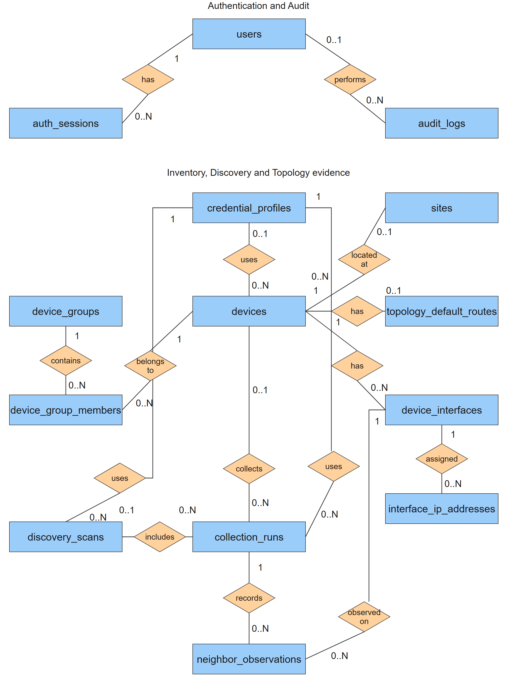

รูป 3.15 การออกแบบ ER Diagram ของระบบ MyNetMate

จากรูป 3.15 ผู้ใช้งานหนึ่งบัญชีมี Session และประวัติเหตุการณ์ได้หลายรายการ อุปกรณ์สัมพันธ์กับสถานที่ ชุดข้อมูลรับรอง กลุ่ม และ Interface ส่วนการค้นหาหนึ่งงานประกอบด้วยการรวบรวมข้อมูลหลายรอบ โดยแต่ละรอบเก็บหลักฐานเพื่อนบ้านจาก LLDP เพื่อใช้สร้างเส้นเชื่อมของ Topology ความสัมพันธ์ในภาพแสดงตาม Foreign Key ที่มีใน Schema ปัจจุบัน จึงไม่มีเส้นจาก users ไปยังช่อง created_by หรือ initiated_by ที่ยังไม่มีข้อบังคับ Foreign Key

### 3.6.1 Entity

### 1) users

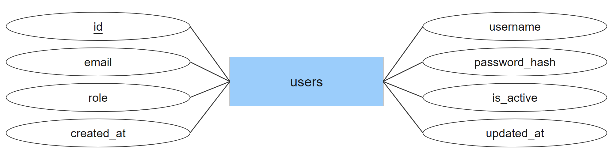

รูป 3.16 users Entity

1.1) เป็น Entity ที่เก็บบัญชีผู้ใช้งานและบทบาท Admin, Operator และ Viewer สำหรับการเข้าสู่ระบบและตรวจสอบสิทธิ์

1.2) มี Attribute ดังต่อไปนี้

- id: รหัสประจำรายการ ใช้เป็น Primary Key

- username: ชื่อบัญชีผู้ใช้งาน

- email: อีเมลของผู้ใช้งาน โดยไม่จำเป็นต้องระบุ

- password_hash: ค่า Hash ของรหัสผ่าน ไม่ใช่รหัสผ่านแบบข้อความปกติ

- role: บทบาทของผู้ใช้งาน ได้แก่ admin, operator หรือ viewer

- is_active: สถานะการเปิดใช้งานบัญชี

- created_at: วันและเวลาที่สร้างรายการ

- updated_at: วันและเวลาที่ปรับปรุงรายการล่าสุด

### 2) auth_sessions

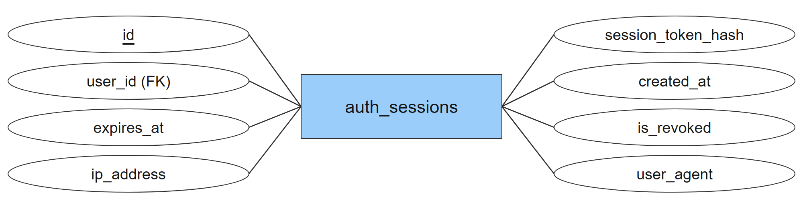

รูป 3.17 auth_sessions Entity

2.1) เป็น Entity ที่เก็บ Session ฝั่งเซิร์ฟเวอร์ เชื่อมโยงกับผู้ใช้งาน เพื่อกำหนดอายุและเพิกถอนการเข้าใช้งาน โดยเก็บเฉพาะค่า Hash ของ Session Token

2.2) มี Attribute ดังต่อไปนี้

- id: รหัสประจำรายการ ใช้เป็น Primary Key

- session_token_hash: ค่า Hash ของ Token สำหรับตรวจสอบ Session

- user_id: รหัสผู้ใช้งานที่เชื่อมโยงกับรายการ ใช้เป็น Foreign Key เชื่อมกับ users.id

- created_at: วันและเวลาที่สร้างรายการ

- expires_at: วันและเวลาที่ Session หมดอายุ

- is_revoked: สถานะการเพิกถอน Session

- ip_address: ที่อยู่ IP ประกอบ Session โดยเป็นช่องที่อนุญาตให้ไม่มีค่า

- user_agent: ข้อมูลโปรแกรมลูกข่ายประกอบ Session โดยเป็นช่องที่อนุญาตให้ไม่มีค่า

2.3) ผู้ใช้งานหนึ่งบัญชีมี Session ได้ตั้งแต่ศูนย์ถึงหลายรายการ แต่แต่ละ Session ต้องอ้างถึงผู้ใช้งานหนึ่งบัญชี ช่อง ip_address และ user_agent มีอยู่ใน Schema โดยไม่ได้หมายความว่าระบบจะบันทึกค่าเหล่านี้ทุกครั้ง

### 3) audit_logs

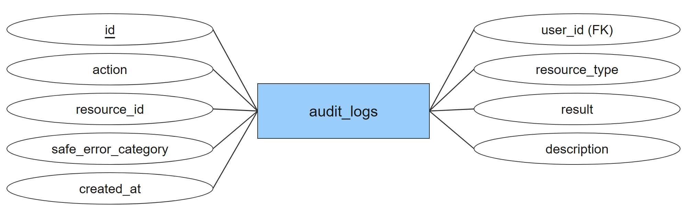

รูป 3.18 audit_logs Entity

3.1) เป็น Entity ที่เก็บประวัติเหตุการณ์ที่ระบบกำหนดให้บันทึก เช่น การเข้าสู่ระบบและการจัดการผู้ใช้งาน เพื่อให้ผู้ดูแลตรวจสอบผู้กระทำ การกระทำ ผลลัพธ์ และเวลา

3.2) มี Attribute ดังต่อไปนี้

- id: รหัสประจำรายการ ใช้เป็น Primary Key

- user_id: รหัสผู้กระทำเหตุการณ์ โดยอนุญาตให้ไม่มีค่าเมื่อไม่สามารถระบุผู้กระทำได้ ใช้เป็น Foreign Key เชื่อมกับ users.id

- action: ชื่อเหตุการณ์ที่บันทึก

- resource_type: ประเภททรัพยากรที่เกี่ยวข้องกับเหตุการณ์

- resource_id: รหัสทรัพยากรที่เกี่ยวข้อง โดยไม่ได้กำหนดเป็น Foreign Key

- result: ผลลัพธ์ของเหตุการณ์ ได้แก่ success หรือ failure

- safe_error_category: ประเภทข้อผิดพลาดที่ผ่านการจำกัดข้อมูลอ่อนไหว

- description: รายละเอียดเพิ่มเติมของรายการ

- created_at: วันและเวลาที่สร้างรายการ

3.3) user_id เป็น Foreign Key ที่อนุญาตให้ไม่มีค่า เช่น เหตุการณ์เข้าสู่ระบบไม่สำเร็จที่ไม่สามารถระบุผู้กระทำได้ ส่วน resource_id ใช้ร่วมกับ resource_type เพื่อระบุทรัพยากร ไม่ใช่ Foreign Key ไปยัง devices หรือ users โดยตรง ระบบไม่บันทึกรหัสผ่าน Token หรือ IP ของลูกข่ายลง Audit Log

### 4) credential_profiles

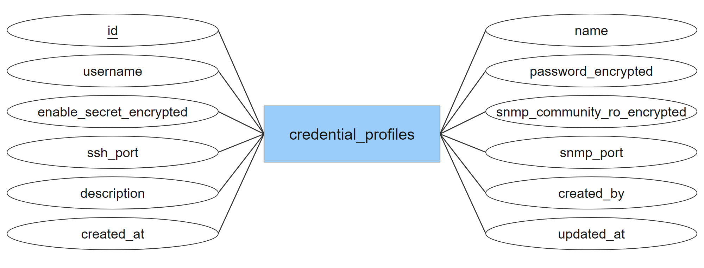

รูป 3.19 credential_profiles Entity

4.1) เป็น Entity ที่เก็บชุดข้อมูลรับรองสำหรับอ่านข้อมูลอุปกรณ์เครือข่าย โดยแยกข้อมูลลับที่เข้ารหัสออกจากข้อมูลอุปกรณ์

4.2) มี Attribute ดังต่อไปนี้

- id: รหัสประจำรายการ ใช้เป็น Primary Key

- name: ชื่อรายการ

- username: ชื่อบัญชีผู้ใช้งาน

- password_encrypted: รหัสผ่านสำหรับเข้าถึงอุปกรณ์ในรูปแบบเข้ารหัส

- enable_secret_encrypted: ข้อมูลลับสำหรับสิทธิ์ระดับสูงของอุปกรณ์ในรูปแบบเข้ารหัส

- snmp_community_ro_encrypted: SNMP Read-only Community ในรูปแบบเข้ารหัส

- ssh_port: หมายเลขพอร์ต SSH

- snmp_port: หมายเลขพอร์ต SNMP

- description: รายละเอียดเพิ่มเติมของรายการ

- created_by: รหัสผู้สร้างรายการ โดย Schema ปัจจุบันยังไม่ได้กำหนดเป็น Foreign Key

- created_at: วันและเวลาที่สร้างรายการ

- updated_at: วันและเวลาที่ปรับปรุงรายการล่าสุด

4.3) created_by เป็น UUID ที่ยังไม่มี Foreign Key บังคับเชื่อม users ใน Schema ปัจจุบัน ภาพรวมจึงไม่แสดงความสัมพันธ์ดังกล่าว

### 5) sites

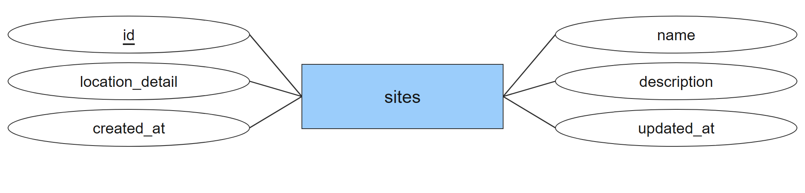

รูป 3.20 sites Entity

5.1) เป็น Entity ที่เก็บชื่อและรายละเอียดสถานที่ติดตั้ง เพื่อจัดหมวดหมู่อุปกรณ์ตามพื้นที่

5.2) มี Attribute ดังต่อไปนี้

- id: รหัสประจำรายการ ใช้เป็น Primary Key

- name: ชื่อรายการ

- location_detail: รายละเอียดสถานที่ติดตั้ง

- description: รายละเอียดเพิ่มเติมของรายการ

- created_at: วันและเวลาที่สร้างรายการ

- updated_at: วันและเวลาที่ปรับปรุงรายการล่าสุด

### 6) device_groups

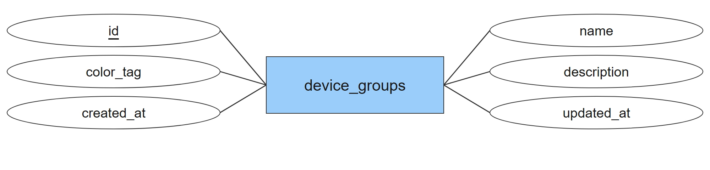

รูป 3.21 device_groups Entity

6.1) เป็น Entity ที่เก็บกลุ่มอุปกรณ์สำหรับการจัดหมวดหมู่ โดยอุปกรณ์หนึ่งรายการสามารถอยู่ได้หลายกลุ่ม

6.2) มี Attribute ดังต่อไปนี้

- id: รหัสประจำรายการ ใช้เป็น Primary Key

- name: ชื่อรายการ

- color_tag: รหัสสีสำหรับแสดงกลุ่มอุปกรณ์

- description: รายละเอียดเพิ่มเติมของรายการ

- created_at: วันและเวลาที่สร้างรายการ

- updated_at: วันและเวลาที่ปรับปรุงรายการล่าสุด

### 7) devices

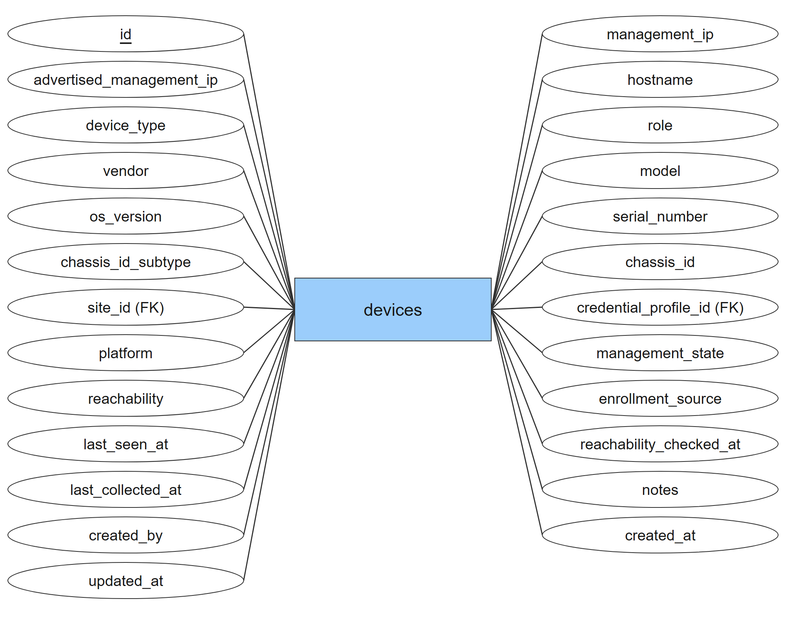

รูป 3.22 devices Entity

7.1) เป็น Entity ที่เก็บตัวตน ข้อมูลประกอบ และสถานะของอุปกรณ์เครือข่าย เป็นข้อมูลหลักสำหรับ Device Inventory และการแสดง Topology

7.2) มี Attribute ดังต่อไปนี้

- id: รหัสประจำรายการ ใช้เป็น Primary Key

- management_ip: ที่อยู่ IP ที่ใช้เข้าถึงอุปกรณ์เพื่อจัดการข้อมูล

- advertised_management_ip: ที่อยู่ Management IP ที่อุปกรณ์ประกาศให้ทราบ

- hostname: ชื่ออุปกรณ์

- device_type: ประเภทอุปกรณ์ เช่น router หรือ switch

- role: บทบาททางเครือข่าย เช่น core, distribution หรือ access

- vendor: ผู้ผลิตอุปกรณ์

- model: รุ่นอุปกรณ์

- os_version: รุ่นของระบบปฏิบัติการอุปกรณ์

- serial_number: หมายเลขประจำเครื่อง

- chassis_id_subtype: ประเภทของ Chassis ID

- chassis_id: ตัวระบุ Chassis ที่ใช้แยกตัวตนอุปกรณ์

- site_id: รหัสสถานที่ติดตั้งอุปกรณ์ ใช้เป็น Foreign Key เชื่อมกับ sites.id

- credential_profile_id: รหัสชุดข้อมูลรับรองที่ใช้เข้าถึงอุปกรณ์ ใช้เป็น Foreign Key เชื่อมกับ credential_profiles.id

- platform: ชื่อแพลตฟอร์มหรือชนิดไดรเวอร์ของอุปกรณ์

- management_state: สถานะการจัดการในระบบ ได้แก่ active, unmanaged, maintenance หรือ retired

- reachability: ผลการตรวจการเข้าถึง ได้แก่ unknown, reachable หรือ unreachable

- enrollment_source: ที่มาของรายการอุปกรณ์

- last_seen_at: วันและเวลาที่พบว่าเข้าถึงอุปกรณ์ได้ล่าสุด

- reachability_checked_at: วันและเวลาที่ตรวจการเข้าถึงล่าสุด

- last_collected_at: วันและเวลาที่รวบรวมข้อมูลอุปกรณ์ล่าสุด

- notes: บันทึกเพิ่มเติมของอุปกรณ์

- created_by: รหัสผู้สร้างรายการ โดย Schema ปัจจุบันยังไม่ได้กำหนดเป็น Foreign Key

- created_at: วันและเวลาที่สร้างรายการ

- updated_at: วันและเวลาที่ปรับปรุงรายการล่าสุด

7.3) role ใน Entity นี้หมายถึงบทบาททางเครือข่าย เช่น core หรือ access ไม่ใช่สิทธิ์ผู้ใช้งาน ส่วน site_id และ credential_profile_id อนุญาตให้ไม่มีค่าได้ และ created_by ยังไม่เป็น Foreign Key

### 8) device_group_members

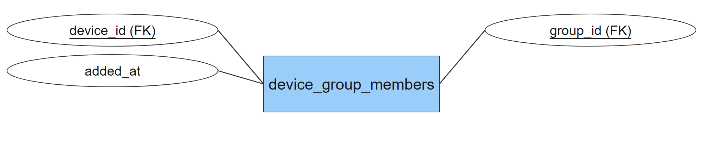

รูป 3.23 device_group_members Entity

8.1) เป็น Entity ที่เก็บความสัมพันธ์ระหว่างอุปกรณ์กับกลุ่ม เพื่อรองรับความสัมพันธ์แบบหลายต่อหลายระหว่าง devices และ device_groups

8.2) มี Attribute ดังต่อไปนี้

- device_id: รหัสอุปกรณ์ที่เกี่ยวข้อง ใช้เป็นส่วนหนึ่งของ Primary Key แบบผสม และใช้เป็น Foreign Key เชื่อมกับ devices.id

- group_id: รหัสกลุ่มอุปกรณ์ ใช้เป็นส่วนหนึ่งของ Primary Key แบบผสม และใช้เป็น Foreign Key เชื่อมกับ device_groups.id

- added_at: วันและเวลาที่เพิ่มอุปกรณ์เข้ากลุ่ม

8.3) Primary Key เป็นคีย์ผสม (device_id, group_id) เพื่อป้องกันการเพิ่มอุปกรณ์เดิมในกลุ่มเดิมซ้ำ

### 9) device_interfaces

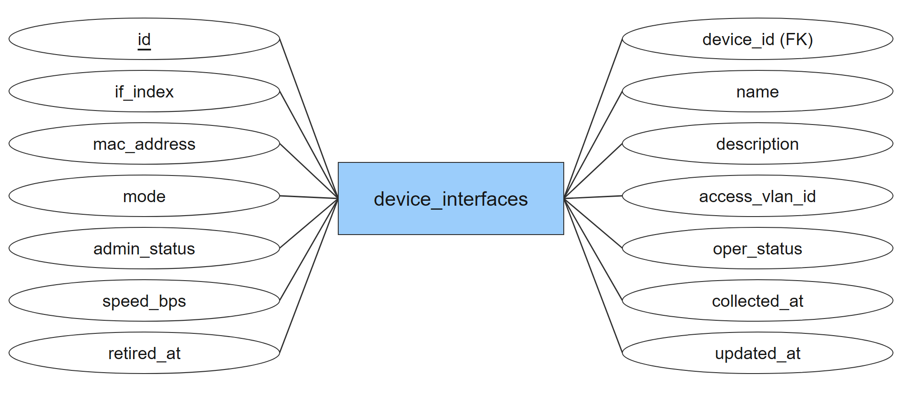

รูป 3.24 device_interfaces Entity

9.1) เป็น Entity ที่เก็บข้อมูล Interface ของอุปกรณ์ รวมถึงสถานะการทำงาน ความเร็ว และเวลาที่รวบรวมข้อมูล

9.2) มี Attribute ดังต่อไปนี้

- id: รหัสประจำรายการ ใช้เป็น Primary Key

- device_id: รหัสอุปกรณ์ที่เกี่ยวข้อง ใช้เป็น Foreign Key เชื่อมกับ devices.id

- if_index: เลขดัชนี Interface ที่อุปกรณ์รายงาน

- name: ชื่อ Interface ที่อุปกรณ์รายงาน

- mac_address: ที่อยู่ MAC ของ Interface

- description: รายละเอียดเพิ่มเติมของรายการ

- mode: รูปแบบ Interface เช่น access, trunk หรือ routed

- access_vlan_id: หมายเลข VLAN สำหรับ Access Port

- admin_status: สถานะ Interface ตามการตั้งค่าทางการบริหาร

- oper_status: สถานะการทำงานที่ Interface รายงาน

- speed_bps: ความเร็ว Interface ในหน่วยบิตต่อวินาที

- collected_at: วันและเวลาที่รวบรวมข้อมูล Interface

- retired_at: วันและเวลาที่เลิกใช้รายการ Interface โดยอาจไม่มีค่า

- updated_at: วันและเวลาที่ปรับปรุงรายการล่าสุด

### 10) interface_ip_addresses

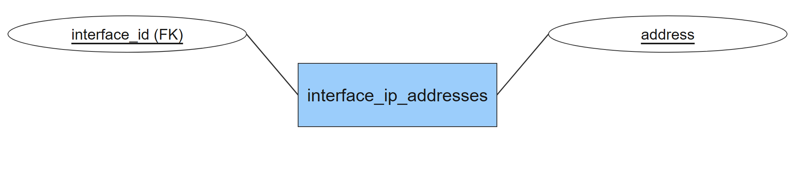

รูป 3.25 interface_ip_addresses Entity

10.1) เป็น Entity ที่เก็บรายการที่อยู่ IP ของแต่ละ Interface เพื่อรองรับ Interface ที่มีมากกว่าหนึ่งที่อยู่

10.2) มี Attribute ดังต่อไปนี้

- interface_id: รหัส Interface ที่เป็นเจ้าของที่อยู่ IP ใช้เป็นส่วนหนึ่งของ Primary Key แบบผสม และใช้เป็น Foreign Key เชื่อมกับ device_interfaces.id

- address: ที่อยู่ IP พร้อม Prefix ใช้เป็นส่วนหนึ่งของ Primary Key แบบผสม

10.3) Primary Key เป็นคีย์ผสม (interface_id, address) อุปกรณ์หนึ่ง Interface จึงมีที่อยู่ IP ได้หลายรายการ

### 11) discovery_scans

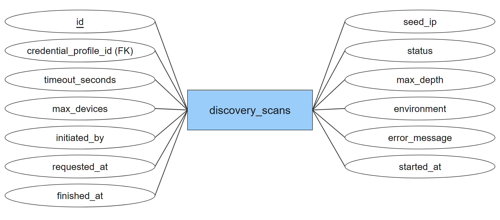

รูป 3.26 discovery_scans Entity

11.1) เป็น Entity ที่เก็บคำขอและสถานะของงานค้นหาเครือข่าย โดยระบุ Seed IP ชุดข้อมูลรับรอง และขอบเขตการค้นหา

11.2) มี Attribute ดังต่อไปนี้

- id: รหัสประจำรายการ ใช้เป็น Primary Key

- seed_ip: ที่อยู่ IP เริ่มต้นสำหรับงานค้นหา

- credential_profile_id: รหัสชุดข้อมูลรับรองที่ใช้เข้าถึงอุปกรณ์ ใช้เป็น Foreign Key เชื่อมกับ credential_profiles.id

- status: สถานะของงาน ได้แก่ queued, running, succeeded, partial, failed หรือ cancelled

- timeout_seconds: ระยะเวลารอคำตอบต่อเป้าหมายในหน่วยวินาที

- max_depth: ความลึกสูงสุดของการค้นหาต่อเนื่อง

- max_devices: จำนวนอุปกรณ์สูงสุดที่กำหนดให้ค้นหา

- environment: ประเภทสภาพแวดล้อมทดสอบ ได้แก่ physical หรือ emulated

- initiated_by: รหัสผู้เริ่มงาน โดย Schema ปัจจุบันยังไม่ได้กำหนดเป็น Foreign Key

- error_message: ข้อความข้อผิดพลาดของงาน

- requested_at: วันและเวลาที่ขอเริ่มงาน

- started_at: วันและเวลาที่เริ่มทำงาน

- finished_at: วันและเวลาที่สิ้นสุดงาน

11.3) งานค้นหาหนึ่งรายการมี Collection Run ได้หลายรายการ ส่วน initiated_by ยังไม่เป็น Foreign Key ใน Schema ปัจจุบัน

### 12) collection_runs

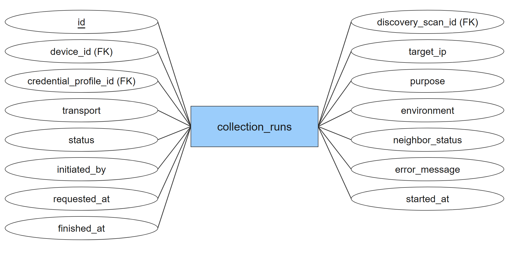

รูป 3.27 collection_runs Entity

12.1) เป็น Entity ที่เก็บประวัติการรวบรวมข้อมูลรายเป้าหมาย ทั้งการเพิ่มอุปกรณ์ การค้นหา และการรวบรวมข้อมูลซ้ำ

12.2) มี Attribute ดังต่อไปนี้

- id: รหัสประจำรายการ ใช้เป็น Primary Key

- discovery_scan_id: รหัสงานค้นหา โดยอาจไม่มีค่าเมื่อเป็นการรวบรวมข้อมูลนอกงานค้นหา ใช้เป็น Foreign Key เชื่อมกับ discovery_scans.id

- device_id: รหัสอุปกรณ์ที่เกี่ยวข้อง ใช้เป็น Foreign Key เชื่อมกับ devices.id

- target_ip: ที่อยู่ IP เป้าหมายของการรวบรวมข้อมูล

- credential_profile_id: รหัสชุดข้อมูลรับรองที่ใช้เข้าถึงอุปกรณ์ ใช้เป็น Foreign Key เชื่อมกับ credential_profiles.id

- purpose: วัตถุประสงค์ เช่น manual_enrollment, csv_import, discovery หรือ recollect

- transport: โพรโทคอลการรวบรวมข้อมูล เช่น snmp หรือ ssh

- environment: ประเภทสภาพแวดล้อมทดสอบ ได้แก่ physical หรือ emulated

- status: สถานะของงาน ได้แก่ queued, running, succeeded, partial, failed หรือ cancelled

- neighbor_status: ผลการรวบรวมเพื่อนบ้าน ได้แก่ not_attempted, succeeded, failed หรือ unsupported

- initiated_by: รหัสผู้เริ่มงาน โดย Schema ปัจจุบันยังไม่ได้กำหนดเป็น Foreign Key

- error_message: ข้อความข้อผิดพลาดของงาน

- requested_at: วันและเวลาที่ขอเริ่มงาน

- started_at: วันและเวลาที่เริ่มทำงาน

- finished_at: วันและเวลาที่สิ้นสุดงาน

12.3) device_id อนุญาตให้ไม่มีค่าขณะยังระบุตัวตนอุปกรณ์ไม่ได้ แต่ต้องมีค่าเมื่อสถานะเป็น succeeded หรือ partial ส่วน discovery_scan_id ต้องมีค่าเมื่อ purpose เป็น discovery และไม่มีค่าในกรณีอื่น

### 13) neighbor_observations

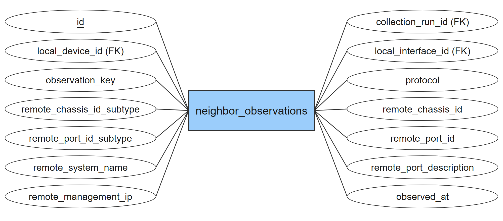

รูป 3.28 neighbor_observations Entity

13.1) เป็น Entity ที่เก็บหลักฐานเพื่อนบ้านจาก LLDP ที่รวบรวมได้ในแต่ละรอบ เพื่อนำไปประมวลผลเส้นเชื่อมใน Topology

13.2) มี Attribute ดังต่อไปนี้

- id: รหัสประจำรายการ ใช้เป็น Primary Key

- collection_run_id: รหัสรอบการรวบรวมข้อมูลที่เป็นแหล่งหลักฐาน เป็นส่วนหนึ่งของ Foreign Key แบบผสม

- local_device_id: รหัสอุปกรณ์ฝั่งที่เก็บหลักฐาน เป็นส่วนหนึ่งของ Foreign Key แบบผสม

- local_interface_id: รหัส Interface ฝั่งที่เก็บหลักฐาน เป็นส่วนหนึ่งของ Foreign Key แบบผสม

- observation_key: ตัวระบุหลักฐานภายในรอบการรวบรวม

- protocol: โพรโทคอลของหลักฐานเพื่อนบ้าน โดย Schema ปัจจุบันกำหนดเป็น lldp

- remote_chassis_id_subtype: ประเภท Chassis ID ของเพื่อนบ้าน

- remote_chassis_id: Chassis ID ของเพื่อนบ้าน

- remote_port_id_subtype: ประเภท Port ID ของเพื่อนบ้าน

- remote_port_id: Port ID ของเพื่อนบ้าน

- remote_system_name: ชื่อระบบที่เพื่อนบ้านประกาศ

- remote_port_description: คำอธิบายพอร์ตของเพื่อนบ้าน

- remote_management_ip: Management IP ที่เพื่อนบ้านประกาศ

- observed_at: วันและเวลาที่สังเกตข้อมูล

13.3) มี Foreign Key แบบผสม (collection_run_id, local_device_id) ไปยัง collection_runs และ (local_device_id, local_interface_id) ไปยัง device_interfaces เพื่อให้หลักฐานอ้างถึงอุปกรณ์เดียวกับรอบการรวบรวมและ Interface จริง ข้อมูลฝั่ง remote เป็นข้อมูลที่เพื่อนบ้านประกาศ ไม่ใช่ Foreign Key ไปยัง devices

### 14) topology_default_routes

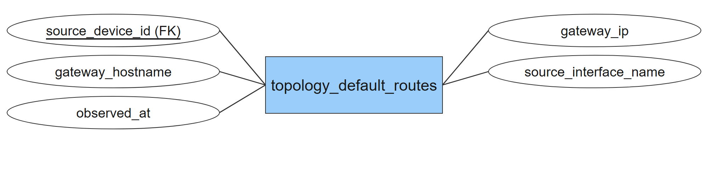

รูป 3.29 topology_default_routes Entity

14.1) เป็น Entity ที่เก็บข้อมูล Default Gateway ที่สังเกตได้ของอุปกรณ์ เพื่อใช้ประกอบการแสดง Topology ไม่ใช่คำสั่งแก้ไข Routing ของอุปกรณ์

14.2) มี Attribute ดังต่อไปนี้

- source_device_id: รหัสอุปกรณ์ต้นทางของข้อมูล Default Gateway ใช้เป็น Primary Key และใช้เป็น Foreign Key เชื่อมกับ devices.id

- gateway_ip: ที่อยู่ IP ของ Default Gateway

- gateway_hostname: ชื่อที่ใช้แสดง Default Gateway

- source_interface_name: ชื่อ Interface ต้นทางที่สัมพันธ์กับข้อมูล Gateway

- observed_at: วันและเวลาที่สังเกตข้อมูล

14.3) source_device_id เป็นทั้ง Primary Key และ Foreign Key อุปกรณ์หนึ่งรายการจึงมีข้อมูลใน Entity นี้ได้ไม่เกินหนึ่งรายการ ภาพรวมแสดงความสัมพันธ์ 1 ต่อ 0..1
