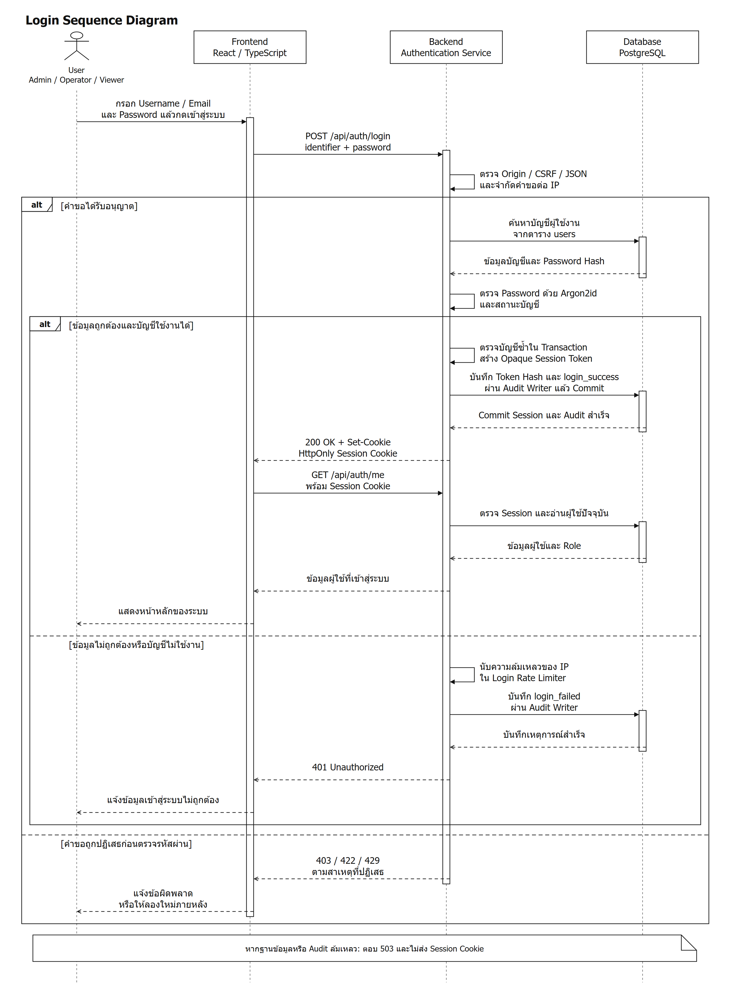
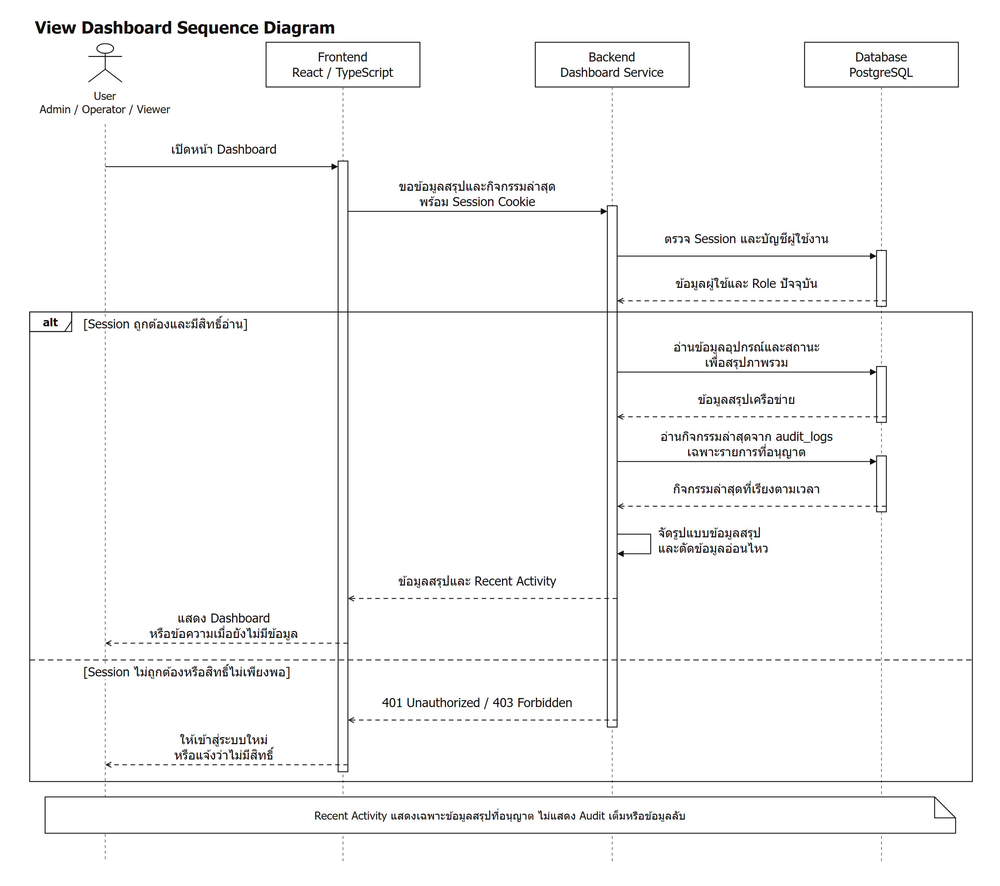
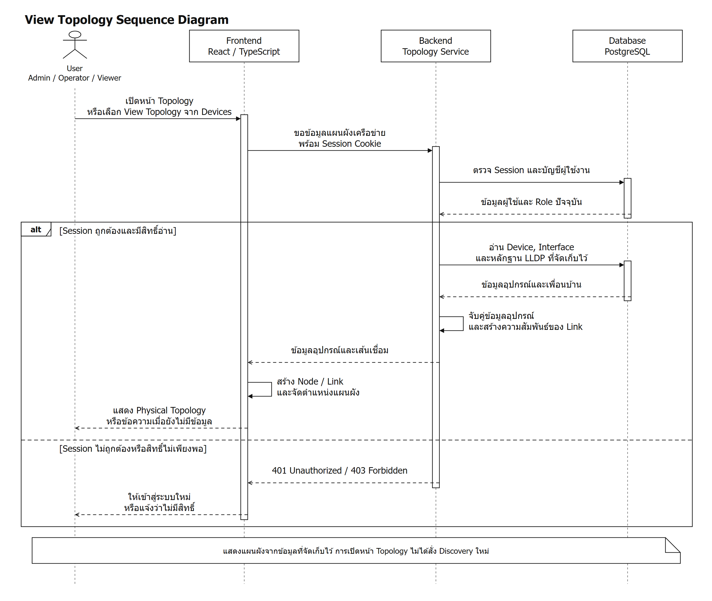
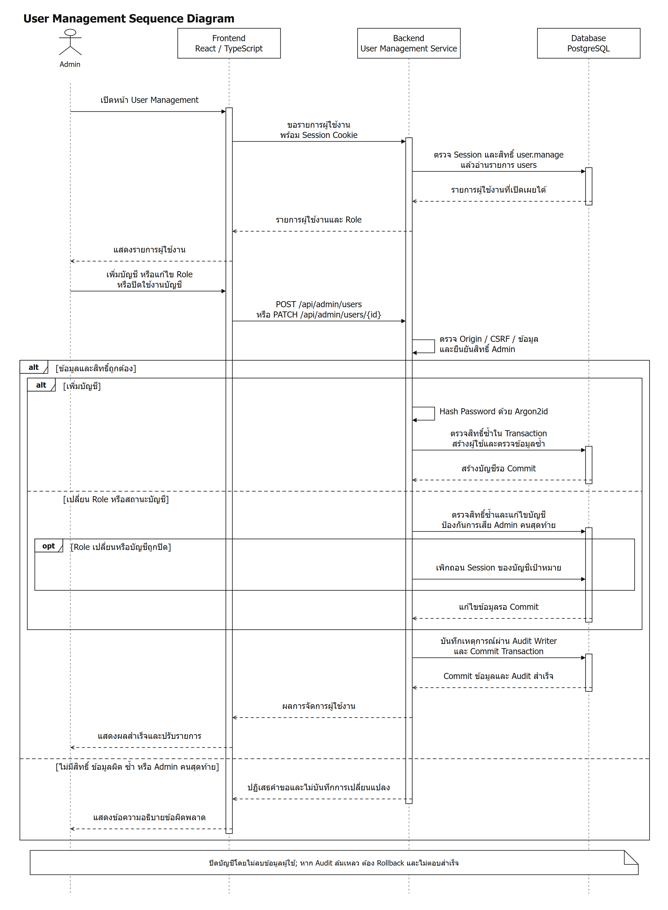
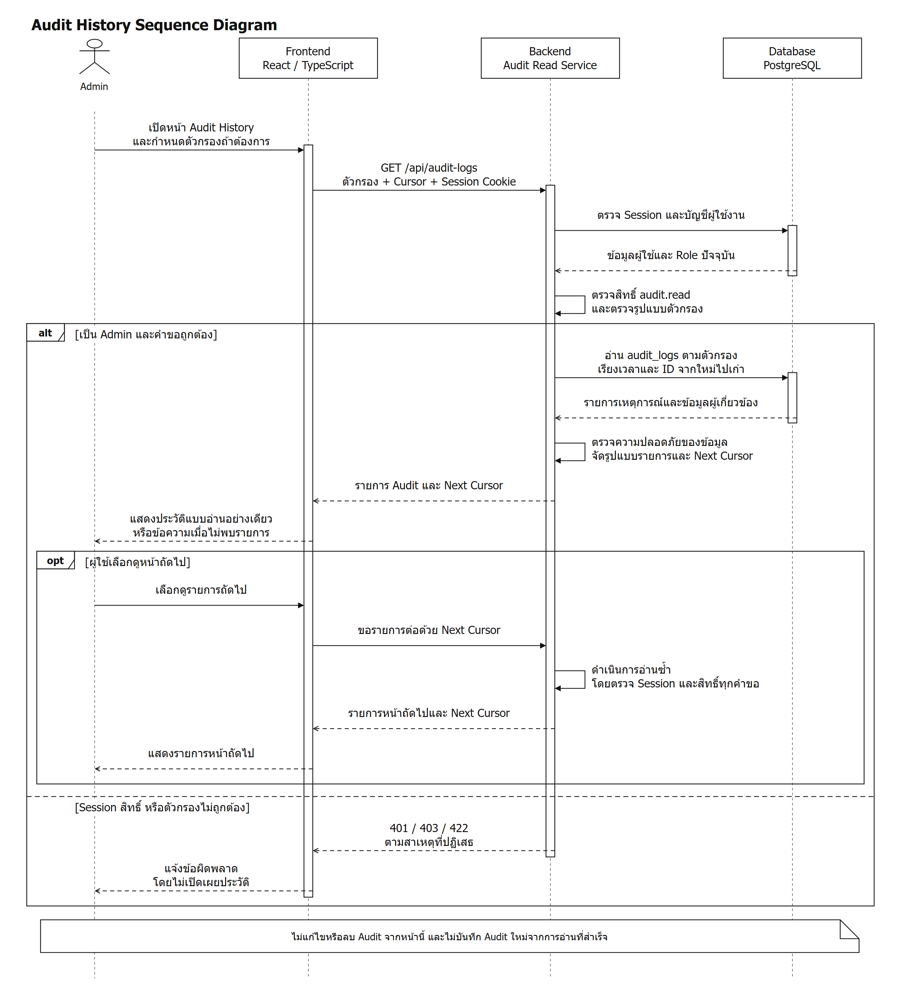

# Sequence Diagram ส่วนที่นภัทรรับผิดชอบ

จัดทำจากบทที่ 3 ใน Google Docs และเทียบกับ Source Code / เอกสารออกแบบของ MyNetMate ปัจจุบันแทรกภาพทั้ง 5 รูปและคำอธิบายในหัวข้อ 3.5 ของเอกสารออนไลน์แล้ว โดยไม่แก้ไขหัวข้อ Sequence Diagram หรือ Description Use Case ของเพื่อน

ตรวจอ่านกลับพบภาพอยู่ก่อนคำบรรยายของแต่ละหัวข้อ และข้อความอธิบายใช้ Angsana New ขนาด 16 pt ส่วน Dashboard และการตรวจสิทธิ์ของ Topology เป็นลำดับตามการออกแบบ ไม่ใช่การรับรองว่าพัฒนาเสร็จแล้ว การส่งออก PDF ถูกปฏิเสธด้วย HTTP 403 จึงยังไม่ได้ตรวจการแบ่งหน้าและขนาดตัวอักษรในภาพบนหน้ากระดาษจริง ระหว่างทำงานมีการแก้ไขส่วน ER จากผู้ร่วมแก้ไขเอกสาร จึงคงการแก้ไขเหล่านั้นไว้

รูปแบบภาพอ้างอิง CE67-37_Thesis.pdf ฉบับเต็มในโฟลเดอร์ `04_project_management/วิชา CE Project 1 และ 2/ตัวอย่าง Thesis/` หน้าเล่ม 48 และ 54 (หน้า PDF 62 และ 68): Actor, ส่วนติดต่อผู้ใช้, บริการฝั่งเซิร์ฟเวอร์, ฐานข้อมูล, Lifeline, Activation, ลูกศรคำขอ/ผลตอบกลับ และ Combined Fragment แบบ alt / opt ทั้งนี้ใช้รูปแบบการนำเสนอเท่านั้น ไม่ใช้ฟังก์ชันหรือเทคโนโลยีของโครงการตัวอย่างเป็นข้อเท็จจริงของ MyNetMate

## ไฟล์ที่ใช้

- [Draw.io รวม 5 แท็บ](naphat-sequence-diagrams.drawio) ใช้แก้ตำแหน่งและข้อความของแต่ละองค์ประกอบได้
- ภาพ PNG ของแต่ละรูปใช้แทรกในเอกสาร และ SVG ใช้เมื่อต้องการปรับขนาดโดยไม่เสียความคมชัด
- แต่ละรูปมี `.drawio` แยก และ `.puml` สำหรับแก้ลำดับการทำงานเป็นข้อความ รูป PNG / SVG ในชุดนี้แสดงจากไฟล์ Draw.io จริง ส่วน PlantUML เป็นแหล่งแก้ไขทางเลือก ไม่ได้อ้างว่าเป็นรูปที่ผ่านการ Render ด้วย PlantUML

## รูป 3.6 Login Sequence Diagram

**รูป 3.6 Login Sequence Diagram**

จากรูป 3.6 Login Sequence Diagram แสดงลำดับการเข้าสู่ระบบ โดยผู้ใช้งานกรอกชื่อผู้ใช้หรืออีเมลและรหัสผ่านผ่านส่วนติดต่อผู้ใช้ จากนั้น Frontend ส่งคำขอไปยัง Backend เพื่อตรวจสอบความปลอดภัยของคำขอและจำกัดความถี่การเข้าสู่ระบบ Backend อ่านข้อมูลบัญชีจากฐานข้อมูลและตรวจสอบรหัสผ่านด้วย Argon2id หากข้อมูลถูกต้องและบัญชียังใช้งานได้ ระบบจะสร้าง Session จัดเก็บค่า Hash ของ Token และบันทึกเหตุการณ์เข้าสู่ระบบ เมื่อบันทึกสำเร็จจึงส่ง Session Cookie กลับไปยังเบราว์เซอร์ Frontend ขอข้อมูลผู้ใช้ปัจจุบันและแสดงหน้าหลัก หากข้อมูลไม่ถูกต้องหรือคำขอถูกปฏิเสธ ระบบจะแสดงข้อผิดพลาดโดยไม่ให้เข้าสู่ระบบ

## รูป 3.7 View Dashboard Sequence Diagram

**รูป 3.7 View Dashboard Sequence Diagram**

จากรูป 3.7 View Dashboard Sequence Diagram แสดงลำดับการเรียกดูภาพรวมเครือข่าย เมื่อผู้ใช้งานเปิดหน้า Dashboard Frontend จะขอข้อมูลสรุปและกิจกรรมล่าสุดจาก Backend หลังตรวจสอบ Session และสิทธิ์การอ่านแล้ว Backend จะอ่านข้อมูลอุปกรณ์ สถานะ และเหตุการณ์ที่อนุญาตจากฐานข้อมูล ก่อนจัดรูปแบบข้อมูลและส่งกลับไปยัง Frontend เพื่อแสดงผล หากยังไม่มีข้อมูล ระบบจะแสดงข้อความแจ้งให้ผู้ใช้งานทราบ ส่วนกรณี Session ไม่ถูกต้องหรือสิทธิ์ไม่เพียงพอ ระบบจะปฏิเสธการเข้าถึง

## รูป 3.12 View Topology Sequence Diagram

**รูป 3.12 View Topology Sequence Diagram**

จากรูป 3.12 View Topology Sequence Diagram แสดงลำดับการเรียกดูแผนผังเครือข่าย โดยผู้ใช้งานเปิดหน้า Topology หรือเลือกดูแผนผังจากหน้า Devices Frontend ส่งคำขอไปยัง Backend ซึ่งตามการออกแบบจะตรวจสอบ Session และสิทธิ์ก่อนอ่านข้อมูลอุปกรณ์ Interface และหลักฐานความสัมพันธ์ที่จัดเก็บไว้ในฐานข้อมูล Backend นำข้อมูลมาจับคู่และสร้างความสัมพันธ์ของเส้นเชื่อม แล้วส่งผลกลับไปยัง Frontend เพื่อสร้าง Node และ Link พร้อมจัดตำแหน่งแผนผัง การเปิดดูแผนผังนี้ใช้ข้อมูลที่จัดเก็บไว้และไม่ได้เริ่มค้นหาอุปกรณ์ใหม่

## รูป 3.13 User Management Sequence Diagram

**รูป 3.13 User Management Sequence Diagram**

จากรูป 3.13 User Management Sequence Diagram แสดงลำดับการจัดการผู้ใช้งานโดย Admin เมื่อเปิดหน้า User Management ระบบจะตรวจสอบ Session และสิทธิ์ก่อนแสดงรายการบัญชี Admin สามารถเพิ่มบัญชี กำหนดหรือเปลี่ยนบทบาท และปิดใช้งานบัญชีได้ Backend ตรวจสอบข้อมูลและสิทธิ์ซ้ำก่อนบันทึก โดยการเพิ่มบัญชีจะจัดเก็บรหัสผ่านในรูปแบบ Hash ส่วนการเปลี่ยนบทบาทหรือปิดบัญชีจะเพิกถอน Session ของบัญชีเป้าหมาย ระบบป้องกันการปิดบัญชีหรือเปลี่ยนบทบาทจนไม่เหลือ Admin ที่ใช้งานได้ และบันทึกเหตุการณ์พร้อมการเปลี่ยนแปลงข้อมูลใน Transaction เดียวกัน ก่อนส่งผลสำเร็จกลับไปแสดงบนหน้าจอ

## รูป 3.14 Audit History Sequence Diagram

**รูป 3.14 Audit History Sequence Diagram**

จากรูป 3.14 Audit History Sequence Diagram แสดงลำดับการดูประวัติเหตุการณ์โดย Admin เมื่อเปิดหน้า Audit History Frontend จะส่งคำขอพร้อม Session Cookie และตัวกรองไปยัง Backend ระบบตรวจสอบ Session สิทธิ์ และรูปแบบคำขอ ก่อนอ่านเหตุการณ์ที่บันทึกไว้จากฐานข้อมูล โดยเรียงลำดับจากรายการใหม่ไปเก่า Backend ตรวจสอบความปลอดภัยของข้อมูลและส่งรายการพร้อม Cursor สำหรับหน้าถัดไปกลับไปยัง Frontend เพื่อแสดงผล หากไม่พบรายการจะแสดงข้อความแจ้งให้ทราบ หน้านี้ใช้ดูประวัติแบบอ่านอย่างเดียวและไม่อนุญาตให้แก้ไขหรือลบเหตุการณ์

## ข้อควรทราบก่อนใช้ในเล่ม

1. ใช้เลขรูปตามที่นภัทรระบุ: 3.6, 3.7, 3.12, 3.13 และ 3.14 ไม่เปลี่ยนเลขรูปของเพื่อน ในเอกสารออนไลน์ที่อ่านพบว่า Update Device Status และ View Topology ใช้เลข 3.12 ซ้ำกัน ส่วน ER Diagram เริ่มที่รูป 3.15 จึงควรตรวจเลขภาพทั้งบทเมื่อรวมงานเสร็จ
2. ตาราง Log in ในเอกสารยังเขียนว่าล้มเหลวแล้วถูกจำกัด 15 นาทีทันที แต่โค้ดใช้ Sliding Window 900 วินาทีต่อ IP และให้เริ่มตรวจได้เมื่อจำนวนความล้มเหลวที่ยังอยู่ในช่วงเวลารวมกับคำขอที่กำลังตรวจสอบน้อยกว่า 5 คำขอที่ถูกปฏิเสธไม่ได้ต่ออายุช่วงเวลา จึงไม่ใช่การล็อกบัญชี 15 นาทีทุกครั้งที่กรอกรหัสผ่านผิด
3. ตาราง User Management กล่าวถึงการลบผู้ใช้ แต่ Source Code ปัจจุบันมี GET / POST / PATCH ไม่มี DELETE ภาพนี้จึงแสดงการปิดบัญชีและเพิกถอน Session แทนการลบข้อมูลผู้ใช้ หากทีมต้องการเพิ่มการลบจริง ต้องยืนยัน Requirement และออกแบบผลต่อประวัติ Audit ก่อน
4. Dashboard เป็นภาพตามเอกสารออกแบบ API ไม่ใช่คำยืนยันว่าพัฒนาเสร็จแล้ว Source Code ที่ตรวจยังแสดง Dashboard Placeholder และไม่พบ Dashboard Router ใน Backend ปัจจุบัน
5. View Topology มีการอ่านข้อมูลแผนผังจากฐานข้อมูลและแสดงผลในโค้ด แต่ Route `/api/v1/devices/topology` ที่ตรวจยังไม่มี Session / Permission Dependency ภาพนี้แสดงการตรวจสิทธิ์ตามเป้าหมายออกแบบ ไม่ใช่การรับรองว่า Route ดังกล่าวได้รับการป้องกันครบแล้ว
6. Login, User Management และ Audit History อ้างอิงการทำงานของ Backend ที่ตรวจพบจริง อย่างไรก็ตาม ภาพนี้เป็นเอกสารลำดับการทำงาน ไม่ใช่หลักฐานว่าทุกกรณีผ่านการทดสอบในรอบนี้ และไม่ได้รันทดสอบหรือสแกนเครือข่ายเพิ่มเติม
7. Audit History แสดงเหตุการณ์ที่ระบบรองรับและบันทึกไว้ ไม่ได้หมายถึงทุกการคลิกบนหน้าจอ การอ่านประวัติที่สำเร็จไม่สร้าง Audit ใหม่ เพื่อไม่ให้เกิดการบันทึกซ้ำไม่สิ้นสุด
8. ภาพระดับภาพรวมรวม Auth Guard, Permission Guard, Repository และ Audit Writer ไว้ภายใน Backend เพื่อให้อ่านง่ายตามตัวอย่าง ไม่ได้หมายความว่า Frontend ติดต่อฐานข้อมูลโดยตรง หรือ Database ตรวจรหัสผ่านแทน Backend

## หลักฐานที่ใช้ตรวจลำดับ

- เอกสารออนไลน์: [เอกสารรายงานความคืบหน้า Project 1 - บทที่ 3](https://docs.google.com/document/d/1bgBgFPAoSGiob5yRsHnE9WyIwqhd6PmakMJAyo3S82c/edit)
- Login: `mynetmate/backend/app/features/authentication/router.py`, `service.py`, `rate_limiter.py`, `request_security.py` และ `mynetmate/website/src/features/authentication/actions.ts`
- Dashboard: `02_feature/01_Dashboard&Monitoring(Naphat)/P1_Core/04_API Contracts.md` และ `mynetmate/website/src/features/home/HomePage.tsx`
- Topology: `mynetmate/backend/app/features/devices/router.py`, `services/topology.py`, `mynetmate/website/src/features/topology/TopologyPage.tsx` และเอกสาร NTV MVP
- User Management: `mynetmate/backend/app/features/authentication/admin_router.py` และ `service.py`
- Audit History: `mynetmate/backend/app/features/audit_trail/router.py`, `reader.py` และ `schemas.py`
