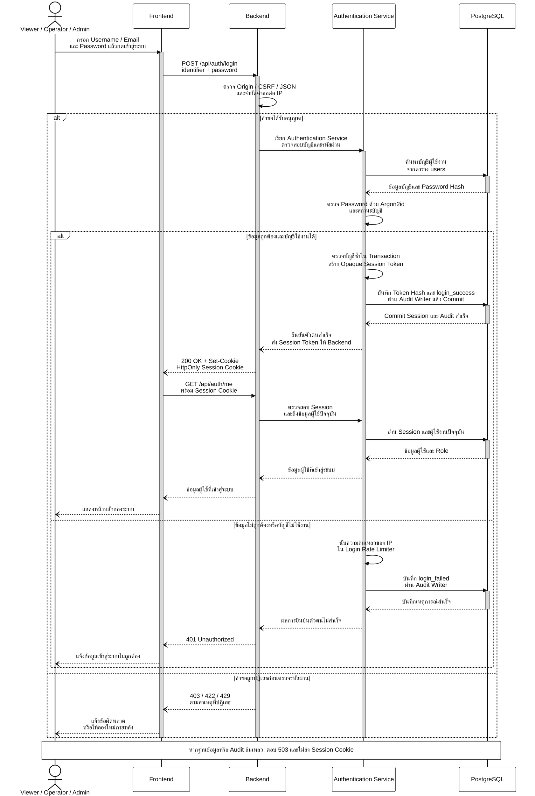
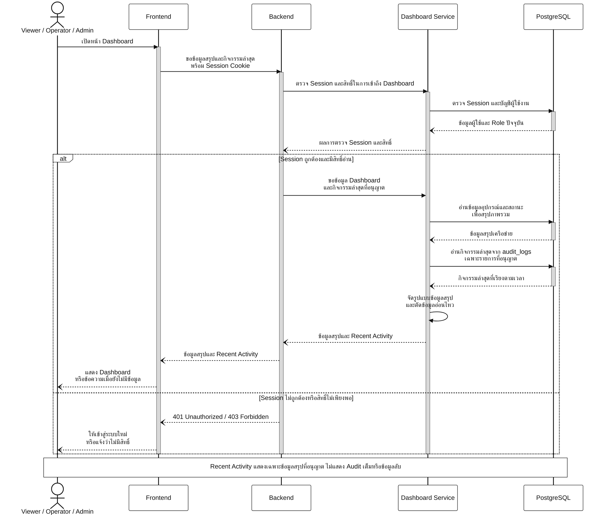
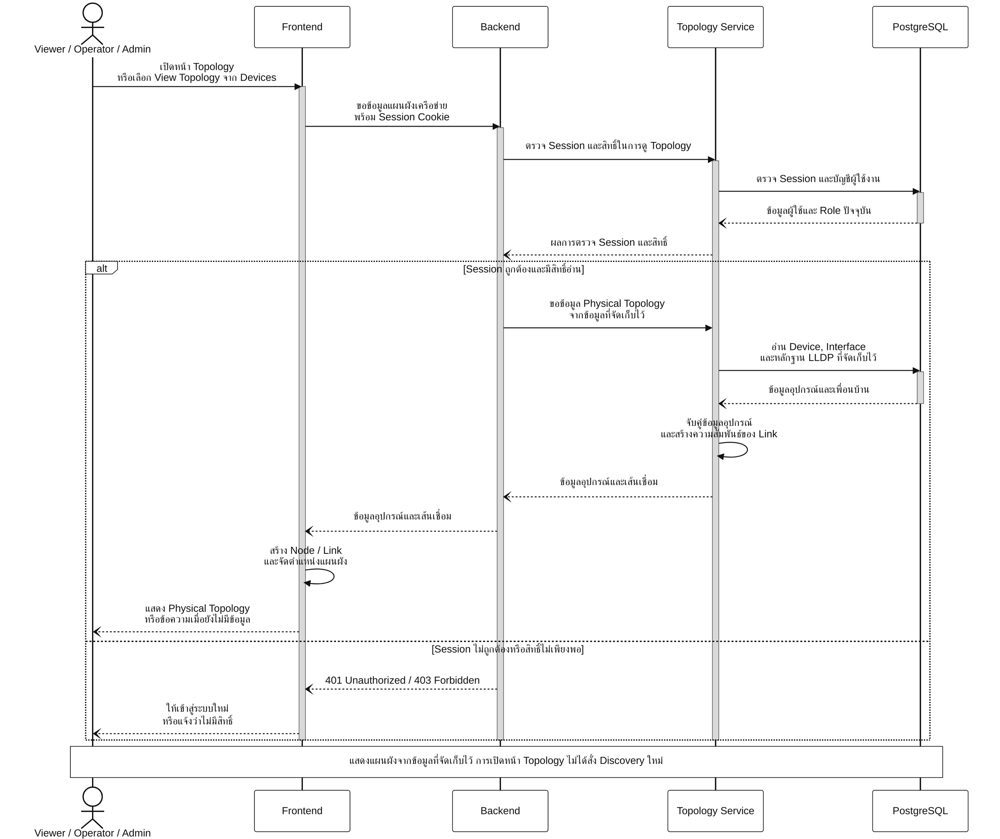
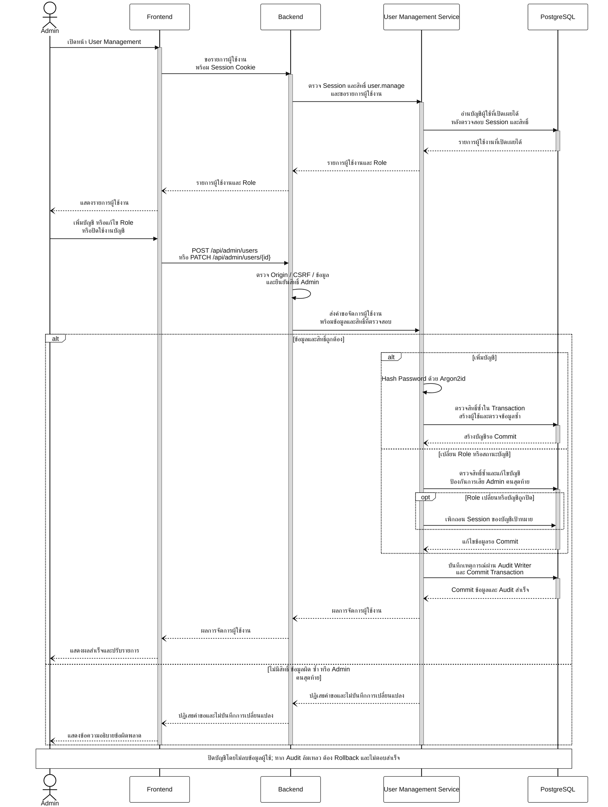
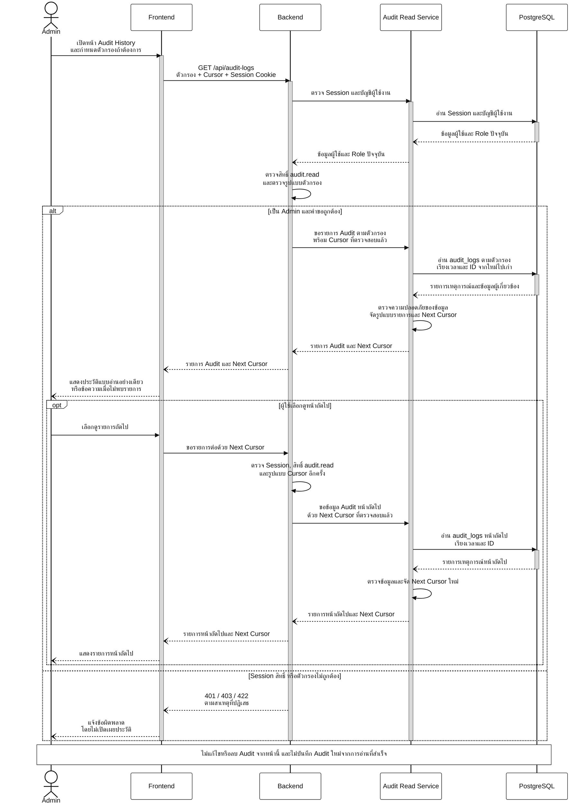

# Sequence Diagram ของนภัทร — Mermaid ขาวดำ

แปลงจากชุด Draw.io เดิมโดยคงข้อความ ลำดับ และเงื่อนไข ใช้พื้นขาว ตัวอักษรและเส้นสีดำ กล่องไม่มีสี และ Activation สีเทา ตามรูปแบบภาพของเพื่อน เหมาะสำหรับรายงานและการพิมพ์ขาวดำ

ประกอบด้วย Login, View Dashboard, View Topology, User Management และ Audit History

Dashboard และการตรวจสิทธิ์ของ Topology เป็นลำดับตามการออกแบบ ไม่ใช่การรับรองว่า Implementation เสร็จครบแล้ว เลขรูปคงตามชุดเดิม

## รูป 3.6 Login Sequence Diagram

## รูป 3.7 View Dashboard Sequence Diagram

## รูป 3.12 View Topology Sequence Diagram

## รูป 3.13 User Management Sequence Diagram

## รูป 3.14 Audit History Sequence Diagram

