# 3.8 ผลการออกแบบส่วนติดต่อผู้ใช้งาน

ผลการออกแบบส่วนติดต่อผู้ใช้งานของระบบ MyNetMate ในส่วนการจัดการเครือข่าย นำเสนอการเชื่อมโยงระหว่างหน้าจอและการจัดวางองค์ประกอบที่รองรับการใช้งานของผู้ดูแลระบบและผู้ใช้งานตามสิทธิ์ โดยแบ่งการนำเสนอเป็นแผนภาพการเชื่อมโยงหน้าจอ (Navigation Flow) และภาพโครงร่างหน้าจอ (Wireframe) เพื่อแสดงตำแหน่งของเมนู ตาราง แบบฟอร์ม และปุ่มดำเนินการก่อนนำไปพัฒนาระบบ

ภาพในหัวข้อนี้เป็นแบบออกแบบและใช้ข้อมูลตัวอย่าง ไม่ใช่ผลการทดสอบการทำงานของระบบกับเครือข่ายจริง สำหรับ Dashboard ในระยะ P2 มีภาพจำลองส่วนติดต่อผู้ใช้งาน (Mockup) เพิ่มเติม เพื่อแสดงแนวทางการจัดวางข้อมูลสถานะการทำงานและประเด็นที่ควรตรวจสอบ โดยไม่รวมความสามารถด้าน Configuration Management

## 3.8.1 การเชื่อมโยงหน้าจอของเว็บแอปพลิเคชัน (Navigation Flow)

การเชื่อมโยงหน้าจอของระบบเริ่มต้นจากหน้าเข้าสู่ระบบ เมื่อเข้าสู่ระบบสำเร็จ ผู้ใช้งานจะเข้าสู่หน้า Dashboard และเลือกเมนู Devices หรือ Topology เพื่อเรียกดูข้อมูลเครือข่าย ส่วน Admin สามารถเข้าถึงหน้า User Management และ Audit History เพิ่มเติม แผนภาพนี้แสดงเฉพาะการเปลี่ยนหน้าจอและการเปิดหน้าต่าง ไม่แสดงการเรียก API หรือการทำงานภายในฐานข้อมูล

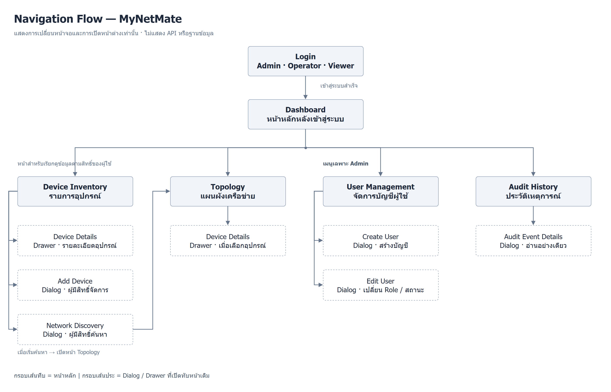

*รูป: การเชื่อมโยงหน้าจอของระบบ MyNetMate ในส่วนการจัดการเครือข่าย*

จากรูป ผู้ใช้งานสามารถเลือกการใช้งานหลักได้ดังนี้

1. **การเข้าสู่ระบบ:** ผู้ใช้งานบทบาท Admin, Operator และ Viewer เริ่มต้นจากหน้า Login และเข้าสู่หน้า Dashboard เมื่อข้อมูลเข้าสู่ระบบได้รับการตรวจสอบสำเร็จ หากเข้าสู่ระบบไม่สำเร็จ ผู้ใช้งานจะอยู่หน้า Login พร้อมข้อความแจ้งข้อผิดพลาด
2. **การเรียกดูและจัดการอุปกรณ์:** ผู้ใช้งานเลือกหน้า Device Inventory เพื่อเรียกดูรายการอุปกรณ์ และเลือกอุปกรณ์เพื่อเปิดแผง Device Details ผู้มีสิทธิ์จัดการสามารถเปิดหน้าต่าง Add Device หรือ Network Discovery ตามความสามารถที่ได้รับอนุญาต
3. **การดูแผนผังเครือข่าย:** ผู้ใช้งานเลือกหน้า Topology จากเมนูหลักหรือจากหน้า Devices และเลือกอุปกรณ์ในแผนผังเพื่อเปิด Device Details ได้ เมื่อเริ่มค้นหาจากหน้าต่าง Network Discovery จะเปิดหน้า Topology สำหรับแสดงการดำเนินการค้นหา
4. **การจัดการบัญชีผู้ใช้งาน:** Admin เลือกหน้า User Management เพื่อดูรายการบัญชี และเปิดหน้าต่าง Create User หรือ Edit User โดยหน้าต่างเหล่านี้แสดงทับหน้ารายการผู้ใช้เดิม
5. **การดูประวัติเหตุการณ์:** Admin เลือกหน้า Audit History เพื่อดูรายการเหตุการณ์ และเปิดหน้าต่าง Audit Event Details เพื่ออ่านรายละเอียด โดยไม่มีการแก้ไขหรือลบประวัติผ่านหน้าจอนี้

กรอบเส้นทึบในแผนภาพแทนหน้าหลัก ส่วนกรอบเส้นประแทนหน้าต่าง Dialog หรือแผง Drawer ซึ่งเปิดทับหน้าหลัก เมื่อปิดหน้าต่าง ผู้ใช้งานจะกลับไปยังหน้าที่เปิดหน้าต่างนั้น การแสดงเมนูและปุ่มดำเนินการต้องสอดคล้องกับสิทธิ์ของผู้ใช้งานแต่ละบทบาท

## 3.8.2 การออกแบบหน้าจอส่วนติดต่อผู้ใช้งาน

การออกแบบหน้าจอใช้เมนูด้านซ้ายสำหรับเปลี่ยนหน้าการใช้งาน และใช้พื้นที่หลักสำหรับแสดงข้อมูลของหน้าที่เลือก โดยเลือกใช้ตารางสำหรับข้อมูลหลายรายการ แบบฟอร์มสำหรับรับข้อมูล และแผนผังสำหรับแสดงความสัมพันธ์ของอุปกรณ์ หน้าต่างสำหรับเพิ่มข้อมูลหรือดูรายละเอียดแสดงทับหน้าเดิม เพื่อลดการเปลี่ยนหน้าที่ไม่จำเป็น มีผลการออกแบบดังนี้

### 1) หน้าเข้าสู่ระบบ (Login)

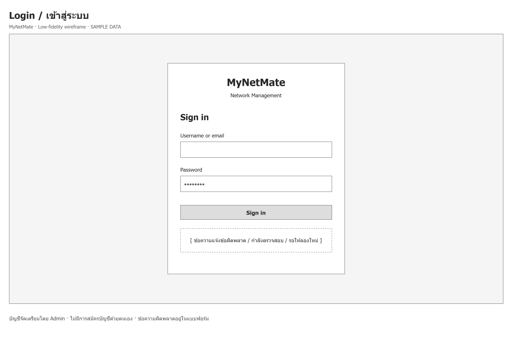

*รูป: Wireframe หน้าเข้าสู่ระบบของ MyNetMate*

จากรูป แสดงการออกแบบหน้าเข้าสู่ระบบสำหรับผู้ใช้งานบทบาท Admin, Operator และ Viewer ประกอบด้วยช่องกรอกชื่อผู้ใช้หรืออีเมล ช่องกรอกรหัสผ่าน ปุ่มเข้าสู่ระบบ และพื้นที่แสดงข้อความแจ้งข้อผิดพลาดหรือสถานะการตรวจสอบ เมื่อเข้าสู่ระบบสำเร็จ ผู้ใช้งานจะเข้าสู่หน้า Dashboard และเข้าถึงเมนูตามสิทธิ์ของตนเอง โดยบัญชีผู้ใช้งานจัดเตรียมโดย Admin และไม่มีการลงทะเบียนบัญชีด้วยตนเอง

### 2) หน้าภาพรวมระบบ (Dashboard)

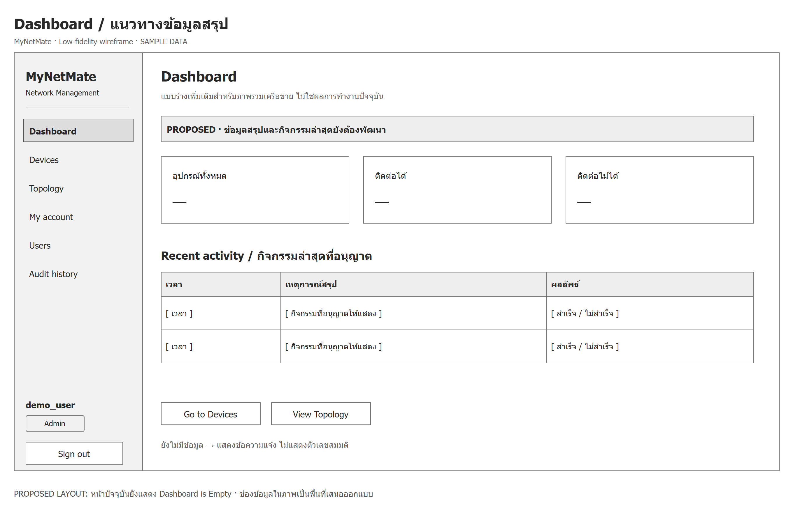

*รูป: Wireframe หน้าภาพรวมระบบแบบพื้นฐาน*

จากรูป แสดงการออกแบบหน้า Dashboard แบบพื้นฐาน ประกอบด้วยการ์ดสรุปจำนวนอุปกรณ์ทั้งหมด จำนวนอุปกรณ์ที่ติดต่อได้และติดต่อไม่ได้ พื้นที่แสดงกิจกรรมล่าสุด และทางลัดไปยังหน้า Devices กับ Topology การ์ดในภาพแสดงช่องข้อมูลแทนตัวเลขจริง เพื่ออธิบายตำแหน่งและหน้าที่ขององค์ประกอบ โดยภาพนี้เป็นข้อเสนอการออกแบบ ไม่ใช่ภาพจากหน้า Dashboard ปัจจุบันที่พัฒนาเสร็จแล้ว

**แนวทางเพิ่มเติมสำหรับระยะ P2: Operational Dashboard**

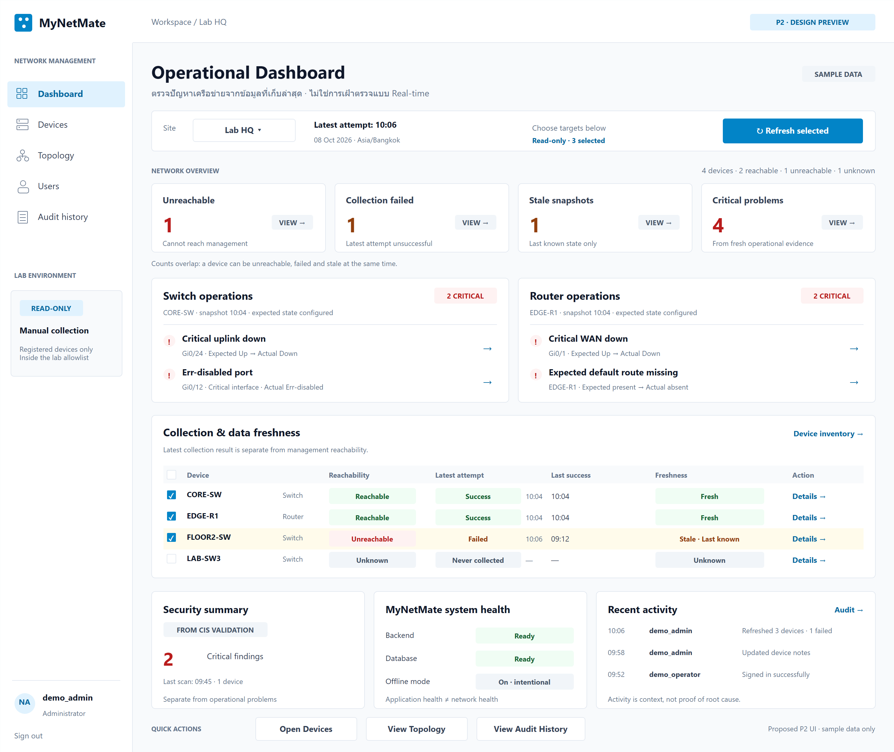

*รูป: Mockup หน้า Dashboard สำหรับ P2 Operational Monitoring โดยใช้ข้อมูลตัวอย่าง*

จากรูป แสดงแนวทางการออกแบบ Dashboard ในระยะ P2 เพื่อแสดงข้อมูลสถานะการทำงานที่เก็บล่าสุดของอุปกรณ์เครือข่าย ประกอบด้วยการเลือก Site การเลือกอุปกรณ์สำหรับ Refresh การ์ดสรุปสถานะ และพื้นที่แสดงประเด็นสำคัญของ Switch กับ Router เช่น Critical Uplink Down และ Critical WAN Down โดยแยกสถานะการติดต่อ ผลการเก็บข้อมูล และความใหม่ของข้อมูลออกจากกัน

การ Refresh เกิดจากผู้ใช้งานเลือกอุปกรณ์และกดปุ่มด้วยตนเอง ใช้การอ่านข้อมูลแบบ Read-only เฉพาะอุปกรณ์ที่ลงทะเบียนและอยู่ใน Allowlist ภายในสภาพแวดล้อมทดสอบที่ได้รับอนุญาต ไม่ใช่การติดตามแบบ Real-time หรือการเก็บข้อมูลอย่างต่อเนื่อง การสรุปประเด็นผิดปกติต้องมีข้อมูลเวลาที่เก็บและ Expected State หรือ Criticality ที่กำหนดไว้ตามประเภทของประเด็น หากข้อมูลรอบล่าสุดเก็บไม่สำเร็จและยังมีข้อมูลเดิม ระบบออกแบบให้แสดง Last Known State พร้อมสถานะความใหม่ ไม่แสดงข้อมูลเก่าเหมือนเป็นสถานะปัจจุบัน

ส่วน Security Summary, Recent Activity และ System Health แสดงแยกจากประเด็นการทำงานของเครือข่าย โดยอ่านข้อมูลจากส่วนที่รับผิดชอบข้อมูลนั้น ตัวเลขและสถานะใน Mockup เป็นข้อมูลสมมติสำหรับอธิบายการจัดวาง ไม่ใช่หลักฐานว่าความสามารถของ P2 ได้รับการ Implement หรือทดสอบครบแล้ว

### 3) หน้ารายการอุปกรณ์ (Device Inventory)

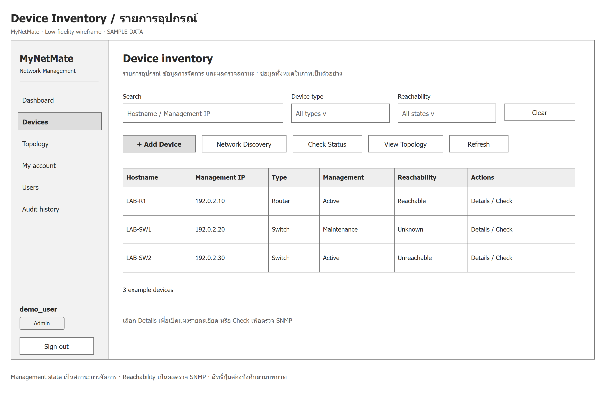

*รูป: Wireframe หน้ารายการอุปกรณ์เครือข่าย*

จากรูป แสดงการออกแบบหน้า Device Inventory โดยใช้ตารางแสดงชื่ออุปกรณ์ Management IP ประเภทอุปกรณ์ สถานะการจัดการ และสถานะการติดต่อ พร้อมช่องค้นหาและตัวกรอง ผู้ใช้งานสามารถเลือกอุปกรณ์เพื่อเปิดรายละเอียด หรือใช้ทางลัดไปยังหน้า Topology ส่วนปุ่มเพิ่มอุปกรณ์ ค้นหาอุปกรณ์ และตรวจสถานะต้องเปิดให้ใช้งานตามสิทธิ์ที่กำหนด

สถานะการจัดการ (Management State) เป็นข้อมูลการจัดการภายใน MyNetMate และต้องแยกจากสถานะการติดต่อ (Reachability) ซึ่งได้จากการตรวจสอบอุปกรณ์ ปุ่ม Refresh สำหรับโหลดรายการใหม่ไม่ควรใช้แทนความหมายของปุ่ม Check Status ที่ใช้ตรวจการติดต่อผ่าน SNMP หรือ Operational Refresh ที่จะพัฒนาเพิ่มเติมใน P2

### 4) แผงรายละเอียดอุปกรณ์ (Device Details)

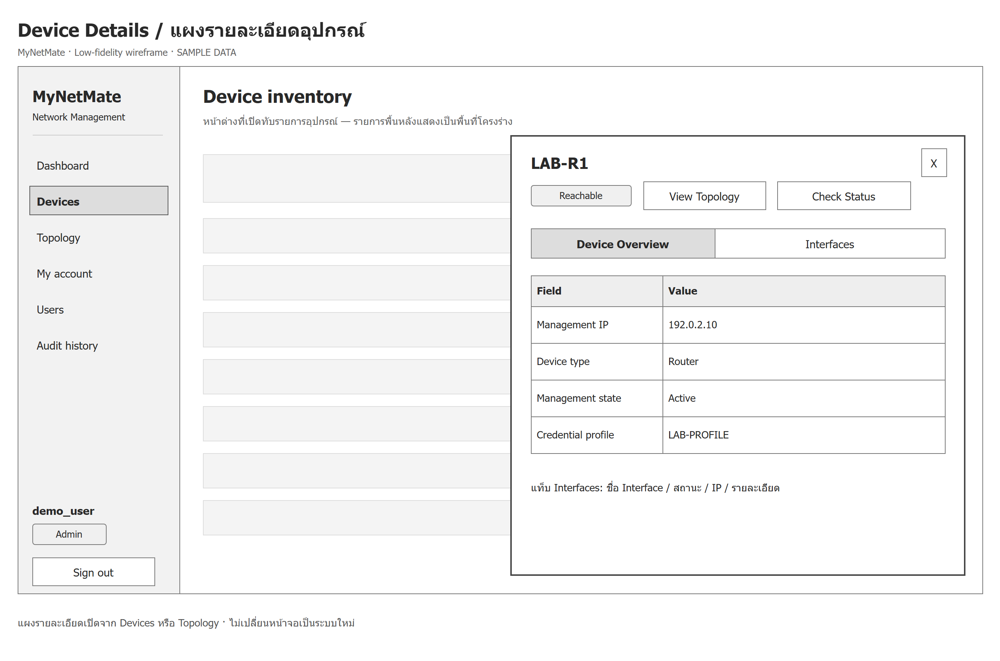

*รูป: Wireframe แผงรายละเอียดอุปกรณ์เครือข่าย*

จากรูป แสดงการออกแบบ Device Details ในลักษณะแผง Drawer ที่เปิดจากหน้ารายการอุปกรณ์หรือการเลือกอุปกรณ์ในหน้า Topology โดยแสดงชื่อและสถานะของอุปกรณ์ พร้อมแท็บ Device Overview และ Interfaces เพื่อแยกข้อมูลภาพรวมออกจากข้อมูล Interface ผู้ใช้งานสามารถอ่านข้อมูลรายตัวโดยยังเห็นบริบทของหน้าเดิม และปิดแผงเพื่อกลับไปยังรายการหรือแผนผังได้

### 5) หน้าต่างเพิ่มอุปกรณ์ (Add Device)

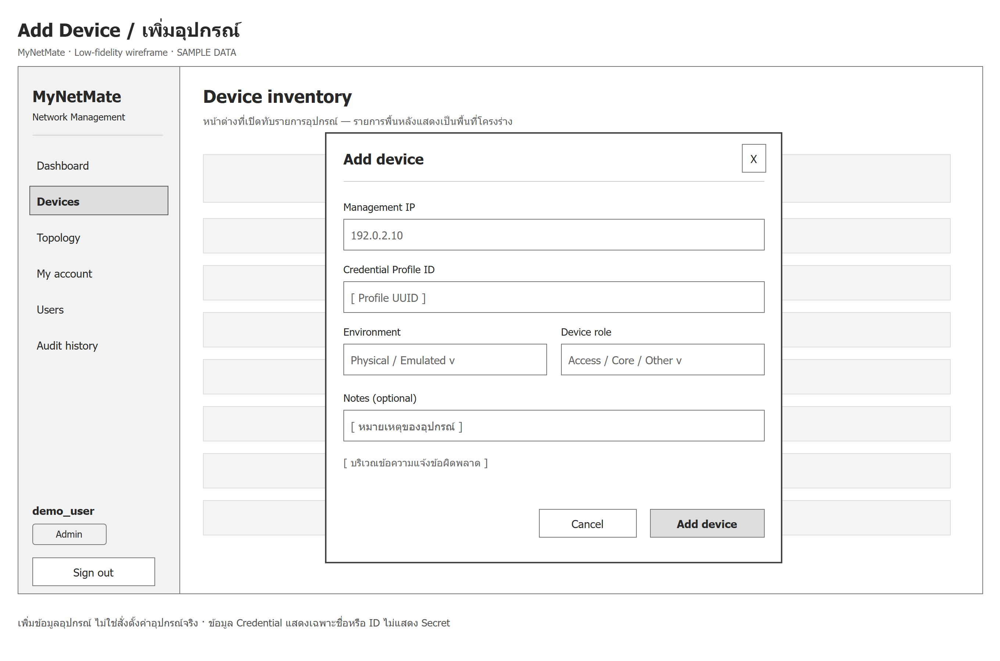

*รูป: Wireframe หน้าต่างเพิ่มอุปกรณ์เครือข่าย*

จากรูป แสดงการออกแบบหน้าต่าง Add Device สำหรับผู้มีสิทธิ์เพิ่มอุปกรณ์ โดยรับข้อมูล Management IP, Credential Profile ID, Environment, Device Role และ Notes พร้อมปุ่มยกเลิกและปุ่มเพิ่มอุปกรณ์ พื้นที่ข้อความแจ้งข้อผิดพลาดอยู่ภายในหน้าต่างเดียวกัน Device Role ในแบบฟอร์มหมายถึงหน้าที่ของอุปกรณ์ในเครือข่าย ไม่ใช่บทบาท Admin, Operator หรือ Viewer ของผู้ใช้ และการเพิ่มอุปกรณ์เป็นการจัดการข้อมูลใน MyNetMate ไม่ใช่การเปลี่ยน Configuration ของอุปกรณ์จริง

### 6) หน้าต่างค้นหาอุปกรณ์เครือข่าย (Network Discovery)

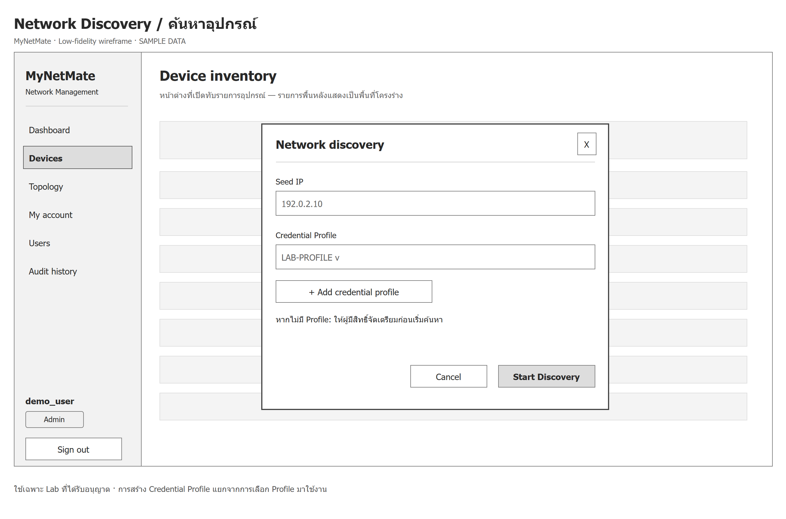

*รูป: Wireframe หน้าต่างค้นหาอุปกรณ์เครือข่าย*

จากรูป แสดงการออกแบบหน้าต่าง Network Discovery สำหรับผู้มีสิทธิ์ค้นหาอุปกรณ์ ประกอบด้วยช่องกรอก Seed IP รายการเลือก Credential Profile และปุ่มเริ่มค้นหา หากยังไม่มี Profile ต้องจัดเตรียมโดยผู้มีสิทธิ์ก่อนเริ่มดำเนินการ เมื่อเริ่มค้นหาจะเปิดหน้า Topology สำหรับแสดงการดำเนินการค้นหา โดยเป้าหมายต้องอยู่ในเครือข่ายทดสอบที่ได้รับอนุญาตเท่านั้น ภาพแสดงชื่อ Profile แทนข้อมูลรหัสผ่านหรือ SNMP Community

### 7) หน้าแผนผังเครือข่าย (Topology)

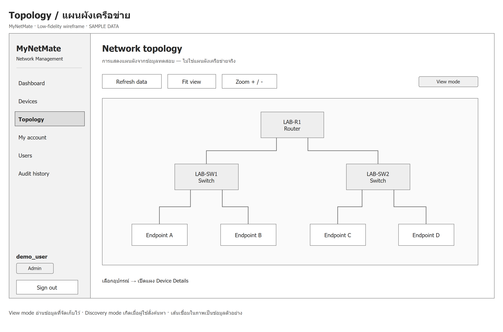

*รูป: Wireframe หน้าแผนผังเครือข่าย โดยใช้โครงสร้างตัวอย่าง*

จากรูป แสดงการออกแบบหน้า Topology โดยใช้พื้นที่หลักแสดงสัญลักษณ์อุปกรณ์และเส้นเชื่อม พร้อมเครื่องมือโหลดข้อมูล จัดมุมมองให้พอดี และย่อหรือขยาย ผู้ใช้งานสามารถเลือกอุปกรณ์เพื่อเปิด Device Details การเรียกดูข้อมูลที่จัดเก็บไว้ต้องแยกจากการแสดงการดำเนินการระหว่าง Discovery

อุปกรณ์และเส้นเชื่อมในภาพเป็นข้อมูลตัวอย่างเพื่ออธิบายรูปแบบการจัดวาง ไม่ใช่ผลการค้นหาเครือข่ายจริง การแสดงแผนผังในระบบที่พัฒนาต้องใช้ข้อมูลและหลักฐานจากการเก็บข้อมูลเครือข่าย ไม่ใช่การสร้างเส้นเชื่อมขึ้นเองจาก Wireframe

### 8) หน้าจัดการผู้ใช้งาน (User Management)

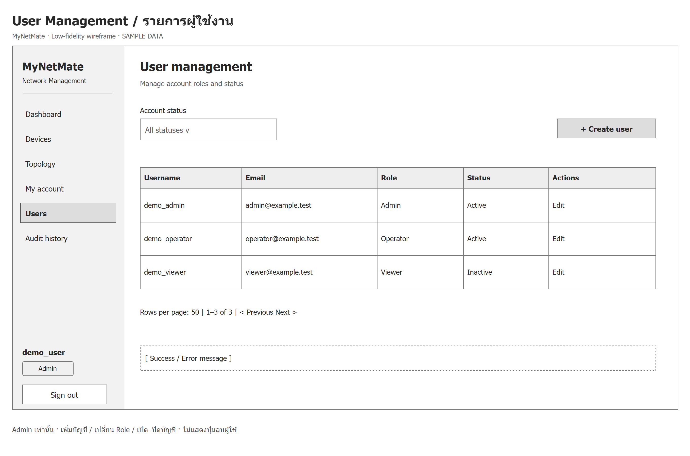

*รูป: Wireframe หน้าจัดการผู้ใช้งานสำหรับ Admin*

จากรูป แสดงการออกแบบหน้า User Management สำหรับ Admin โดยใช้ตารางแสดงชื่อผู้ใช้ อีเมล บทบาท และสถานะบัญชี พร้อมตัวกรองสถานะ การแบ่งหน้า ปุ่มสร้างบัญชี และปุ่มแก้ไข ขอบเขตของหน้าจอนี้ประกอบด้วยการเพิ่มบัญชี เปลี่ยนบทบาท และเปิดหรือปิดใช้งานบัญชี โดยไม่แสดงปุ่มลบผู้ใช้

**หน้าต่างสร้างบัญชีผู้ใช้งาน (Create User)**

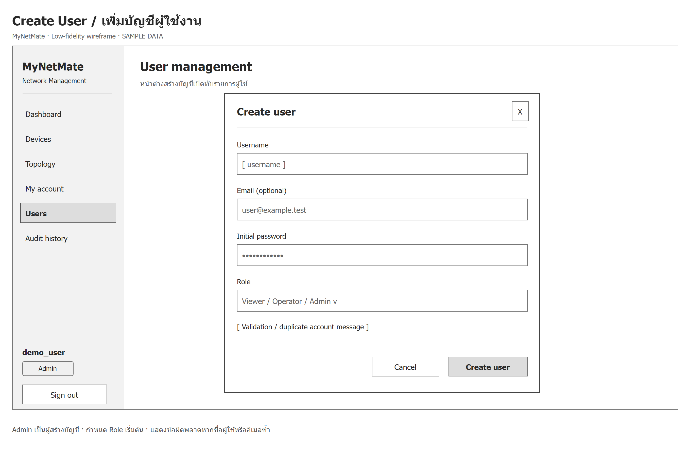

*รูป: Wireframe หน้าต่างสร้างบัญชีผู้ใช้งาน*

จากรูป แสดงหน้าต่าง Create User ที่เปิดทับหน้ารายการผู้ใช้งาน โดยให้ Admin กรอกชื่อผู้ใช้ อีเมลเมื่อมีการระบุ รหัสผ่านเริ่มต้น และบทบาทของบัญชี พร้อมพื้นที่แจ้งข้อผิดพลาด เช่น ข้อมูลไม่ครบหรือชื่อผู้ใช้ซ้ำ เมื่อบันทึกสำเร็จจะกลับไปแสดงรายการบัญชีผู้ใช้งาน

**หน้าต่างแก้ไขบัญชีผู้ใช้งาน (Edit User)**

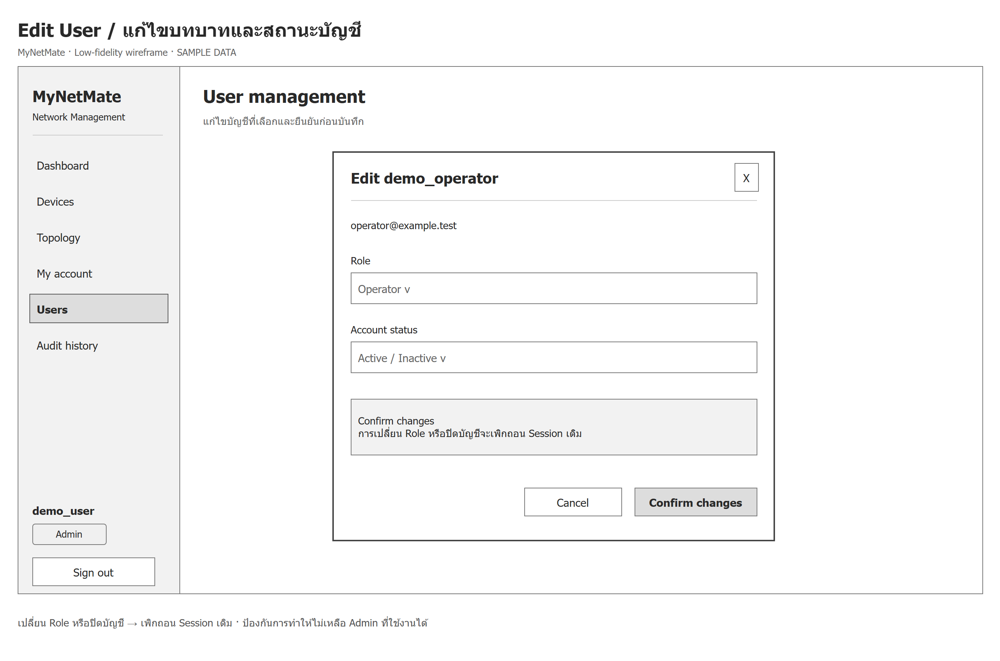

*รูป: Wireframe หน้าต่างแก้ไขบทบาทและสถานะบัญชีผู้ใช้งาน*

จากรูป แสดงหน้าต่าง Edit User สำหรับ Admin โดยให้เปลี่ยนบทบาทหรือสถานะ Active และ Inactive ของบัญชี พร้อมข้อความอธิบายผลกระทบและปุ่มยืนยันการเปลี่ยนแปลง การเปลี่ยนบทบาทหรือปิดใช้งานบัญชีต้องเพิกถอน Session เดิม และต้องป้องกันการเปลี่ยนแปลงที่ทำให้ระบบไม่เหลือ Admin ที่ใช้งานได้

### 9) หน้าประวัติเหตุการณ์ (Audit History)

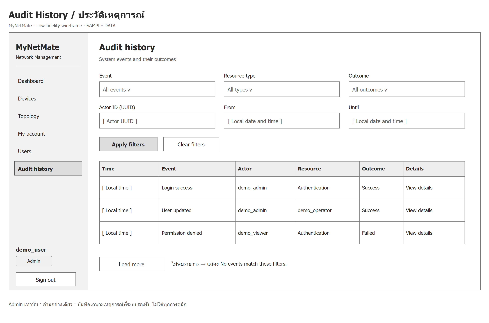

*รูป: Wireframe หน้าประวัติเหตุการณ์สำหรับ Admin*

จากรูป แสดงการออกแบบหน้า Audit History สำหรับ Admin โดยมีตัวกรองประเภทเหตุการณ์ ประเภททรัพยากร ผลลัพธ์ ผู้กระทำ และช่วงเวลา พร้อมตารางแสดงเวลา เหตุการณ์ ผู้กระทำ ทรัพยากร และผลลัพธ์ ผู้ใช้งานสามารถโหลดรายการเพิ่มเติมหรือเลือกดูรายละเอียดได้ หน้านี้ออกแบบให้อ่านอย่างเดียว ไม่มีปุ่มแก้ไขหรือลบประวัติ และแสดงเฉพาะเหตุการณ์ที่ระบบกำหนดให้บันทึก ไม่ใช่ทุกการคลิกของผู้ใช้งาน

**หน้าต่างรายละเอียดเหตุการณ์ (Audit Event Details)**

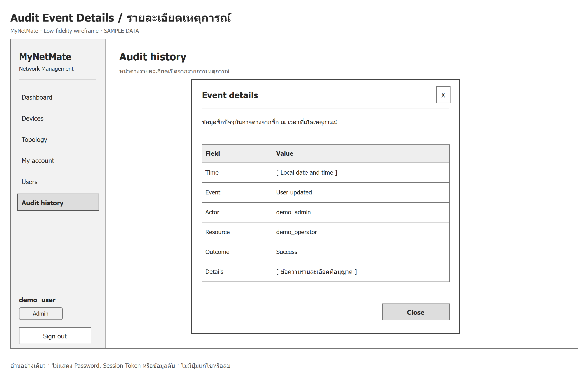

*รูป: Wireframe หน้าต่างรายละเอียดเหตุการณ์*

จากรูป แสดงหน้าต่าง Audit Event Details ที่เปิดจากรายการประวัติ เพื่ออ่านเวลา เหตุการณ์ ผู้กระทำ ทรัพยากร ผลลัพธ์ และรายละเอียดที่อนุญาตให้แสดง พร้อมปุ่มปิดหน้าต่าง ข้อมูลรหัสผ่าน Session Token และข้อมูลลับไม่แสดงในหน้าต่างนี้ ชื่อผู้ใช้หรือทรัพยากรที่แสดงอาจเป็นชื่อปัจจุบัน ซึ่งอาจแตกต่างจากชื่อ ณ เวลาที่เกิดเหตุการณ์

ผลการออกแบบดังกล่าวแสดงความเชื่อมโยงของหน้าจอและหน้าที่ขององค์ประกอบในส่วนการจัดการเครือข่าย โดยแยกการเรียกดูข้อมูล การจัดการบัญชี และการอ่านประวัติเหตุการณ์ออกจากกัน ภาพ Wireframe และ Mockup ใช้เป็นแนวทางการพัฒนา ไม่ใช่หลักฐานว่าทุกความสามารถทำงานสมบูรณ์หรือผ่านการทดสอบแล้ว
