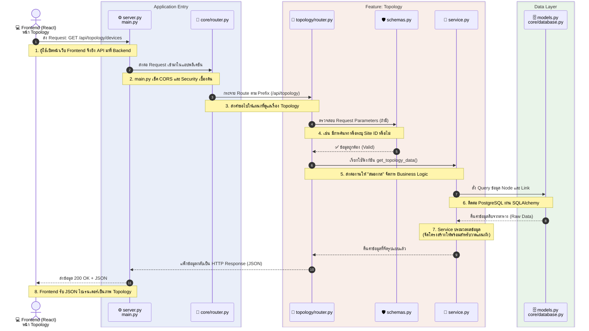

# 🗺️ Data Flow: การขอดูอุปกรณ์ในหน้า Topology

แผนภาพนี้แสดงลำดับการไหลของข้อมูล (Data Flow) ตั้งแต่ที่ผู้ใช้คลิกหน้าเว็บ ไปจนถึงการดึงข้อมูลจากฐานข้อมูลออกมาแสดงผล โดยอิงจากโครงสร้างสถาปัตยกรรม (Architecture) ที่เราคุยกันครับ

### 📝 คำอธิบายเพิ่มเติมตามภาพ:
1. **Frontend** ยิงคำขอ (Request) ไปที่ URL ของ Topology (เช่น `GET /api/topology/devices`)
2. **`main.py` / `server.py`** รับแขกที่หน้าประตู เช็คความปลอดภัย (เช่น ตรวจสอบ Session Cookie)
3. **`core/router.py`** อ่าน URL แล้วรู้ว่าต้องส่งไปให้แฟ้มงานไหน (แยกไปที่แฟ้ม Topology)
4. **`topology/router.py`** รับเรื่องต่อ แล้วสั่งให้ **`schemas.py`** ตรวจสอบว่า Frontend ส่งข้อมูลมาถูกต้องตามฟอร์แมตไหม
5. เมื่อข้อมูลถูกต้อง **`topology/router.py`** จะไปสะกิด **`service.py`** ว่า *"ไปคำนวณและหาข้อมูล Topology มาให้หน่อย"*
6. **`service.py`** เดินไปที่คลังสินค้า สั่งผ่าน **`database.py`** ให้ไปดึงข้อมูลอุปกรณ์ (Devices) และเส้นเชื่อมต่อ (Links) จากฐานข้อมูลตามแปลนของ **`models.py`**
7. เมื่อได้ของมาครบ **`service.py`** จะจัดการปั้นข้อมูลให้อยู่ในรูปทรงที่ Frontend ต้องการวาดรูป
8. สุดท้าย ข้อมูลถูกส่งกลับย้อนเส้นทางเดิม ออกไปเป็นข้อมูล JSON ให้ Frontend นำไปแสดงผลบนหน้าจอครับ
